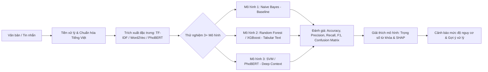

# 🧠 BRAINSTORM & PROJECT SPECIFICATION: ĐỒ ÁN CUỐI KỲ CS114

**Môn học:** CS114 - Machine Learning (Máy học)  
**Giảng viên:** ThS. Cáp Phạm Đình Thăng  
**Thuyết trình sớm:** 18:30 ngày 23/09/2026 (Trực tuyến MS Teams — Hệ ĐT Từ xa UIT) | 15 phút / nhóm (Luân phiên 3 thành viên)  
**Nộp bài LMS:** 13/10/2026 23:59 (Hạn chính thức Moodle — buffer an toàn sau khi báo cáo xong)  
**Repository:** [`uit-25730067-chithanh/CS114-Team10-Elderly-Scam-Detection`](https://github.com/uit-25730067-chithanh/CS114-Team10-Elderly-Scam-Detection)

---

## I. TỔNG QUAN ĐỀ TÀI (PROJECT OVERVIEW)

### 1. Tên đề tài chính thức
* **Tiếng Việt:** *Nghiên cứu và Xây dựng Hệ thống Phát hiện Tin nhắn & Kịch bản Thao túng Tâm lý Lừa đảo nhắm vào Người cao tuổi tại Việt Nam*.
* **Tiếng Anh:** *Vietnamese Elderly Scam & Psychological Manipulation Detection using Machine Learning*.

### 2. Tính cấp bách & Ý nghĩa xã hội (Social Impact)
* **Bối cảnh 2026:** Tình trạng tội phạm công nghệ cao sử dụng tin nhắn SMS, Zalo, Telegram, cuộc gọi giả mạo lừa đảo người cao tuổi (vốn ít am hiểu công nghệ, tâm lý dễ lo âu, có tài sản tích lũy) bùng nổ dữ dội.
* **Nỗi đau thực tế:** Người cao tuổi thường sập bẫy các kịch bản thao túng tâm lý:
  1. **Đe dọa / Quyền lực (Fear & Authority):** Giả danh Công an, Viện kiểm sát, Tòa án dọa bắt giam, phong tỏa tài khoản.
  2. **Thúc ép khẩn cấp (Urgency & Family Emergency):** Giả danh bệnh viện, trường học báo con/cháu bị tai nạn nguy kịch cần chuyển viện phí gấp trong 15-30 phút.
  3. **Dụ dỗ sức khỏe / Tri ân (Greed & Health Bait):** Tặng thuốc đông y trị bách bệnh, nhận quà tri ân hưu trí miễn phí, tham gia hội thảo trúng vàng.
  4. **Giả mạo dịch vụ công (Public Service Impersonation):** Hướng dẫn cập nhật VNeID mức 2, nhận tiền trợ cấp hưu trí, nâng cấp SIM 4G/5G.
* **Mục tiêu của hệ thống:** Tự động phát hiện tin nhắn / đoạn chat lừa đảo, đồng thời **bôi đỏ và giải thích rõ bẫy tâm lý** để cảnh báo người cao tuổi và người thân.

---

## II. BRAINSTORM CONTRACT (BẢN GIAO KÈO ĐẦU RA)

| Mục | Nội dung chi tiết |
|---|---|
| **Outcome (Đầu ra mong đợi)** | • File Báo cáo đồ án (.docx) theo chuẩn quy định môn học CS114.<br>• File Slide thuyết trình (PowerPoint / HTML) tối ưu chuẩn 15 phút.<br>• Source code hoàn chỉnh + Pipeline huấn luyện 3+ mô hình ML.<br>• Web App Demo (Streamlit/Gradio) giả lập khung chat kiểm tra tin nhắn & giải thích bẫy tâm lý. |
| **Constraints (Ràng buộc)** | • Tuân thủ yêu cầu thầy Thăng: So sánh ít nhất 3 mô hình, đánh giá Train vs Val (Overfitting), Precision-Recall, Confusion Matrix.<br>• Không dùng Computer Vision, không làm Fraud Detection ngân hàng (tránh trùng môn CS106).<br>• Dữ liệu văn bản tiếng Việt thực tế. |
| **Non-goals (Không làm)** | • Không phát triển ứng dụng di động native phức tạp (iOS/Android).<br>• Không can thiệp chặn cuộc gọi viễn thông ở mức phần cứng/nhà mạng. |
| **Acceptance Criteria (Tiêu chí nghiệm thu)** | • Độ chính xác F1-Score ≥ 88% trên tập kiểm thử.<br>• Chỉ số **Recall của lớp Lừa đảo ≥ 92%** (hạn chế tối đa bỏ lọt lừa đảo).<br>• Có bảng giải thích các từ khóa kích hoạt tâm lý (SHAP / Feature Weights). |

---

## III. THIẾT KẾ DỮ LIỆU (DATASET DESIGN)

### 1. Cấu trúc tập dữ liệu (`dataset.csv`)
Bộ dữ liệu gồm **2.193 mẫu thực tế** (1.773 mẫu bình thường + 420 mẫu lừa đảo) vượt mốc chỉ tiêu ban đầu (≥1.500 mẫu), tuân thủ 100% chính sách **Zero Synthetic Text** (0% văn bản do AI tự bịa):
* `id`: Định danh duy nhất (1 – 2193).
* `text`: Nội dung tin nhắn đơn lẻ hoặc đoạn hội thoại SMS/Zalo thực tế.
* `label`: Nhãn nhị phân (`1`: Lừa đảo [420 mẫu], `0`: Bình thường [1.773 mẫu]).
* `scam_category`: Nhóm bẫy tâm lý (`fear_authority` [127], `family_emergency` [88], `health_gift` [46], `public_service` [159], `none` [1.773]).
* `source`: Nguồn thu thập đời thực (IEEE Access 2026, UIT IE403, La Chắn Cuộc Gọi, KLTN Smishing, Báo Dân Trí, VnExpress, Tuổi Trẻ, CS114 Evidence Vault).
* `source_url`: 100% liên kết permalink kiểm chứng 1-1 trên GitHub Raw hoặc bài báo chính thống.
* `collector_name`: Ghi nhận đóng góp độc lập của cả 3 thành viên (Thanh: 1.773, Sơn: 215, Cẩm: 205).
* `notes`: Ghi chú kỹ thuật và thông tin kiểm toán bổ sung.

### 2. Tỷ lệ & Nguồn thu thập thực tế
* **Mẫu Lừa đảo (`label = 1` — 420 mẫu):**
  * Thu thập độc lập bởi Hoàng Cao Sơn (215 mẫu) và Bùi Thị Mỷ Cẩm (205 mẫu).
  * 100% dữ liệu đời thực, vượt qua 7 tầng kiểm toán (`audit_son_rigorous.py`, `audit_cam_rigorous.py`), 0% cờ bạc/gái gọi, 0% rò rỉ PII, 0% trùng lặp nội bộ và chéo nhóm.
* **Mẫu Bình thường (`label = 0` — 1.773 mẫu):**
  * Thu thập bởi Đặng Chí Thanh từ tập chuẩn Vietnamese Quality-Assured SMS Dataset (IEEE Access 2026), 100% permalink 1-1.
  * Kèm 50 mẫu Holdout Test độc lập từ ảnh chụp điện thoại đời thực trong `CS114_Evidence_Vault` (0% rò rỉ với tập huấn luyện).
* **Chính sách Không sử dụng AI tự sinh (Zero Synthetic Text):** Nhóm kiên quyết loại bỏ mọi mẫu do LLM tự bịa, bảo vệ tính trung thực học thuật tuyệt đối trước Hội đồng chấm thi.

---

## IV. PIPELINE KỸ THUẬT & MÔ HÌNH MACHINE LEARNING



### 1. Tiền xử lý & Trích xuất đặc trưng (Feature Engineering)
* Chuẩn hóa Unicode tiếng Việt dựng sẵn.
* Xử lý viết tắt, teencode, loại bỏ ký tự rác.
* Tách từ tiếng Việt (`pyvi` hoặc `underthesea`).
* Trích xuất đặc trưng văn bản: TF-IDF (N-gram 1-2), kết hợp đặc trưng phụ (số lượng số điện thoại, link URL, số lượng từ khóa khẩn cấp).

### 2. Bộ mô hình so sánh thực nghiệm (Bắt buộc theo yêu cầu thầy Thăng)
1. **Mô hình 1 (Baseline đơn giản):** `Multinomial Naive Bayes` — Nhanh, dễ giải thích, làm chuẩn so sánh.
2. **Mô hình 2 (Tầm trung - Ensemble):** `Random Forest` hoặc `XGBoost` — Đánh giá tương tác giữa các từ khóa.
3. **Mô hình 3 (Nâng cao):** `Support Vector Machine (Linear/RBF Kernel)` hoặc Fine-tuning `PhoBERT` — Khả năng nắm bắt ngữ cảnh tiếng Việt phức tạp.

### 3. Bộ tiêu chí đánh giá & Phân tích chuyên sâu
* **Metrics:** Accuracy, Precision, Recall, Macro/Weighted F1-Score.
* **Phân tích Overfitting:** So sánh Learning Curves (Đường cong học tập giữa Train vs Validation qua K-Fold Cross Validation).
* **Phân tích nhầm lẫn:** Trực quan hóa **Confusion Matrix** — Làm rõ tỷ lệ *False Positive* (báo nhầm tin người nhà) và *False Negative* (bỏ sót tin lừa đảo).
* **Giải thích mô hình (Explainable AI):** Trích xuất top 20 từ khóa có trọng số cảnh báo cao nhất (ví dụ: *viện kiểm sát, bắt tạm giam, chuyển khoản ngay, tai nạn cấp cứu, trúng thưởng...*).

---

## V. THIẾT KẾ GIAO DIỆN DEMO (STREAMLIT / GRADIO WEB APP)

* **Nền tảng:** Python Web (Streamlit hoặc Gradio) chạy nhẹ nhàng trên Desktop browser.
* **Giao diện:**
  * **Cột trái:** Ô nhập tin nhắn SMS hoặc dán cả đoạn chat Zalo/Telegram.
  * **Cột phải (Kết quả kiểm tra):**
    * Thanh đo nguy cơ trực quan: Xanh (An toàn) / Vàng (Nghi vấn) / Đỏ (Cảnh báo lừa đảo khẩn cấp).
    * Bảng phân tích chi tiết: Bôi đỏ từ khóa nhạy cảm + Dự đoán loại bẫy tâm lý.
    * Lời khuyên an toàn: *"Tuyệt đối không chuyển tiền, hãy gọi lại số điện thoại chính thức của con cháu hoặc gọi 113 để xác minh."*

---

## VI. PHÂN CÔNG CÔNG VIỆC TRONG NHÓM (WORK BREAKDOWN)

| Thành viên / Vai trò | Nhiệm vụ chính | Sản phẩm bàn giao |
|---|---|---|
| **Non-Dev (Data & Content)** | • Tìm kiếm và thu thập 1.500+ mẫu tin nhắn lừa đảo & bình thường.<br>• Phân loại gán nhãn 4 nhóm bẫy tâm lý vào Excel.<br>• Soạn thảo nội dung Báo cáo Word (Chương 1 Đặt vấn đề & Chương 2 Khảo sát thực tế). | File `dataset.csv` + Bản nháp Word Chương 1, 2. |
| **Dev (ML Engineer)** | • Xây dựng pipeline tiền xử lý tiếng Việt (`pyvi`).<br>• Huấn luyện và tinh chỉnh 3 mô hình (Naive Bayes, Random Forest, SVM/PhoBERT).<br>• Xuất các biểu đồ đánh giá: ROC Curve, Confusion Matrix, Train vs Val Curves. | Source code Python / Notebook `.ipynb`. |
| **Dev / Fullstack (Demo & UI)** | • Xây dựng ứng dụng Web Demo bằng Streamlit.<br>• Tích hợp model đã train và hiển thị cảnh báo giải thích bẫy tâm lý. | File `app.py` chạy mượt mà trên localhost. |
| **Cả nhóm (Lead & QA)** | • Rà soát số liệu thực nghiệm, đảm bảo không có mâu thuẫn.<br>• Hoàn thiện Slide PowerPoint (15 phút) và diễn tập thuyết trình.<br>• Đóng gói thư mục nộp bài chuẩn quy định: `25730067-25730013-25730061.zip`. | File `Slide_CS114.pptx` + File Word hoàn chỉnh. |

---

## VII. DANH MỤC HỒ SƠ & TÀI LIỆU NỘP THEO QUY ĐỊNH MÔN HỌC

Cấu trúc thư mục nộp bài theo đúng hướng dẫn trong [README.md](./README.md):

```
25730067-25730013-25730061/
├── DOCS/
│   ├── DoAnMonHoc.docx        # Báo cáo đầy đủ theo mẫu chuẩn khoa/môn
│   └── DoAnMonHoc.pdf         # Bản PDF xuất từ file Word
├── SLIDES/
│   └── Presentation_CS114.pptx # File trình chiếu bảo vệ 15 phút
├── SOURCE/
│   ├── data/                  # File dataset.csv và các dữ liệu huấn luyện
│   ├── models/                # File lưu trọng số model đã train (.pkl, .pt)
│   ├── src/                   # Source code tiền xử lý, huấn luyện
│   ├── app.py                 # File chạy Web Demo Streamlit
│   └── requirements.txt       # Danh sách thư viện Python cần cài
└── README.md                  # Hướng dẫn chạy code và tổng quan đề tài
```

---
*Tài liệu này đóng vai trò là kim chỉ nam và hợp đồng kiến trúc (Architectural Blueprint) cho toàn bộ các bước triển khai tiếp theo của đồ án.*
