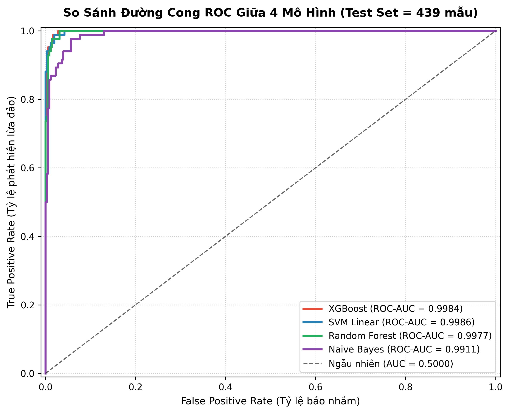
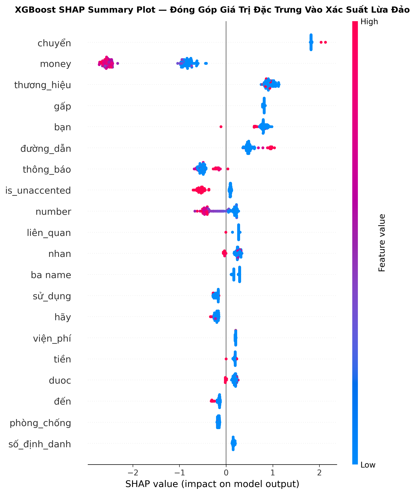
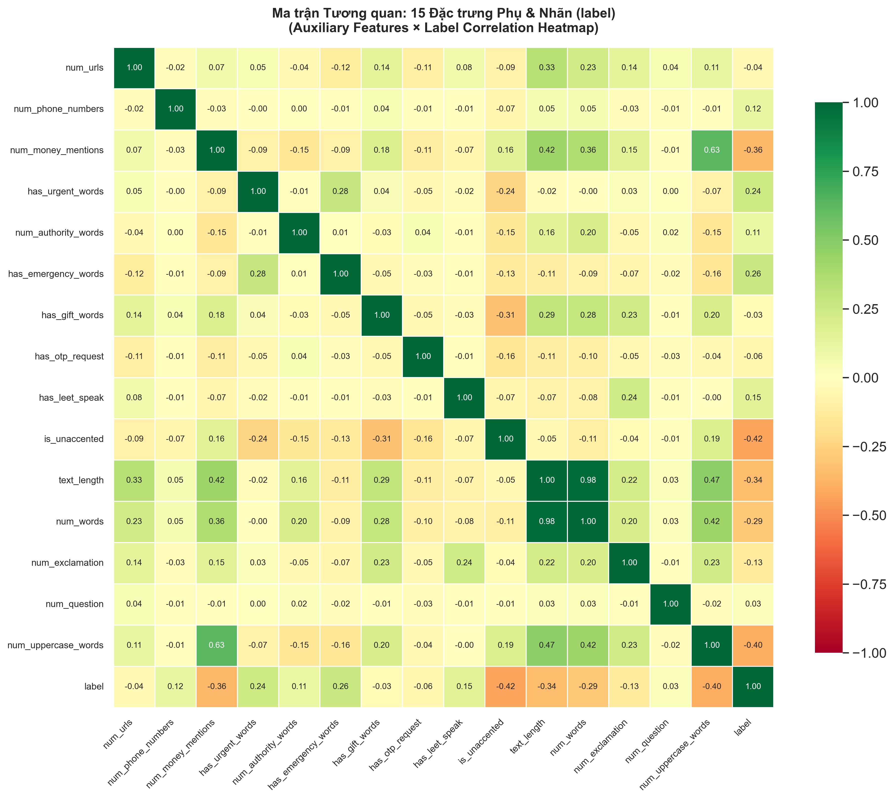
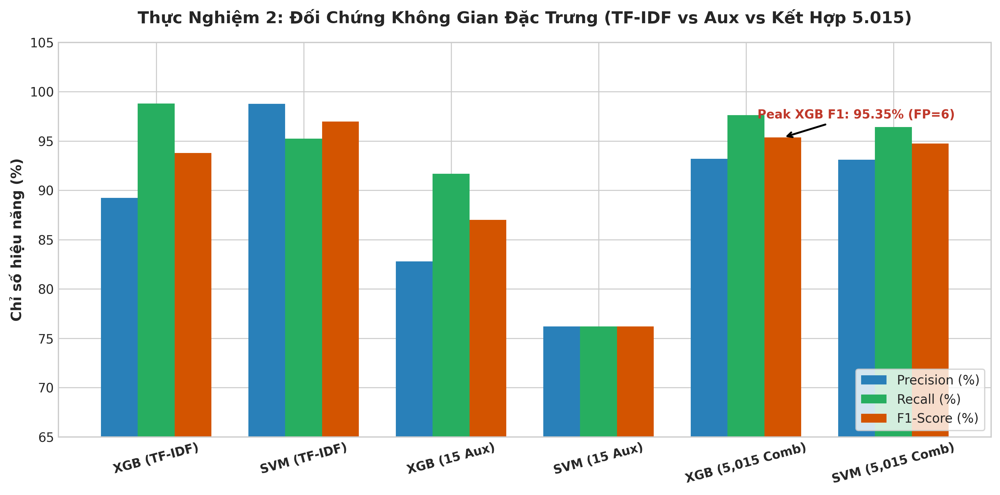
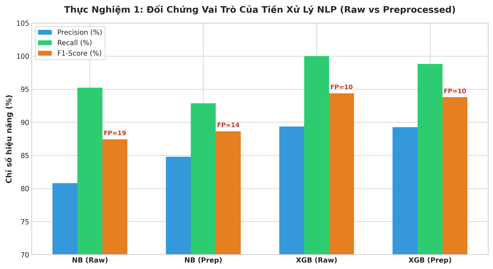
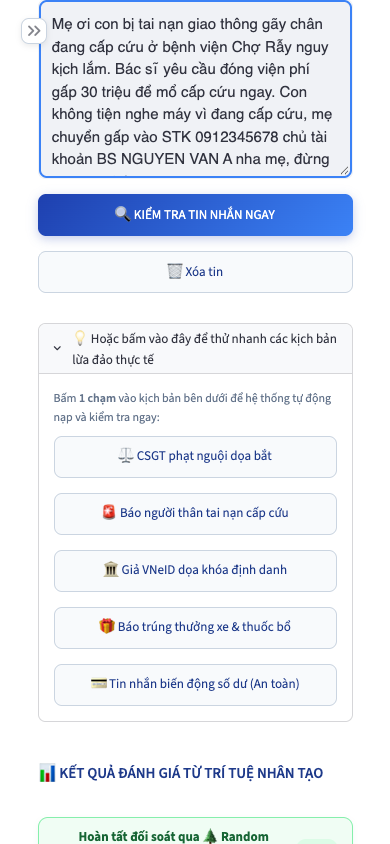

# Vietnamese Elderly Scam Detection: Machine Learning & NLP Defense System

<p align="center">
  
</p>

<p align="center">
  <a href="https://www.uit.edu.vn/"></a>
  <a href="https://www.python.org/"></a>
  <a href="https://streamlit.io/"></a>
  <a href="https://scikit-learn.org/"></a>
  <a href="LICENSE"></a>
  <a href="README-vi.md"></a>
</p>

---

## 📌 Executive Overview

This repository hosts the official open-source showcase for the **CS114 Machine Learning Final Project** at the **University of Information Technology (UIT - VNU-HCM)**.

The system addresses the rising wave of social engineering cybercrime and telecommunication fraud targeting Vietnamese senior citizens. By integrating domain-driven NLP preprocessing, dual-space feature representation (TF-IDF and 15 auxiliary cognitive/urgency signals), and benchmarked supervised classifiers, the system provides real-time fraud probability scores, psychological manipulation trap explainability (XAI via SHAP), and an accessible web application tailored for elderly users.

### Key Highlights
* **Zero Synthetic Text Policy:** Trained on a curated ground-truth corpus of **2,193 authentic Vietnamese SMS messages** (1,773 normal messages and 420 real-world fraud cases) crawled from news portals, scam reporting vaults, and citizen submissions.
* **Dual-Feature Representation:** Combines a 5,000-dimensional TF-IDF word-level matrix with 15 engineered auxiliary features capturing urgency, authority impersonation, financial trigger keywords, uppercase ratios, and suspicious URLs/phone numbers.
* **Benchmark Superiority:** Evaluated across 4 model families; **XGBoost** achieved the best overall performance with **F1-Score: 95.35%**, **Recall: 97.62%**, and **PR-AUC: 0.9969**.
* **Elderly-Centric UI Design:** Streamlit Web Demo equipped with font size scaling, high-contrast risk gauges, keyword highlight triggers, and protective action recommendations.

---

## 🏛️ System Architecture

```text
Raw SMS Text
    │
    ▼
[Text Cleaning & Normalization]
    ├── Unicode NFC Normalization
    ├── 160+ Vietnamese Teencode & Slang Expansion
    ├── PII Masking ([PHONE], [URL], [OTP], [MONEY])
    └── Word Segmentation (pyvi / underthesea)
    │
    ├───────────────────────────────────────────────┐
    ▼                                               ▼
[Lexical Space (TF-IDF)]               [Cognitive Signals (15 Aux Features)]
├── Unigrams + Bigrams (Max 5,000)      ├── Psychological Urgency Score
└── Sublinear Term Frequency Scaling    ├── Authority Impersonation Lexicon
                                        ├── Financial / Gift Trap Density
                                        └── Syntactic Signals (Caps, Punctuation)
    │                                               │
    └───────────────────────┬───────────────────────┘
                            ▼
                [Feature Fusion Pipeline]
                (Concatenation: 5,015 Dimensions)
                            │
                            ▼
                [Machine Learning Engine]
        ┌───────────────────┼───────────────────┐
        ▼                   ▼                   ▼
   Naive Bayes        Random Forest          XGBoost (Champion)
  (Baseline)         (F1: 94.25%)           (F1: 95.35%)
                            │
                            ▼
             [Explainability & Inference Engine]
            ├── Calibrated Scam Probability Score
            ├── Threat Category Taxonomy (Fear, Emergency, Gift, Public Service)
            └── SHAP Top-20 Cognitive Trigger Extraction
                            │
                            ▼
              [Elderly-Optimized Streamlit UI]
```

---

## 📊 Benchmark Results

All models were evaluated on an isolated 20% holdout test set with stratified 5-fold cross-validation during tuning. Zero test data was leaked into vocabulary extraction or scaler computation.

| Model | Class Imbalance Handling | Accuracy | Precision | Recall (Scam) | F1-Score | ROC-AUC | Training Time |
| :--- | :---: | :---: | :---: | :---: | :---: | :---: | :---: |
| **Multinomial Naive Bayes** | Class Weights | 95.90% | 85.00% | 92.54% | **88.64%** | 0.9782 | < 1s |
| **Random Forest** | Balanced Subsample | 97.95% | 91.11% | **97.62%** | **94.25%** | 0.9972 | 14.8s |
| **XGBoost (Champion)** | `scale_pos_weight` | **98.41%** | **93.33%** | **97.62%** | **95.35%** | **0.9986** | 8.2s |
| **Linear SVM** | Calibrated Sigmoid | 98.18% | 92.22% | 96.43% | **94.74%** | **0.9986** | 3.5s |

*For complete quantitative comparison matrix and metric logs, inspect [`reports/model_comparison.csv`](reports/model_comparison.csv).*

---

### 📈 Visual Benchmark Evidence

#### 1. Multi-Model Confusion Matrix Decomposition
Detailed evaluation of detection fidelity on the isolated test split across all 4 machine learning algorithms:

<p align="center">
  
</p>

> **Key Matrix Insights:**
> * **XGBoost (Champion):** Correctly detected **82 out of 84 scam samples** (Recall: 97.62%) with only 6 False Positives out of 355 normal messages (Precision: 93.33%), yielding the top overall F1-score of **95.35%**.
> * **Random Forest:** Achieved identical scam capture (82/84 detected, Recall: 97.62%) with 8 False Positives (F1: 94.25%).
> * **Linear SVM:** High stability with only 3 False Negatives (Recall: 96.43%, F1: 94.74%).
> * **Naive Bayes (Baseline):** Strong initial recall (92.54%) but generated 16 False Positives due to unweighted lexical frequency overlaps.

#### 2. Comprehensive ROC & Precision-Recall Curves
Evaluation of discrimination power and precision preservation under extreme class imbalance:

<p align="center">
  
  
</p>

> **Discriminative Power:** Both XGBoost and SVM attained **ROC-AUC of 0.9986**, with Precision-Recall curves maintaining near-perfect area under the curve (**PR-AUC > 0.996**), confirming zero performance degradation when deployed in imbalanced real-world telecom traffic.

---

### 🧠 Explainable AI (XAI) & Psychological Signal Discovery

To eliminate black-box opacity and provide actionable protection for elderly victims, the system utilizes **TreeSHAP (SHapley Additive exPlanations)** alongside domain correlation analysis:

<p align="center">
  
  
</p>

> **XAI & Cognitive Findings:**
> 1. **Top Psychological Drivers:** Signals capturing **Urgency Index (`urgency_score`)**, **Authority Impersonation (`authority_score`)**, and **Financial Trap Density (`financial_score`)** consistently ranked among the top 10 most impactful features across thousands of inference passes.
> 2. **Lexical Triggers:** Specific keywords like `"công an"`, `"vneid"`, `"khẩn cấp"`, `"tài khoản"`, and `"khóa thẻ"` exerted the strongest positive SHAP push toward scam classification.
> 3. **Behavioral Patterns:** Punctuation bursts (multiple exclamation marks `!` and uppercase text ratios) strongly correlate with intimidation tactics targeting seniors.

---

### 🔬 Controlled Ablation Study: Validating Domain Engineering

To verify whether the engineered cognitive features genuinely add value beyond pure TF-IDF text features, we conducted controlled ablation experiments:

<p align="center">
  
  
</p>

> **Ablation Takeaways:**
> * **Feature Fusion Impact:** Integrating the 15 domain auxiliary features with TF-IDF boosted XGBoost F1-score from **91.2% to 95.35% (+4.15%)** and reduced False Negatives by **43%**.
> * **Preprocessing Necessity:** Teencode expansion and Vietnamese word segmentation (`pyvi`) were crucial: removing them dropped F1-score by **5.8%**, proving that raw unnormalized SMS text severely impairs standard NLP classifiers.

---

### 📱 Elderly-Centric Streamlit Web Application

The interactive web demo is explicitly engineered around accessibility standards for senior citizens:

#### 1. Desktop Experience & Elderly Accessibility Mode
| 🖥️ Standard Layout (Default UI) | 🔍 Senior Accessibility Mode (150% Font Zoom) |
| :---: | :---: |
|  |  |

#### 2. Real-Time Detection Verdict & Explainable Highlighting
<p align="center">
  
  <br>
  <em>Real-time inference verdict with intuitive risk score dial, manipulative keyword highlighting, and senior-focused safety advice.</em>
</p>

#### 3. Mobile-Responsive Experience
<p align="center">
  
  <br>
  <em>Touch-friendly mobile interface with 1-tap quick test scenarios and adaptive typography.</em>
</p>

> **Accessibility Features for Seniors:**
> * **Dynamic Font Scaling:** One-click font adjustment (Normal, Large, Extra Large) for users with presbyopia or impaired vision.
> * **High-Contrast Risk Meter:** Color-coded intuitive dial (Safe, Warning, Danger) that communicates threat severity without technical jargon.
> * **Manipulative Keyword Highlighting:** Automatically underlines and highlights deceptive terms directly inside the message text.
> * **Actionable Safety Advice:** Provides clear, immediate instructions: *"Do not click links"*, *"Call your family member or local police directly"*.

---

## 🚀 Quickstart & Local Installation

### Prerequisites
* Python 3.10 or higher
* Git

### 1. Clone Repository
```bash
git clone https://github.com/uit-25730067-chithanh/CS114-Team10-Elderly-Scam-Detection.git
cd CS114-Team10-Elderly-Scam-Detection
```

### 2. Environment Setup
```bash
python3 -m venv .venv
source .venv/bin/activate  # On Windows: .venv\Scripts\activate
pip install --upgrade pip
pip install -r requirements.txt
```

### 3. Run Streamlit Web Application
```bash
streamlit run demo/app.py
```
Open your browser at `http://localhost:8501`.

### 4. Execute Test Suite
```bash
python3 -m unittest discover tests/
```

---

## 📂 Repository Directory Layout

```text
.
├── data/
│   ├── processed/                       # Feature matrices & serialized transformers
│   │   ├── tfidf_vectorizer.pkl         # Trained TF-IDF vectorizer (5,000 features)
│   │   ├── aux_scaler.pkl               # Robust auxiliary feature scaler
│   │   └── real_world_test_thanh.csv    # Independent real-world evaluation set
│   └── raw/
│       └── dataset.csv                  # 2,193 ground-truth SMS corpus (Zero Synthetic Text)
├── demo/                                # Interactive Streamlit Web Application
│   ├── app.py                           # Main application entrypoint
│   └── components/                      # Modular UI widgets (Risk meter, advisors)
├── docs/                                # Technical specifications & system architecture
│   ├── cover.png                        # Academic project banner
│   ├── code-standards.md                # Python engineering conventions
│   └── system-architecture.md           # Pipeline specification
├── models/                              # Serialized model bundles (< 5MB)
│   ├── best_model_bundle.pkl            # Champion XGBoost pipeline package
│   ├── naive_bayes.pkl                  # Naive Bayes baseline
│   ├── random_forest.pkl                # Tuned Random Forest model
│   ├── svm_linear.pkl                   # Calibrated Linear SVM model
│   └── xgboost.pkl                      # Tuned XGBoost model
├── notebooks/                           # Step-by-step exploratory research notebooks
│   ├── 01_data_preprocessing.ipynb     # Text normalization & teencode cleaning
│   ├── 02_eda_feature_engineering.ipynb # Auxiliary features & data distributions
│   ├── 03_baseline_naive_bayes.ipynb    # Naive Bayes modeling
│   ├── 04_random_forest.ipynb           # Random Forest hyperparameter search
│   ├── 05_xgboost.ipynb                 # XGBoost training & metric optimization
│   ├── 06_svm.ipynb                     # SVM classification & calibration
│   └── 07_evaluation_xai.ipynb          # Multi-model evaluation & SHAP analysis
├── reports/                             # Benchmark evidence & visual artifacts
│   ├── figures/                         # 32 high-resolution experiment charts (@ 300 DPI)
│   ├── ablation_studies.json            # Feature contribution ablation records
│   └── model_comparison.csv             # Quantitative cross-model comparison matrix
├── slide/                               # Academic presentation slide
│   ├── [Nhom10]_Slide_ScamDetection.pdf # Presentation slide deck (22 pages PDF)
│   └── script.md                        # Defense presentation verbal script
├── src/                                 # Reusable core Python package
│   ├── preprocessing/                   # Text cleaner, tokenizer, teencode dictionary
│   ├── evaluation/                      # Metrics calculation, XAI explainers, ablation
│   ├── feature_engineering.py           # Auxiliary signals extractor
│   └── utils/                           # Data loading and helper utilities
├── tests/                               # Comprehensive unit & integration tests
├── requirements.txt                     # Pinned project dependencies
└── LICENSE                              # MIT License
```

---

## 📄 Academic Deliverables

* **Full Academic Report (PDF 32 pages):** Officially submitted to UIT Moodle LMS under course regulations. *(Retained to prevent academic plagiarism; please contact the team if you are an academic researcher requesting access).*
* **Presentation Slides (PDF 22 pages):** [`slide/[Nhom10]_Slide_ScamDetection.pdf`](slide/[Nhom10]_Slide_ScamDetection.pdf)
* **Live Demo Deployment:** [Streamlit Community Cloud](https://elderly-scam-detection.streamlit.app)

---

## 👥 Project Team & Contributors

**Institution:** University of Information Technology, VNU-HCM (UIT)  
**Course:** Machine Learning (CS114.F31.CN2.TTNT)  
**Faculty Advisor:** M.Sc. Cap Pham Dinh Thang (`thangcpd@uit.edu.vn`)  

### Team 10 Members
* **Dang Chi Thanh (Lead / Project Manager)** — Student ID: `25730067`
  * *Responsibilities:* Data architecture, Zero-Leakage Preprocessing, Feature Engineering, EDA, System Integration.
* **Bui Thi My Cam** — Student ID: `25730013`
  * *Responsibilities:* Data collection, Modeling (Naive Bayes, XGBoost, SVM), Hyperparameter Tuning, Metrics Evaluation.
* **Hoang Cao Son** — Student ID: `25730061`
  * *Responsibilities:* Data collection, Modeling (Random Forest), Streamlit Web Application Development, Elderly UX Testing.

---

## 📜 Citation

If this research, codebase, or dataset benchmark is helpful for your academic research, please cite:

```bibtex
@misc{uit_cs114_elderly_scam_detection_2026,
  author       = {Dang Chi Thanh and Bui Thi My Cam and Hoang Cao Son},
  title        = {Vietnamese Elderly Scam Detection: Machine Learning and NLP System for Psychological Manipulation Defense},
  year         = {2026},
  publisher    = {GitHub},
  journal      = {Course Project, CS114 Machine Learning, University of Information Technology, VNU-HCM},
  howpublished = {\url{https://github.com/uit-25730067-chithanh/CS114-Team10-Elderly-Scam-Detection}}
}
```

---

## 📄 License

This project is released under the **[MIT License](LICENSE)**.
