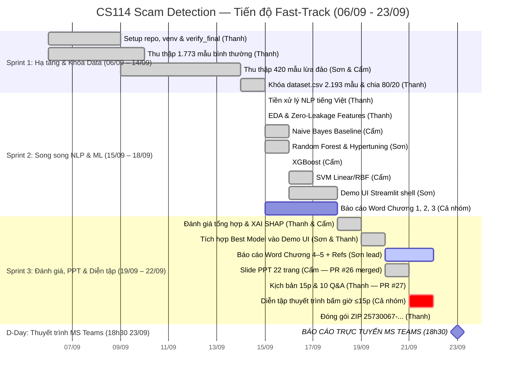

# Project Roadmap — CS114 Scam Detection (Fast-Track 23/09 Mode)

## Hành trình dự án

**Bắt đầu:** 06/09/2026 | **Báo cáo sớm:** 23/09/2026 (Hạn LMS gốc: 13/10/2026) | **Daily Sync:** 21:00 hàng ngày

> ⚡ **Chiến lược Thực thi Song song (`--parallels`):**
> Do nhóm xin thầy báo cáo sớm vào ngày **23/09/2026**, toàn bộ lộ trình được tối ưu thành **3-Sprint Fast-Track** (13 ngày). Dữ liệu khóa vào 12/09, kích hoạt 4 luồng kỹ thuật song song từ 13/09, hoàn tất Báo cáo Word & Slide PPT ngày 20/09, dành 2 ngày (21–22/09) diễn tập bấm giờ và đóng gói ZIP.

---

## 🗺️ Lộ trình tổng thể (Biểu đồ Gantt Fast-Track)

---

## 🏃 Sprint 1 — 06/09 → 14/09 (Khóa Hạ tầng & Dữ liệu)

> **Mục tiêu:** Setup môi trường, hoàn tất thu thập ≥1.500 mẫu tiếng Việt, chạy `data_validation.py` PASSED và đóng băng `dataset.csv` 2.193 mẫu thực tế.

### Thanh (PM & Data Lead)
| Task | Trạng thái |
|------|:---:|
| Setup repo, venv, requirements.txt, verify_final.py | ✅ Done (Phase 00) |
| `src/utils/helpers.py`: constants, set_seeds(), random_state=42 | ✅ Done (Phase 00) |
| Thu thập 1.773 mẫu bình thường, ẩn danh PII 100%, 50 mẫu Holdout Test | ✅ Done (Phase 01) |
| Hỗ trợ review schema và đối soát dữ liệu cho Sơn & Cẩm | ✅ Done |
| Hợp nhất dữ liệu (2.193 mẫu), chạy kiểm định và khóa `dataset.csv` | ✅ Done |

### Sơn (Data Collection Lead)
| Task | Trạng thái |
|------|:---:|
| Lập quy chuẩn phân loại 4 nhóm bẫy tâm lý theo chuẩn kiểm toán | ✅ Done |
| Thu thập 215 mẫu lừa đảo (`fear_authority` và `family_emergency`) | ✅ Done (PR #10 merged) |
| Export dữ liệu và vượt qua 7 tầng kiểm toán `audit_son_rigorous.py` | ✅ Done |

### Cẩm (Modeling Engineer)
| Task | Trạng thái |
|------|:---:|
| Setup venv cá nhân, cài đặt thư viện ML | ✅ Done |
| Thu thập 205 mẫu lừa đảo (`health_gift` và `public_service`) | ✅ Done (PR #9 merged) |
| Export dữ liệu và vượt qua 10 vòng kiểm toán `audit_cam_rigorous.py` | ✅ Done |

---

## 🏃 Sprint 2 — 15/09 → 18/09 (Song song NLP & Huấn luyện Mô hình)

> **Mục tiêu:** Pipeline tiền xử lý hoàn tất, trích xuất TF-IDF sẵn sàng, huấn luyện đồng thời 4 mô hình (NB, RF, XGBoost, SVM), dựng khung Demo UI Streamlit, viết xong Báo cáo Word Chương 1–3.

### Thanh (Data & NLP Lead)
| Task | Trạng thái |
|------|:---:|
| `src/preprocessing/text_cleaner.py`: Unicode NFC, teencode mapper, 160 teencode, 15 aux features | ✅ Done (Phase 02 PASSED — PR #12) |
| `src/preprocessing/tokenizer.py` (pyvi) + stopwords domain-guard | ✅ Done (Phase 02 PASSED — PR #12) |
| `src/preprocessing/pipeline.py` + `dataset_preprocessed.csv` (2.193 dòng, 24 cột) | ✅ Done (Phase 02 PASSED — PR #12) |
| `notebooks/01_preprocessing.ipynb`: Thực nghiệm pipeline và xuất CSV sạch | ✅ Done (Phase 02 PASSED — PR #12) |
| `notebooks/02_eda.ipynb`: Phân phối nhãn, n-grams, word cloud, độ dài, heatmap (7 figures @ 300 DPI) | ✅ Done (Phase 03 PASSED — PR #13) |
| `src/feature_engineering.py`: Zero-leakage pipeline (Split FIRST 80/20 → TF-IDF & Scaler fit on train only) | ✅ Done (Phase 03 PASSED — PR #13) |
| Xuất ma trận `data/processed/`: `X_train.pkl` (1754×5015), `X_test.pkl` (439×5015), `y_train.pkl`, `y_test.pkl` | ✅ Done (Phase 03 PASSED — PR #13) |

### Cẩm (Modeling Engineer — NB, XGBoost, SVM)
| Task | Trạng thái |
|------|:---:|
| `notebooks/03_model_naive_bayes.ipynb`: Nạp ma trận Phase 03, GridSearch alpha, Learning Curve | ✅ Hoàn thành (Phase 04 PASSED — F1=0.8864) |
| `models/naive_bayes.pkl` & `naive_bayes_metrics.json`: Lưu trọng số baseline & metrics | ✅ Hoàn thành (Phase 04) |
| `notebooks/04_model_xgboost.ipynb`: Tinh chỉnh RandomizedSearchCV, scale_pos_weight | ✅ Hoàn thành (Phase 05 — F1=0.9535) |
| `models/xgboost.pkl` & `xgboost_metrics.json`: Lưu trọng số XGBoost & metrics | ✅ Hoàn thành (Phase 05) |
| `notebooks/05_model_svm.ipynb`: LinearSVC Calibrated / RBF kernel, so sánh đa tham số | ✅ Hoàn thành (Phase 06 PASSED — F1=0.9474, PR #20) |

### Sơn (Modeling & UI Lead — Random Forest & Demo UI)
| Task | Trạng thái |
|------|:---:|
| `notebooks/04_model_random_forest.ipynb`: Nạp ma trận Phase 03, RandomizedSearch n_estimators, max_depth | ✅ Hoàn thành (Phase 05 PASSED — F1=0.9425, PR #16) |
| `models/random_forest.pkl` & `random_forest_metrics.json`: Lưu trọng số Random Forest & metrics | ✅ Hoàn thành (Phase 05 — PR #16) |
| `demo/app.py`: Khung Streamlit 2 cột (Nhập liệu / Kết quả cảnh báo) | ✅ Hoàn thành (Phase 08 PASSED — PR #21) |
| `demo/components/`: risk_meter.py, keyword_highlighter.py, safety_advisor.py | ✅ Hoàn thành (Phase 08 PASSED — PR #21) |

### Cả nhóm (Academic Documentation)
| Task | Trạng thái |
|------|:---:|
| Báo cáo Word: Chương 1 — Đặt vấn đề, bối cảnh lừa đảo NCT 2026, ý nghĩa xã hội | ⏳ (15/09 – 16/09) |
| Báo cáo Word: Chương 2 — Khảo sát các công trình nghiên cứu & hướng tiếp cận | ⏳ (16/09 – 17/09) |
| Báo cáo Word: Chương 3 — Phương pháp nhóm chọn: Tiền xử lý, TF-IDF, kiến trúc 3+ models | ⏳ (17/09 – 18/09) |
| Lên khung cấu trúc Slide PowerPoint 15 phút (khung ban đầu) | ✅ Hoàn thành (18/09) |

---

## 🏃 Sprint 3 — 19/09 → 22/09 (Đánh giá, Demo, PPT & Diễn tập Bảo vệ)

> **Mục tiêu:** Đánh giá tổng hợp 4 mô hình, trích xuất XAI SHAP, tích hợp model vào Demo Streamlit, hoàn thiện Báo cáo Word (≥15 trang) và Slide PPT, diễn tập bảo vệ ≤15 phút, đóng gói ZIP `25730067-25730013-25730061.zip`.

### Thanh (Evaluation & Packaging Lead)
| Task | Trạng thái |
|------|:---:|
| `notebooks/06_evaluation_xai.ipynb`: Bảng so sánh 4 models (Accuracy, Precision, Recall, F1, ROC-AUC) | ✅ Hoàn thành (Phase 07 PASSED — 19/09) |
| Trực quan hóa: Confusion Matrix so sánh, ROC Curves, Precision-Recall Curves | ✅ Hoàn thành (Phase 07 — 6 figures 300 DPI) |
| Phân tích Overfitting: Learning Curves (Train vs Validation K-Fold) | ✅ Hoàn thành (Phase 07 — `learning_curves_summary.png`) |
| XAI: Trích xuất Top-20 từ khóa cảnh báo kích hoạt bẫy tâm lý (Consensus & SHAP) | ✅ Hoàn thành (Phase 07 — `top20_keywords_barplot.png`, `shap_summary.png`) |
| `reports/model_comparison.csv` và xuất toàn bộ figures | ✅ Hoàn thành (Phase 07 — 19/09) |
| Pre-flight check toàn diện bằng `verify_final.py` | 🔲 (22/09) |
| Đóng gói ZIP `25730067-25730013-25730061.zip` theo chuẩn nộp bài UIT | 🔲 (22/09) |

### Sơn (Demo Integration & Screenshots)
| Task | Trạng thái |
|------|:---:|
| Tích hợp Best Model (.pkl) và Vectorizer vào `demo/app.py` | ✅ Hoàn thành (Phase 08 PASSED — PR #21) |
| Hoàn thiện tính năng bôi đỏ từ khóa bẫy tâm lý và khuyến cáo an toàn cho NCT | ✅ Hoàn thành (Phase 08 PASSED — PR #21) |
| Chụp ≥3 ảnh màn hình Demo chất lượng cao chèn vào Báo cáo Word và Slide PPT | ✅ Hoàn thành (Phase 08 PASSED — 4 figures 300 DPI) |

### Cả nhóm (Báo cáo, Slide PPT & Diễn tập Thuyết trình)
| Task | Trạng thái |
|------|:---:|
| Hoàn thiện file Slide 22 trang `phase09_presentation.pptx` (3.4 MB) & PDF | ✅ (21/09 — PR #26 merged) |
| Soạn thảo kịch bản bảo vệ 15 phút WPM & 10 chủ đề Q&A (`script.md`) | ✅ (21/09 — PR #27 open) |
| Báo cáo Word: Hoàn thiện Chương 1–5 & Refs (branch `feat/phase-09-report-template`) | 🟡 (21/09 – 22/09 — Sơn lead) |
| Xuất bản file `DOCS/DoAnMonHoc.docx` và `DOCS/DoAnMonHoc.pdf` (≥15 trang) | 🔲 (22/09) |
| Diễn tập thuyết trình bấm giờ ≤15 phút theo kịch bản chuẩn WPM | 🔲 (21/09 – 22/09) |
| Diễn tập phản biện 10 câu hỏi Q&A từ ThS. Cáp Phạm Đình Thăng | 🔲 (22/09) |

---

## 🎯 D-Day — 18:30 Ngày 23/09/2026: Thuyết Trình Bảo Vệ Đồ Án (MS Teams)

> 📌 **Hình thức:** Trực tuyến qua Microsoft Teams (thầy Thăng tạo điều kiện báo cáo sớm).  
> 📌 **Quy cách:** Bắt buộc thuyết trình luân phiên cả 3 thành viên; Trưởng nhóm Đặng Chí Thanh điều phối Master Share Screen. Tổng thời lượng 15 phút (900s) phân bổ chuẩn nhịp WPM theo `script.md`.

| Thời gian | Nội dung & Slide tương ứng | Phụ trách & Thao tác kỹ thuật |
|-----------|----------------------------|------------------------------|
| 00:00 – 05:50 | **Khối 1 & 2 (Slide 1–8):** Bìa, Agenda, Bối cảnh lừa đảo NCT, Mục tiêu đề tài, Dataset 2.193 mẫu thực tế, 4 nhóm bẫy tâm lý, Pipeline NLP tiếng Việt & TF-IDF | **Đặng Chí Thanh** (Bật mic/cam, Master Share Screen Slide 1–8, chuyển quyền nói cho Cẩm) |
| 05:50 – 10:10 | **Khối 3 (Slide 9–12):** Mô hình hóa, Bảng so sánh 4 mô hình, Đường cong ROC/PR, XAI SHAP Beeswarm & Từ khóa quan trọng | **Bùi Thị Mỷ Cẩm** (Bật mic/cam, thuyết minh Slide 9–12, chuyển quyền nói cho Sơn) |
| 10:10 – 14:25 | **Khối 4 & 5 (Slide 13–18):** Web Demo Streamlit Split-View & Trợ năng NCT, Kết luận, 15 Tài liệu tham khảo theo vòng đời, Lời cảm ơn | **Hoàng Cao Sơn** (Bật mic/cam, thuyết minh Slide 13–18 & Demo do Thanh share) |
| 14:25 – 15:00 | **Buffer:** Dự phòng chuyển tiếp kỹ thuật trên MS Teams | **Cả nhóm** |
| Q&A Phản biện | **Phụ lục (Slide 19–22):** Trả lời câu hỏi phản biện của ThS. Cáp Phạm Đình Thăng (Siêu tham số, Confusion Matrix, Learning Curves) | **Cả nhóm** (Thanh điều phối, cùng Cẩm và Sơn giải trình theo 10 kịch bản Q&A) |
