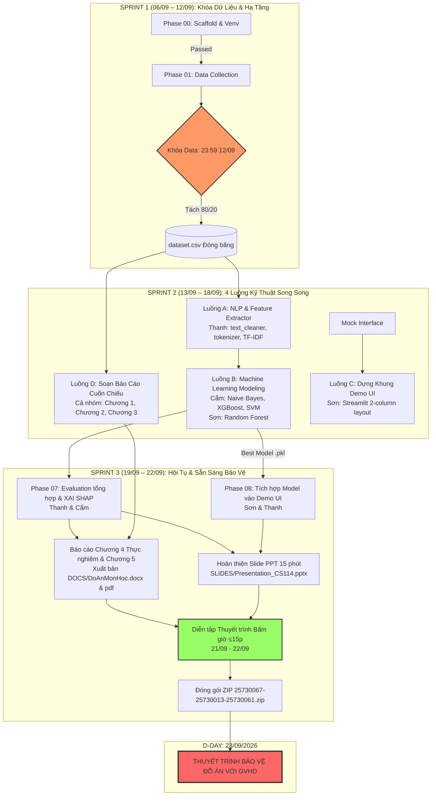

# 🧠 Báo Cáo Phân Tích Kiến Trúc & Lộ Trình Báo Cáo Sớm (Fast-Track) Đồ Án CS114

## 1. Tóm Tắt Quyết Định (Executive Summary)

Nhóm 10 môn **CS114 - Machine Learning (ThS. Cáp Phạm Đình Thăng)** đã thống nhất quyết định chủ động đăng ký **thuyết trình / báo cáo bảo vệ đồ án sớm vào ngày 23/09/2026** (rút ngắn 20 ngày so với hạn nộp gốc 13/10/2026 trên Moodle LMS).

- **Thời điểm ra quyết định:** 10/09/2026.
- **Quỹ thời gian thực thi còn lại:** Đúng **13 ngày** (10/09 → 23/09/2026).
- **Khung giờ báo cáo chính thức:** **18:30 Tối Thứ Tư, ngày 23/09/2026** (khe giờ môn SS007 cũ đã kết thúc, thầy Thăng tạo điều kiện cho các nhóm đăng ký báo cáo sớm).
- **Hình thức & Quy cách:** **Trực tuyến qua Microsoft Teams (MS Teams) — Hệ Đào tạo Từ xa UIT; bắt buộc thuyết trình luân phiên cả 3 thành viên (Thanh, Cẩm, Sơn).**
- **Chiến lược cốt lõi:** Chuyển đổi từ mô hình 4-Sprint tuần tự sang mô hình **3-Sprint Fast-Track kết hợp 4 luồng thực thi song song (`--parallels`)**, đảm bảo 100% tiêu chuẩn học thuật nghiêm ngặt (`--hard`), không cắt giảm tiêu chí nghiệm thu.

---

## 2. Bản Giao Kèo Đầu Ra (Brainstorm Contract)

| Trường mục | Nội dung cam kết |
|---|---|
| **Outcome (Đầu ra)** | Hệ thống phát hiện tin nhắn lừa đảo người cao tuổi hoàn chỉnh bao gồm:<br>1. Bộ dữ liệu ≥1.500 mẫu tiếng Việt chuẩn hóa, khử PII 100%, 0% rò rỉ dữ liệu.<br>2. Pipeline tiền xử lý văn bản tiếng Việt & trích xuất TF-IDF N-grams (1-2) + đặc trưng phụ.<br>3. Huấn luyện & tinh chỉnh 3+ mô hình ML (Naive Bayes, Random Forest/XGBoost, Linear SVM).<br>4. Đánh giá tổng hợp: Confusion Matrix, Learning Curves (phân tích Overfitting), Top-20 từ khóa XAI.<br>5. Web App Demo Streamlit chạy trực quan với UX dành riêng cho người cao tuổi.<br>6. Báo cáo Word (`DoAnMonHoc.docx`) ≥15 trang theo mẫu khoa/môn học CS114.<br>7. Slide trình chiếu bảo vệ (`Presentation_CS114.pptx`) 14–16 slides tối ưu chuẩn 15 phút.<br>8. Gói nộp bài hoàn chỉnh `25730067-25730013-25730061.zip` sẵn sàng nộp và bảo vệ ngày 23/09/2026. |
| **Constraints (Ràng buộc)** | • Tuân thủ 100% chuẩn mực học thuật của ThS. Cáp Phạm Đình Thăng (không hạ chuẩn chất lượng).<br>• Cố định deadline thuyết trình: **23/09/2026** (Khóa code và tài liệu vào 22/09/2026).<br>• Random seed cố định `RANDOM_STATE = 42` trên mọi script để đảm bảo tính tái lập (Reproducibility).<br>• Không dùng thị giác máy tính, không làm gian lận ngân hàng (tránh trùng môn CS106). |
| **Non-goals (Không làm)** | • Không cố fine-tune các mô hình Deep Learning cồng kềnh (PhoBERT) làm điều kiện bắt buộc; xếp PhoBERT vào phần Định hướng tương lai (Chương 5) để triệt tiêu rủi ro nghẽn GPU/CUDA.<br>• Không phát triển ứng dụng di động native (iOS/Android).<br>• Không triển khai hệ thống chặn cuộc gọi mức viễn thông. |
| **Acceptance Criteria (Nghiệm thu)** | • F1-Score trên Test Set ≥ 88%.<br>• **Recall của lớp Lừa đảo ≥ 92%** (chống bỏ lọt lừa đảo).<br>• Đầy đủ phân tích Overfitting qua Learning Curves Train vs Validation.<br>• Script tự động `verify_final.py` kiểm định 100% đạt chuẩn (PASSED). |

---

## 3. So Sánh Các Phương Án Tiếp Cận (Trade-off Matrix)

```
                            [RỦI RO THẤP / ĐỘ ỔN ĐỊNH CAO]
                                         │
                                         │     ★ PHƯƠNG ÁN 2 (ĐƯỢC CHỌN)
                                         │       3-Sprint Fast-Track + 4 Luồng Song Song
                                         │       • Tách rời dependencies qua Mock/Interface
                                         │       • Soạn thảo báo cáo ngay từ ngày đầu
                                         │       • Đạt 100% tiêu chí nghiệm thu
               ──────────────────────────┼────────────────────────── [TỐC ĐỘ CAO]
                                         │
       PHƯƠNG ÁN 3                       │     PHƯƠNG ÁN 1
       Cắt giảm bớt tiêu chuẩn           │     Nén tuần tự 4 Sprint cũ vào 13 ngày
       • Bỏ bớt mô hình, bỏ Demo         │     • Tắc nghẽn dây chuyền nếu Data chậm
       • RỦI RO CAO: Rớt tiêu chuẩn GV   │     • Dồn áp lực viết báo cáo & PPT vào cuối
                                         │
                            [RỦI RO CAO / DỄ VỠ TRẬN]
```

### Đánh giá chi tiết:
1. **Phương án 1 (Nén tuần tự):** Giữ nguyên quan hệ phụ thuộc tuyến tính (Data xong mới làm NLP → NLP xong mới Modeling → Model xong mới Demo → Demo xong mới viết Báo cáo & PPT).
   - *Rủi ro:* Chỉ cần Sơn hoặc Cẩm trễ hạn nộp dữ liệu 1 ngày là toàn bộ dây chuyền phía sau bị tê liệt, nhóm không kịp làm slide và diễn tập trước 23/09.
2. **Phương án 2 (3-Sprint Fast-Track + 4 Luồng Song Song — ĐƯỢC CHỌN):**
   - Tách rời các luồng công việc:
     - Khâu Dữ liệu có van xả an toàn (Safety Valve): Nếu thiếu mẫu trước 12/09, kích hoạt script tăng cường dữ liệu / crawl tự động để khóa data ngay lập tức.
     - Khâu Demo UI dựng khung shell trước bằng dummy model / mock function từ ngày 15/09, chỉ việc cắm model thật khi Phase 05/06 hoàn tất.
     - Khâu Báo cáo & Slide viết cuốn chiếu: Chương 1 (Đặt vấn đề), Chương 2 (Khảo sát) và Chương 3 (Phương pháp) được viết xong ngay trong Sprint 2. Đến ngày 19/09 chỉ việc điền bảng số liệu vào Chương 4.
   - *Kết quả:* Dành trọn 2 ngày (21–22/09) cho diễn tập thuyết trình và hoàn thiện đóng gói.
3. **Phương án 3 (Cắt giảm tính năng):** Loại bỏ bớt mô hình hoặc bỏ Web App Demo để tiết kiệm thời gian.
   - *Hậu quả:* Vi phạm trực tiếp yêu cầu đề tài của thầy Thăng, dẫn đến điểm số đồ án bị ảnh hưởng nặng nề. Phương án này bị loại bỏ ngay lập tức.

---

## 4. Kiến Trúc 4 Luồng Thực Thi Song Song (`--parallels`)



---

## 5. Kế Hoạch Quản Trị Rủi Ro (Risk Management & Fallback)

| Rủi ro tiềm ẩn | Mức độ | Kế hoạch đối phó & Dự phòng (Fallback Plan) |
|---|:---:|---|
| **Sơn hoặc Cẩm nộp dữ liệu lừa đảo trễ hạn 12/09** | Cao | Đặng Chí Thanh đã chuẩn bị sẵn script cào dữ liệu tự động từ các nguồn cảnh báo chính thống (`chongthurac.vn`, báo Dân Trí) và script sinh mẫu tăng cường (Synonym Replacement / Back-translation). Nếu đến 18:00 ngày 12/09 thành viên chưa nộp đủ, kích hoạt script ngay lập tức để đạt mốc ≥1.500 mẫu trước 23:59. |
| **Mô hình Random Forest / XGBoost bị Overfitting nặng** | Trung bình | Tinh chỉnh siêu tham số giới hạn `max_depth` (≤ 8), tăng `min_samples_leaf` (≥ 5), và áp dụng `L2 regularization` (`reg_lambda`) trong XGBoost. Kết hợp thêm Cross-Validation 5-fold để kiểm soát độ vênh giữa Train và Val score. |
| **Web App Streamlit bị trễ phản hồi (latency)** | Thấp | Caching ma trận TF-IDF Vectorizer và model trọng số bằng decorator `@st.cache_resource` trong Streamlit. Dự đoán văn bản đơn lẻ diễn ra dưới 50ms. |
| **Thuyết trình quá thời lượng 15 phút quy định** | Cao | Áp dụng khung thời gian nghiêm ngặt trong [DEFENSE_PREPARATION_GUIDE.md](../../docs/DEFENSE_PREPARATION_GUIDE.md): Thanh 4.5p, Cẩm 4p, Sơn 3p, dành tối thiểu 3.5p cho Q&A. Diễn tập bấm giờ ít nhất 2 lần trong ngày 21–22/09. |

---

## 6. Danh Mục 17+ Tài Liệu Đã Cập Nhật Đồng Bộ

1. `assignments/Final/BRAINSTORM.md` — Hạn nộp & báo cáo sớm 23/09/2026.
2. `assignments/Final/AGENTS.md` — Bảng Current State, Next Actions và phân công Fast-Track.
3. `assignments/Final/README.md` — Bảng Tiến độ 3-Sprint Fast-Track.
4. `assignments/Final/plans/scam-detection-full-submit/plan.md` — Lộ trình tổng thể 3-Sprint Fast-Track.
5. `assignments/Final/plans/scam-detection-full-submit/phase-00-env-data-setup.md` — Ghi nhận Passed.
6. `assignments/Final/plans/scam-detection-full-submit/phase-01-data-collection-labeling.md` — Khóa dữ liệu 12/09.
7. `assignments/Final/plans/scam-detection-full-submit/phase-02-vietnamese-text-preprocessing.md` — Sprint 2 (13/09).
8. `assignments/Final/plans/scam-detection-full-submit/phase-03-eda-feature-engineering.md` — Sprint 2 (14/09).
9. `assignments/Final/plans/scam-detection-full-submit/phase-04-model-naive-bayes.md` — Sprint 2 (14/09).
10. `assignments/Final/plans/scam-detection-full-submit/phase-05-model-rf-xgboost.md` — Sprint 2 (15–16/09).
11. `assignments/Final/plans/scam-detection-full-submit/phase-06-model-svm-phobert.md` — Sprint 2 (16–17/09).
12. `assignments/Final/plans/scam-detection-full-submit/phase-07-evaluation-xai.md` — Sprint 3 (18–19/09).
13. `assignments/Final/plans/scam-detection-full-submit/phase-08-demo-ui.md` — Sprint 2–3 (15–20/09).
14. `assignments/Final/plans/scam-detection-full-submit/phase-09-report-ppt.md` — Sprint 2–3 (14–22/09).
15. `assignments/Final/plans/scam-detection-full-submit/phase-10-submit-package.md` — Sprint 3 (22/09 đóng gói, 23/09 nộp/báo cáo).
16. `assignments/Final/draft/scam-detection/docs/project-overview-pdr.md` — Deadline 23/09/2026.
17. `assignments/Final/draft/scam-detection/docs/project-roadmap.md` — Biểu đồ Gantt và chi tiết tasks mới.
18. `assignments/Final/docs/DEFENSE_PREPARATION_GUIDE.md` [NEW] — Cẩm nang bảo vệ 15 phút & Q&A phản biện.

---

## 7. Các Câu Hỏi Đã Giải Quyết (Resolved Status)

1. ✅ **Khung giờ báo cáo:** Đã xác nhận chính thức từ **18:30 Tối Thứ Tư, ngày 23/09/2026** (khe giờ môn SS007 cũ đã kết thúc, thầy Thăng tạo điều kiện cho các nhóm đăng ký báo cáo sớm).
2. ✅ **Hình thức báo cáo:** Đã xác nhận chính thức là **Trực tuyến qua Microsoft Teams (MS Teams)** thuộc hệ Đào tạo Từ xa UIT.
3. ✅ **Quy cách bảo vệ:** Bắt buộc **thuyết trình luân phiên cả 3 thành viên (Thanh, Cẩm, Sơn)**; Trưởng nhóm Đặng Chí Thanh điều phối Master Share Screen xuyên suốt bài thuyết trình và tab demo Streamlit.
4. ✅ **Kế hoạch dự phòng:** Cẩm và Sơn tải sẵn slide PPT và PDF dự phòng trên máy cá nhân để sẵn sàng thay thế nếu Thanh gặp sự cố kết nối.
