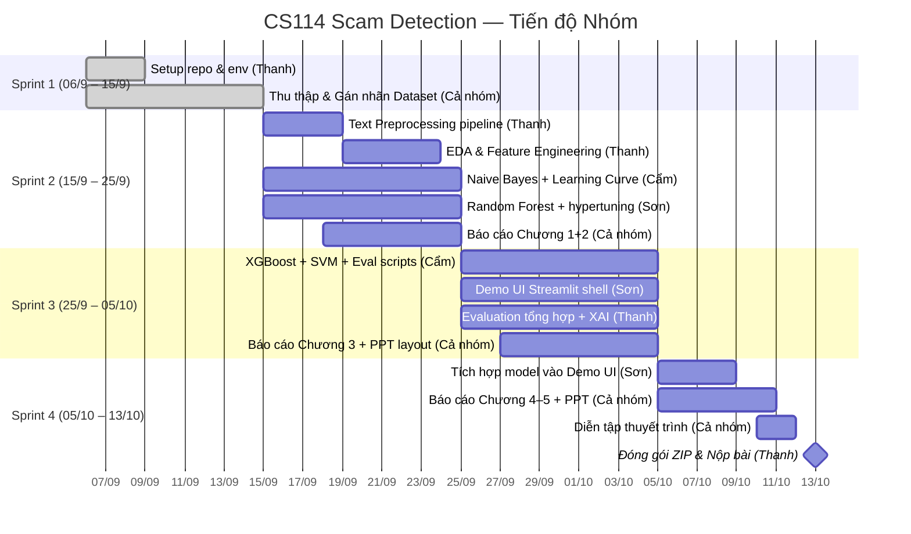

# Project Roadmap — CS114 Scam Detection

## Hành trình dự án

**Bắt đầu:** 06/09/2026 | **Deadline nộp bài:** 13/10/2026 | **Sprint review:** Tối Thứ 6 hàng tuần

> Nhóm Data & Pipeline (Thanh) tập trung preprocessing & feature engineering. Nhóm Modeling (Cẩm, Sơn) triển khai song song từ Sprint 2. Cả nhóm cùng làm Báo cáo & PPT từ Sprint 2 để tránh dồn cuối.

---

## 🗺️ Lộ trình tổng thể (Biểu đồ Gantt)

---

## 🏃 Sprint 1 — 06/9 → 15/9

> **Mục tiêu:** Setup môi trường, thu thập ≥1500 mẫu, export `dataset.csv`.

### Thanh
| Task | Trạng thái |
|------|-----------|
| Setup repo, venv, requirements.txt | 🔲 |
| `src/utils/helpers.py`: constants + set_seeds() | 🔲 |
| Tạo Google Sheet schema cùng Sơn | 🔲 |
| Thu thập ≥500 mẫu (tin nhắn nhà mạng/bank bình thường) | 🔲 |

### Sơn
| Task | Trạng thái |
|------|-----------|
| Lập bảng gán nhãn 4 nhóm bẫy tâm lý | 🔲 |
| Tạo Google Sheet chia sẻ nhóm | 🔲 |
| Thu thập ≥500 mẫu (giả danh công an, gia đình khẩn cấp) | 🔲 |
| Export `data/raw/dataset.csv` + validate | 🔲 |

### Cẩm
| Task | Trạng thái |
|------|-----------|
| Setup venv cá nhân | 🔲 |
| Thu thập ≥500 mẫu (giả mạo dịch vụ công, health_gift) | 🔲 |

---

## 🏃 Sprint 2 — 15/9 → 25/9

> **Mục tiêu:** Preprocessing xong, TF-IDF features sẵn sàng, NB + RF chạy được.

### Thanh
| Task | Trạng thái |
|------|-----------|
| `src/preprocessing/text_cleaner.py` | 🔲 |
| `src/preprocessing/tokenizer.py` (pyvi) | 🔲 |
| `src/preprocessing/stopwords.py` | 🔲 |
| `src/preprocessing/pipeline.py` + auxiliary features | 🔲 |
| `data/processed/dataset_preprocessed.csv` | 🔲 |
| `notebooks/02_eda.ipynb`: ≥7 visualizations | 🔲 |
| TF-IDF vectorizer + Combined features saved | 🔲 |

### Cẩm
| Task | Trạng thái |
|------|-----------|
| `notebooks/03_model_naive_bayes.ipynb` | 🔲 |
| GridSearch alpha + Classification report | 🔲 |
| Confusion Matrix + Learning Curve | 🔲 |
| `models/naive_bayes.pkl` saved | 🔲 |

### Sơn
| Task | Trạng thái |
|------|-----------|
| `notebooks/04_model_random_forest.ipynb` | 🔲 |
| RandomizedSearch hypertuning | 🔲 |
| Confusion Matrix + Learning Curve + Feature importance | 🔲 |
| `models/random_forest.pkl` saved | 🔲 |

### Cả nhóm
| Task | Trạng thái |
|------|-----------|
| Báo cáo Word: Chương 1 — Đặt vấn đề | 🔲 |
| Báo cáo Word: Chương 2 — Khảo sát phương pháp | 🔲 |

---

## 🏃 Sprint 3 — 25/9 → 05/10

> **Mục tiêu:** XGBoost + SVM done, Evaluation tổng hợp, Demo shell chạy được.

### Thanh
| Task | Trạng thái |
|------|-----------|
| `notebooks/06_evaluation_xai.ipynb` | 🔲 |
| Confusion Matrix (4 models) | 🔲 |
| ROC Curve + Precision-Recall Curve | 🔲 |
| Learning Curves (4 models) | 🔲 |
| Top-20 scam keywords | 🔲 |
| `reports/model_comparison.csv` | 🔲 |

### Cẩm
| Task | Trạng thái |
|------|-----------|
| `notebooks/04_model_xgboost.ipynb` | 🔲 |
| `notebooks/05_model_svm.ipynb` | 🔲 |
| XGBoost + SVM: report + confusion + learning curve | 🔲 |
| `models/xgboost.pkl` + `models/svm_linear.pkl` saved | 🔲 |

### Sơn
| Task | Trạng thái |
|------|-----------|
| `demo/app.py`: Streamlit 2-column layout | 🔲 |
| `demo/components/risk_meter.py` | 🔲 |
| `demo/components/keyword_highlighter.py` | 🔲 |
| `demo/components/safety_advisor.py` | 🔲 |
| `streamlit run demo/app.py` chạy được (no model yet) | 🔲 |

### Cả nhóm
| Task | Trạng thái |
|------|-----------|
| Báo cáo Word: Chương 3 — Phương pháp | 🔲 |
| PPT layout: 14-16 slides, design | 🔲 |

---

## 🏃 Sprint 4 — 05/10 → 13/10

> **Mục tiêu:** Demo hoàn chỉnh, Báo cáo Word & PPT hoàn thiện, Nộp bài đúng deadline.

### Sơn
| Task | Trạng thái |
|------|-----------|
| Tích hợp best model vào Demo UI | 🔲 |
| ≥3 screenshots demo | 🔲 |

### Cả nhóm
| Task | Trạng thái |
|------|-----------|
| Báo cáo Word: Chương 4 — Thực nghiệm | 🔲 |
| Báo cáo Word: Chương 5 — Kết luận + Tài liệu tham khảo (≥10) | 🔲 |
| PPT: hoàn thiện nội dung + biểu đồ + screenshots demo | 🔲 |
| Diễn tập thuyết trình (≤15 phút) | 🔲 |

### Thanh
| Task | Trạng thái |
|------|-----------|
| Đóng gói ZIP theo cấu trúc 25730067-25730013-25730061 | 🔲 |
| Pre-flight check: verify tất cả files | 🔲 |
| Upload LMS trước 13/10 23:59 | 🔲 |
