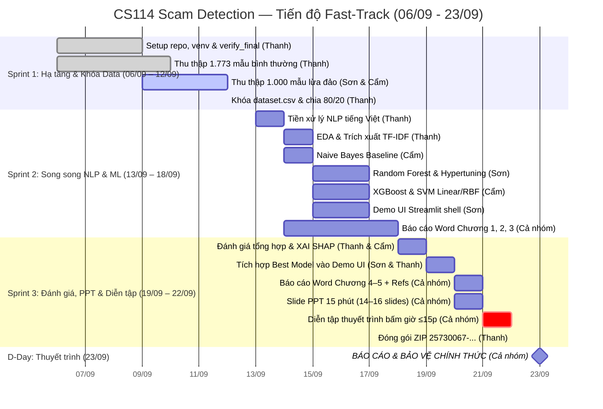

# Project Roadmap — CS114 Scam Detection (Fast-Track 23/09 Mode)

## Hành trình dự án

**Bắt đầu:** 06/09/2026 | **Báo cáo sớm:** 23/09/2026 (Hạn LMS gốc: 13/10/2026) | **Daily Sync:** 21:00 hàng ngày

> ⚡ **Chiến lược Thực thi Song song (`--parallels`):**
> Do nhóm xin thầy báo cáo sớm vào ngày **23/09/2026**, toàn bộ lộ trình được tối ưu thành **3-Sprint Fast-Track** (13 ngày). Dữ liệu khóa vào 12/09, kích hoạt 4 luồng kỹ thuật song song từ 13/09, hoàn tất Báo cáo Word & Slide PPT ngày 20/09, dành 2 ngày (21–22/09) diễn tập bấm giờ và đóng gói ZIP.

---

## 🗺️ Lộ trình tổng thể (Biểu đồ Gantt Fast-Track)

---

## 🏃 Sprint 1 — 06/09 → 12/09 (Khóa Hạ tầng & Dữ liệu)

> **Mục tiêu:** Setup môi trường, hoàn tất thu thập ≥1.500 mẫu tiếng Việt, chạy `data_validation.py` PASSED và đóng băng `dataset.csv`.

### Thanh (PM & Data Lead)
| Task | Trạng thái |
|------|:---:|
| Setup repo, venv, requirements.txt, verify_final.py | ✅ Done (Phase 00) |
| `src/utils/helpers.py`: constants, set_seeds(), random_state=42 | ✅ Done (Phase 00) |
| Thu thập 1.773 mẫu bình thường, ẩn danh PII 100%, 42 mẫu Holdout Test | ✅ Done (Phase 01) |
| Hỗ trợ review schema dữ liệu Google Sheet cho Sơn & Cẩm | ⏳ Đang thực hiện |
| Khóa toàn bộ dữ liệu 23:59 ngày 12/09, chạy kiểm định và chia Train/Test 80/20 | 🔲 Chờ đồng bộ |

### Sơn (Data Collection Lead)
| Task | Trạng thái |
|------|:---:|
| Lập Google Sheet phân loại 4 nhóm bẫy tâm lý theo chuẩn kiểm toán | ⏳ Đang thực hiện |
| Thu thập ≥500 mẫu lừa đảo (`fear_authority` và `family_emergency`) | ⏳ Đang thực hiện (Hạn 12/09) |
| Export dữ liệu và nộp file CSV để merge vào pipeline | 🔲 Chờ hoàn thành |

### Cẩm (Modeling Engineer)
| Task | Trạng thái |
|------|:---:|
| Setup venv cá nhân, cài đặt thư viện ML | ✅ Done |
| Thu thập ≥500 mẫu lừa đảo (`health_gift` và `public_service`) | ⏳ Đang thực hiện (Hạn 12/09) |
| Export dữ liệu và nộp file CSV để merge vào pipeline | 🔲 Chờ hoàn thành |

---

## 🏃 Sprint 2 — 13/09 → 18/09 (Song song NLP & Huấn luyện Mô hình)

> **Mục tiêu:** Pipeline tiền xử lý hoàn tất, trích xuất TF-IDF sẵn sàng, huấn luyện đồng thời 4 mô hình (NB, RF, XGBoost, SVM), dựng khung Demo UI Streamlit, viết xong Báo cáo Word Chương 1–3.

### Thanh (Data & NLP Lead)
| Task | Trạng thái |
|------|:---:|
| `src/preprocessing/text_cleaner.py`: Unicode NFC, teencode mapper, xóa rác | 🔲 (13/09) |
| `src/preprocessing/tokenizer.py` (pyvi / underthesea) + stopwords | 🔲 (13/09) |
| `src/preprocessing/pipeline.py` + trích xuất đặc trưng phụ (URL, SĐT, cấp cứu) | 🔲 (13/09) |
| `notebooks/02_eda.ipynb`: Phân phối nhãn, n-grams, word cloud, độ dài | 🔲 (14/09) |
| Lưu trữ `models/vectorizer.pkl` và các ma trận đặc trưng `data/processed/` | 🔲 (14/09) |

### Cẩm (Modeling Engineer — NB, XGBoost, SVM)
| Task | Trạng thái |
|------|:---:|
| `notebooks/03_model_naive_bayes.ipynb`: GridSearch alpha, Learning Curve, Confusion Matrix | 🔲 (14/09) |
| `models/naive_bayes.pkl`: Lưu trọng số baseline | 🔲 (14/09) |
| `notebooks/04_model_xgboost.ipynb`: Tinh chỉnh n_estimators, max_depth, learning_rate | 🔲 (15/09 – 16/09) |
| `notebooks/05_model_svm.ipynb`: LinearSVC Calibrated / RBF kernel, so sánh đa tham số | 🔲 (16/09 – 17/09) |
| Lưu `models/xgboost.pkl` và `models/svm.pkl` | 🔲 (17/09) |

### Sơn (Modeling & UI Lead — Random Forest & Demo UI)
| Task | Trạng thái |
|------|:---:|
| `notebooks/04_model_random_forest.ipynb`: RandomizedSearch n_estimators, max_depth | 🔲 (15/09 – 16/09) |
| `models/random_forest.pkl`: Lưu trọng số Random Forest | 🔲 (16/09) |
| `demo/app.py`: Khung Streamlit 2 cột (Nhập liệu / Kết quả cảnh báo) | 🔲 (15/09 – 17/09) |
| `demo/components/`: risk_meter.py, keyword_highlighter.py, safety_advisor.py | 🔲 (17/09) |

### Cả nhóm (Academic Documentation)
| Task | Trạng thái |
|------|:---:|
| Báo cáo Word: Chương 1 — Đặt vấn đề, bối cảnh lừa đảo NCT 2026, ý nghĩa xã hội | 🔲 (14/09 – 15/09) |
| Báo cáo Word: Chương 2 — Khảo sát các công trình nghiên cứu & hướng tiếp cận | 🔲 (15/09 – 16/09) |
| Báo cáo Word: Chương 3 — Phương pháp nhóm chọn: Tiền xử lý, TF-IDF, kiến trúc 3+ models | 🔲 (17/09 – 18/09) |
| Lên khung cấu trúc Slide PowerPoint 15 phút (14–16 slides) | 🔲 (18/09) |

---

## 🏃 Sprint 3 — 19/09 → 22/09 (Đánh giá, Demo, PPT & Diễn tập Bảo vệ)

> **Mục tiêu:** Đánh giá tổng hợp 4 mô hình, trích xuất XAI SHAP, tích hợp model vào Demo Streamlit, hoàn thiện Báo cáo Word (≥15 trang) và Slide PPT, diễn tập bảo vệ ≤15 phút, đóng gói ZIP `25730067-25730013-25730061.zip`.

### Thanh (Evaluation & Packaging Lead)
| Task | Trạng thái |
|------|:---:|
| `notebooks/06_evaluation_xai.ipynb`: Bảng so sánh 4 models (Accuracy, Precision, Recall, F1, ROC-AUC) | 🔲 (18/09 – 19/09) |
| Trực quan hóa: Confusion Matrix so sánh, ROC Curves, Precision-Recall Curves | 🔲 (19/09) |
| Phân tích Overfitting: Learning Curves (Train vs Validation K-Fold) | 🔲 (19/09) |
| XAI: Trích xuất Top-20 từ khóa cảnh báo kích hoạt bẫy tâm lý (SHAP / Feature Weights) | 🔲 (19/09) |
| `reports/model_comparison.csv` và xuất toàn bộ figures | 🔲 (19/09) |
| Pre-flight check toàn diện bằng `verify_final.py` | 🔲 (22/09) |
| Đóng gói ZIP `25730067-25730013-25730061.zip` theo chuẩn nộp bài UIT | 🔲 (22/09) |

### Sơn (Demo Integration & Screenshots)
| Task | Trạng thái |
|------|:---:|
| Tích hợp Best Model (.pkl) và Vectorizer vào `demo/app.py` | 🔲 (19/09 – 20/09) |
| Hoàn thiện tính năng bôi đỏ từ khóa bẫy tâm lý và khuyến cáo an toàn cho NCT | 🔲 (20/09) |
| Chụp ≥3 ảnh màn hình Demo chất lượng cao chèn vào Báo cáo Word và Slide PPT | 🔲 (20/09) |

### Cả nhóm (Báo cáo, Slide PPT & Diễn tập Thuyết trình)
| Task | Trạng thái |
|------|:---:|
| Báo cáo Word: Chương 4 — Thực nghiệm (Dataset, Metrics, Bảng so sánh, Confusion Matrix, Overfitting) | 🔲 (20/09) |
| Báo cáo Word: Chương 5 — Kết luận, Hạn chế và Định hướng phát triển (PhoBERT, Mobile) | 🔲 (20/09) |
| Hoàn thiện Tài liệu tham khảo (≥10 trích dẫn chuẩn IEEE/APA) | 🔲 (20/09) |
| Xuất bản file `DOCS/DoAnMonHoc.docx` và `DOCS/DoAnMonHoc.pdf` (≥15 trang) | 🔲 (21/09) |
| Hoàn thiện file Slide `SLIDES/Presentation_CS114.pptx` (14–16 slides) | 🔲 (20/09 – 21/09) |
| Diễn tập thuyết trình lần 1: Bấm giờ từng phần (Thanh 5p, Cẩm 4p, Sơn 3p) | 🔲 (21/09) |
| Diễn tập thuyết trình lần 2: Giả lập phản biện Q&A từ ThS. Cáp Phạm Đình Thăng (3p) | 🔲 (22/09) |

---

## 🎯 D-Day — 23/09/2026: Thuyết trình Bảo vệ Đồ án

| Thời gian | Nội dung | Phụ trách |
|-----------|----------|-----------|
| 00:00 – 02:00 | Khai mạc, Đặt vấn đề, Bối cảnh lừa đảo NCT & Ý nghĩa thực tiễn | **Đặng Chí Thanh** |
| 02:00 – 05:00 | Phương pháp đề xuất, Pipeline NLP tiếng Việt, Feature Engineering | **Đặng Chí Thanh** |
| 05:00 – 09:00 | Thực nghiệm 3+ Mô hình (NB, RF/XGB, SVM), Đánh giá Overfitting, Confusion Matrix | **Bùi Thị Mỷ Cẩm** |
| 09:00 – 12:00 | Demo Web App Streamlit trực quan, Giải thích bẫy tâm lý XAI, Kết luận | **Hoàng Cao Sơn** |
| 12:00 – 15:00 | Trả lời câu hỏi phản biện của Giảng viên (Q&A) | **Cả nhóm** |
