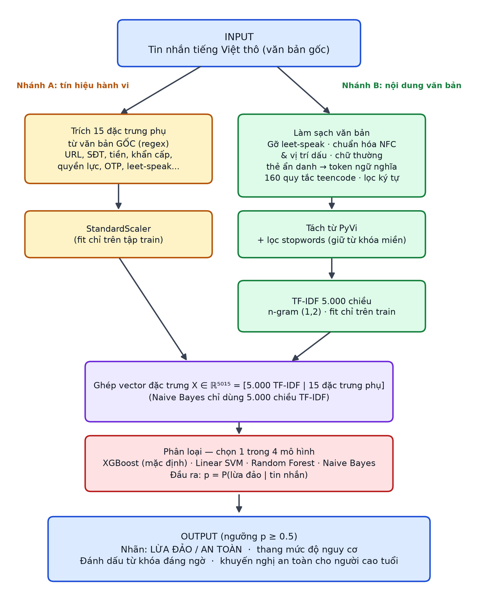
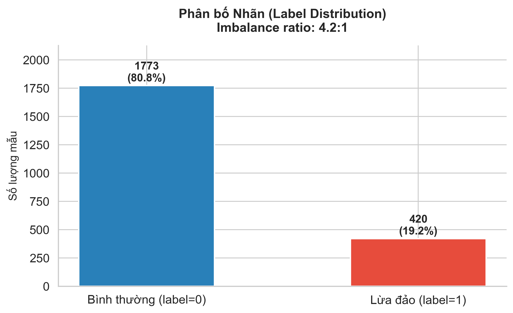
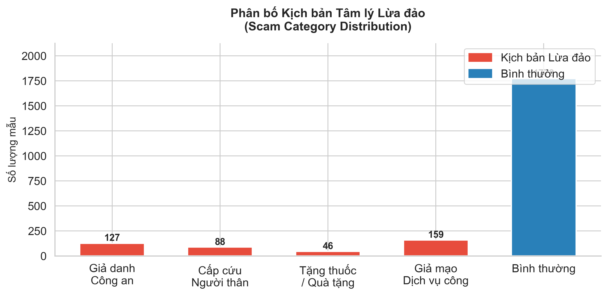
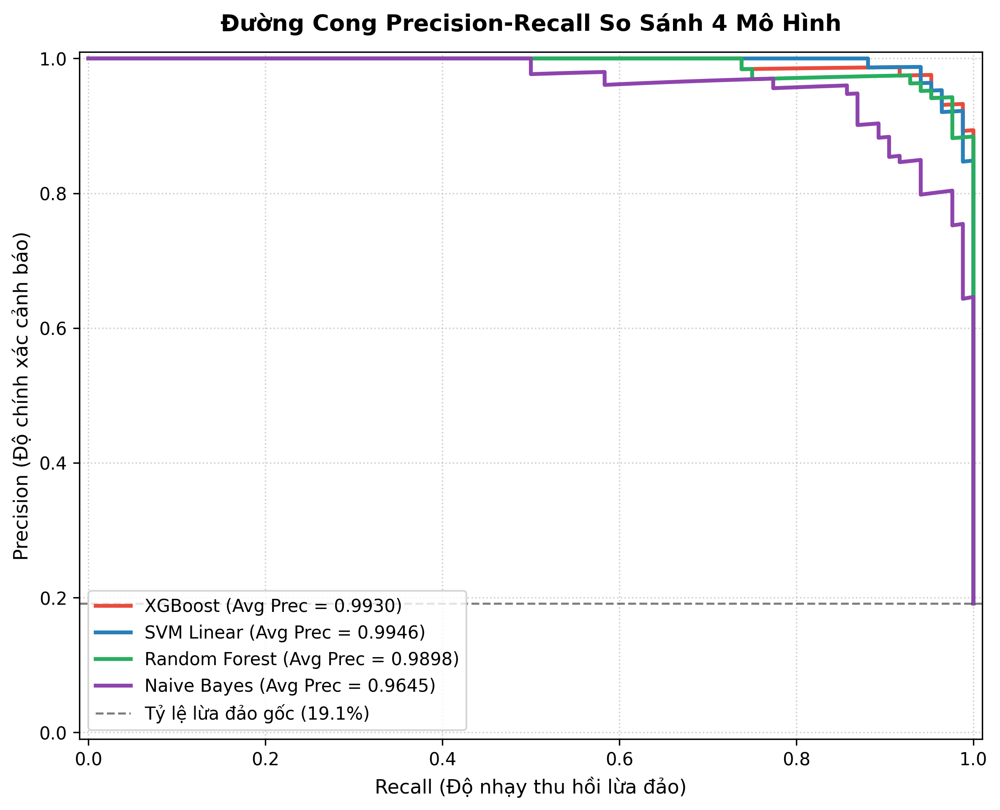
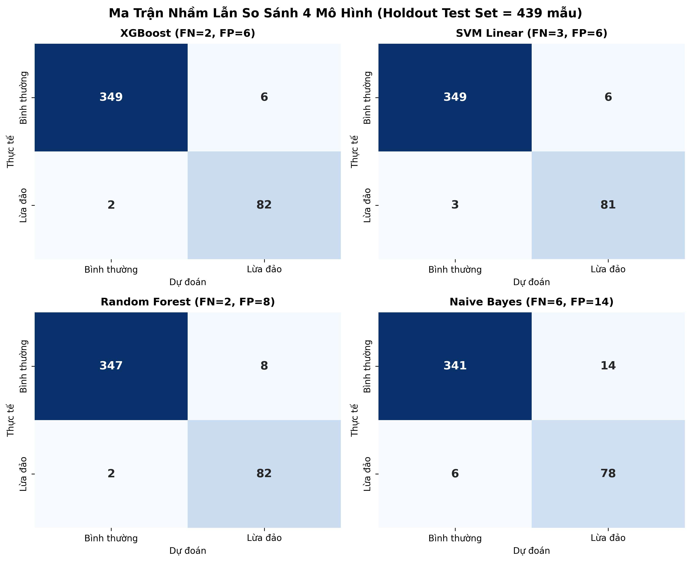
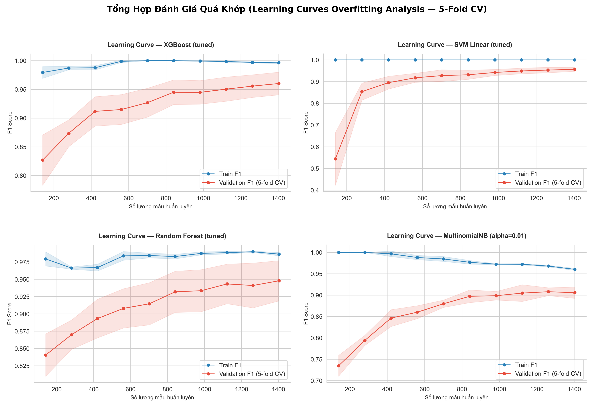
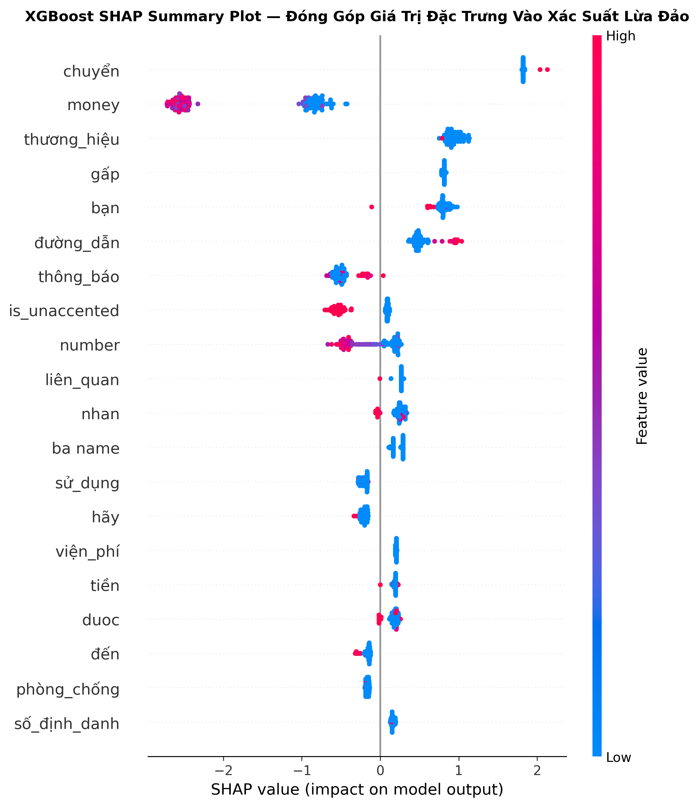
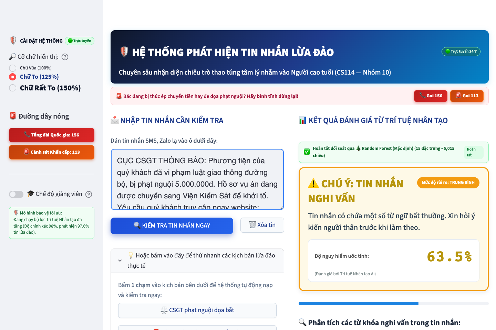
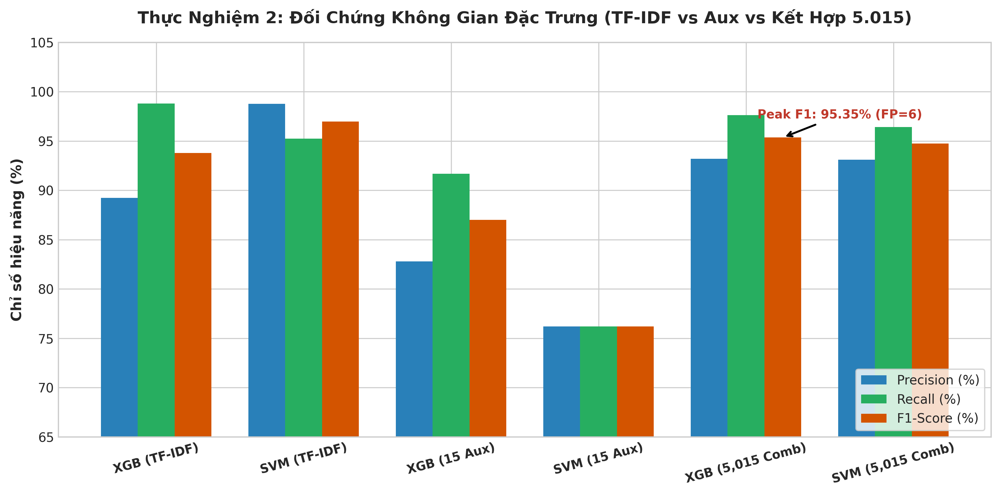

<!-- ═══════════════════════════════════════════════════════════════════
     TEMPLATE MẪU — Phase 09 Report
     Branch: feat/phase-09-report-template
     Bàn giao: Hoàng Cao Sơn (25730061) tạo PR và sửa tiếp
     Reviewer: Đặng Chí Thanh (25730067)
     ═══════════════════════════════════════════════════════════════════ -->

# Cam kết Liêm chính Học thuật

> Chúng tôi — Đặng Chí Thanh (25730067), Bùi Thị Mỷ Cẩm (25730013), Hoàng Cao Sơn (25730061) — cam kết rằng báo cáo này là công trình nghiên cứu độc lập của nhóm, không vi phạm liêm chính học thuật. Mọi nguồn tài liệu đều được trích dẫn đầy đủ.

---

# Mục lục

1. Đặt vấn đề
2. Các phương pháp tiếp cận
3. Phương pháp nhóm chọn
4. Thực nghiệm
5. Kết luận
- Tài liệu tham khảo

---

# Chương 1 — Đặt vấn đề

## 1.1. Bối cảnh và tính cấp thiết

Trong giai đoạn 2025–2026, Việt Nam chứng kiến làn sóng chuyển đổi số toàn diện với sự phổ cập sâu rộng của định danh điện tử VNeID, thanh toán không tiền mặt và các dịch vụ hành chính công trực tuyến. Tuy nhiên, cùng với tiện ích công nghệ, tình hình tội phạm mạng và lừa đảo viễn thông (Smishing, Social Engineering) cũng bùng phát với mức độ tinh vi và nguy hiểm chưa từng có. Trong các đối tượng người dùng, **người cao tuổi (từ 60 tuổi trở lên)** đang trở thành nhóm nạn nhân chịu tổn thất nặng nề nhất cả về tài sản lẫn sức khỏe tinh thần.

Theo thống kê chính thức từ Cục An toàn thông tin (Bộ Thông tin và Truyền thông) và Cục Cảnh sát hình sự (Bộ Công an) trong năm 2025 và đầu năm 2026, các cơ quan chức năng đã ghi nhận hàng chục nghìn phản ánh lừa đảo trực tuyến với tổng thiệt hại ước tính lên tới hàng nghìn tỷ đồng. Đáng báo động, các vụ án chiếm đoạt từ hàng trăm triệu đến hàng tỷ đồng phần lớn nhắm vào người hưu trí và người cao tuổi. Do phản xạ công nghệ còn chậm, thị lực suy giảm, khả năng xác minh thông tin viễn thông hạn chế và tâm lý cả tin, người cao tuổi rất dễ bị cô lập và thao túng khi nhận được các kịch bản tin nhắn được thiết kế bài bản.

**Phân định ranh giới bài toán — Lừa đảo thao túng tâm lý vs Kiểm chứng tin giả báo chí:**
Trong nghiên cứu này, bài toán phát hiện tin nhắn lừa đảo thao túng tâm lý (Social Engineering Phishing) nhắm vào người cao tuổi được phân định ranh giới bản chất với bài toán kiểm chứng tin giả báo chí (Fake News Verification):
- *Kiểm chứng tin giả báo chí (Fake News)*: Bản chất là bài toán đối chiếu tri thức (Fact-checking). Tin giả thường là các phát ngôn, sự kiện thời sự cộng đồng sai sự thật phát tán rộng rãi trên mạng xã hội; việc xác thực chủ yếu dựa vào truy vấn đối sánh với các cơ sở tri thức công cộng, văn bản pháp luật hoặc các nguồn báo chí chính thống đáng tin cậy.
- *Phát hiện tin nhắn lừa đảo thao túng tâm lý (Social Engineering Phishing)*: Bản chất là bài toán phát hiện hành vi tấn công kỹ nghệ xã hội trong giao tiếp cá nhân 1-1. Kẻ lừa đảo không bịa đặt sự kiện tin tức chung, mà nhắm thẳng vào nạn nhân cụ thể thông qua các kịch bản đe dọa, giục giã hoặc mồi nhử tài chính riêng tư. Không một cơ sở dữ liệu tin tức công cộng nào có thể chứa sẵn nội dung của một tin nhắn lừa đảo riêng lẻ. Do đó, việc phát hiện bắt buộc phải dựa trên **phân tích ngữ cảnh bất thường, hành vi thúc ép và các tín hiệu thao túng tâm lý nội tại** (từ khóa đe dọa quyền lực, thúc giục chuyển tiền gấp, yêu cầu cung cấp OTP, link mạo danh).

Qua quá trình thu thập và chuẩn hóa 2.193 mẫu tin nhắn thực tế (1.773 tin nhắn thông thường và 420 tin nhắn lừa đảo), nhóm đã phân loại và bao phủ 4 nhóm bẫy thao túng tâm lý chủ đạo:
- **Đe dọa quyền lực (`fear_authority`)**: Giả mạo Cơ quan Công an, Viện kiểm sát, Tòa án thông báo nạn nhân liên quan đến đường dây rửa tiền, buôn ma túy; đe dọa bắt giam nhằm ép chuyển tiền "phục vụ điều tra".
- **Khẩn cấp gia đình (`family_emergency`)**: Thông báo con cháu, người thân gặp tai nạn giao thông nguy kịch, đang cấp cứu tại bệnh viện lớn, cần chuyển gấp viện phí phẫu thuật trong vòng 30 phút.
- **Dụ dỗ quà tặng & Sức khỏe (`health_gift`)**: Mạo danh tri ân khách hàng cao tuổi tặng sữa dinh dưỡng, thuốc đông y trị bách bệnh miễn phí, hoặc mời tham gia bảo hiểm y tế lãi suất cao.
- **Giả mạo dịch vụ công (`public_service`)**: Giả danh cán bộ Thuế, Bảo hiểm xã hội, Điện lực thông báo sai lệch hồ sơ VNeID, thúc ép bấm vào liên kết lạ tải ứng dụng dịch vụ công giả mạo để chiếm quyền điều khiển điện thoại.

## 1.2. Các khó khăn và thách thức kỹ thuật

Việc xây dựng một hệ thống phát hiện tự động tin nhắn lừa đảo tiếng Việt nhắm vào người cao tuổi đặt ra 4 thách thức kỹ thuật cốt lõi:

1. **Đặc thù ngôn ngữ tiếng Việt và thủ thuật lách kiểm duyệt (Linguistic & Evasion Complexity)**: Tiếng Việt là ngôn ngữ đơn lập với 6 thanh điệu phong phú, ranh giới từ phức tạp cần cơ chế tách từ chuyên dụng (Word Segmentation). Thêm vào đó, tội phạm mạng liên tục sử dụng ngôn ngữ teencode (`ck`, `stk`, `sdt`), từ viết tắt không dấu, và thủ thuật chèn ký tự đặc biệt leet-speak (`c.o.n.g a.n`, `t.i.e.n`) nhằm qua mặt các bộ lọc từ khóa đơn giản.
2. **Hiện tượng mất cân bằng dữ liệu sâu sắc (Severe Class Imbalance)**: Trong không gian viễn thông thực tế, tin nhắn lừa đảo chỉ chiếm tỷ trọng thiểu số (~19.15% trong tập dữ liệu của nhóm, tỷ lệ 4.22 : 1). Các mô hình tối ưu Accuracy thuần túy sẽ có xu hướng dự đoán nhãn bình thường cho mọi trường hợp, gây mất khả năng phát hiện.
3. **Sự thiếu vắng bộ ngữ liệu chuẩn hóa công khai (Lack of Benchmark Datasets)**: Cho đến nay, cộng đồng nghiên cứu AI trong nước chưa có một bộ dữ liệu công khai nào chuyên biệt về tin nhắn lừa đảo người cao tuổi có đầy đủ nguồn gốc truy vết (provenance) và đã được làm sạch khử định danh (PII) triệt để.
4. **Chi phí bất đối xứng giữa các loại sai số (Asymmetric Error Cost)**: Trong bài toán an toàn bảo vệ người già, hậu quả của việc bỏ sót một tin lừa đảo (False Negative — FN) là nạn nhân có thể mất sạch tài sản dưỡng già tích cóp cả đời, nghiêm trọng hơn rất nhiều so với việc cảnh báo nhầm một tin nhắn thông thường (False Positive — FP). Do đó, hệ thống bắt buộc phải đặt mục tiêu tối thượng vào **chỉ số Recall trên lớp lừa đảo** (yêu cầu Recall ≥ 92%).

## 1.3. Ý nghĩa thực tiễn và tác động xã hội

Đề tài mang lại giá trị thực tiễn và tác động xã hội sâu sắc:
- **Lá chắn công nghệ bảo vệ người yếu thế**: Hệ thống hoạt động như một người trợ lý số thông minh, hỗ trợ trực tiếp người cao tuổi nhận diện nguy cơ ngay khi tin nhắn vừa xuất hiện trên thiết bị di động.
- **Khả năng triển khai linh hoạt**: Với kiến trúc học máy gọn nhẹ (tốc độ suy luận <50ms trên CPU tiêu chuẩn, không đòi hỏi GPU đắt đỏ), giải pháp có thể dễ dàng tích hợp vào ứng dụng nhắn tin SMS, tiện ích chặn cuộc gọi rác trên hệ điều hành Android, bot cảnh báo gia đình qua Zalo/Telegram, hoặc cổng lọc tin nhắn của các nhà mạng viễn thông.
- **Minh bạch hóa quyết định nhờ AI có thể giải thích (XAI)**: Không dừng lại ở việc đưa ra cảnh báo nhị phân vô cảm, hệ thống trích xuất rõ các từ khóa nguy cơ và phân tích cơ chế bẫy tâm lý bên trong tin nhắn (qua biểu đồ trực quan và giải thích SHAP), giúp người cao tuổi và con cháu hiểu rõ bản chất thủ đoạn, từ đó nâng cao kỹ năng số và năng lực tự phòng vệ lâu dài.

---

# Chương 2 — Các phương pháp tiếp cận

## 2.1. Khảo sát các công trình liên quan (Related Works)

Bài toán phát hiện tin nhắn rác và gian lận viễn thông đã được cộng đồng nghiên cứu xử lý qua nhiều giai đoạn với các hướng tiếp cận đa dạng. Bảng 2.1 tổng hợp các công trình khoa học tiêu biểu liên quan trực tiếp đến đề tài:

| Công trình khoa học | Hướng tiếp cận & Phương pháp | Đặc điểm tập dữ liệu | Kết quả & Đóng góp chính | Hạn chế đối với bài toán đề tài |
|---|---|---|---|---|
| **Tran et al. (2026) [IEEE Access]** [1] | Học máy truyền thống (Naive Bayes, SVM, RF) kết hợp TF-IDF | 1.944 mẫu SMS tiếng Việt thực tế được chuẩn hóa chất lượng | Đạt F1-score > 90% trên bài toán phân loại Spam viễn thông thông thường | Dữ liệu tập trung vào tin nhắn quảng cáo sim số, bất động sản; chưa bao phủ các kịch bản lừa đảo thao túng tâm lý nhắm vào người già |
| **Salton & Buckley (1988) [IP&M]** [6] | Trọng số TF-IDF và không gian vector n-grams | Ngữ liệu văn bản tự nhiên | Đặt nền móng lý thuyết cho việc vector hóa văn bản dựa trên tần suất từ và nghịch đảo tần suất tài liệu | Chỉ bắt cặp tần suất thống kê từ vựng, bỏ qua các đặc trưng hành vi và cấu trúc thúc ép tâm lý |
| **Chen & Guestrin (2016) [ACM KDD]** [7] | Extreme Gradient Boosting (XGBoost) dạng cây | Đa dạng bài toán phân loại cấu trúc bảng và văn bản | Thuật toán Boosting tối ưu tốc độ, hỗ trợ hàm mất mát phạt gradient theo trọng số `scale_pos_weight` | Cần thiết kế không gian đặc trưng phụ trợ tinh chỉnh để mô hình cây phát huy tối đa sức mạnh |
| **Nguyen & Nguyen (2020) [EMNLP]** [15] | Pre-trained Transformer tiếng Việt (PhoBERT-base) | Hàng triệu câu văn bản tiếng Việt từ Wikipedia và báo chí | Nắm bắt ngữ cảnh sâu và phụ thuộc xa giữa các từ đơn/từ ghép trong câu | Đòi hỏi tài nguyên GPU tính toán lớn, độ trễ suy luận cao (>300ms), khó triển khai offline nhẹ nhàng trên máy cá nhân của người cao tuổi |

## 2.2. So sánh các hướng tiếp cận công nghệ

Nhằm lựa chọn giải pháp tối ưu nhất cho bài toán, nhóm đã tiến hành đối sánh toàn diện 4 hướng tiếp cận công nghệ chính trong xử lý ngôn ngữ tự nhiên tiếng Việt (Bảng 2.2):

| Tiêu chí đánh giá | 1. Hệ luật (Rule-based / Regex) | 2. Học máy truyền thống + Feature Engineering (Giải pháp chọn) | 3. Transformer tiếng Việt (PhoBERT) | 4. Mô hình ngôn ngữ lớn (LLM qua API) |
|---|---|---|---|---|
| **Khả năng khái quát hóa** | Rất thấp, chỉ bắt đúng từ khóa cố định | **Rất cao**, học được phân phối từ ngữ và hành vi phức tạp | Rất cao, bắt trọn ngữ cảnh sâu | Rất cao, hiểu ngữ nghĩa linh hoạt |
| **Tốc độ suy luận (Latency)** | < 1 ms | **< 10 ms (Siêu nhanh trên CPU)** | ~200 – 400 ms (cần GPU) | 1.000 – 3.000 ms (phụ thuộc mạng) |
| **Yêu cầu phần cứng** | Tối thiểu (CPU cơ bản) | **Rất nhẹ (< 500MB RAM, CPU phổ thông)** | Nặng (GPU VRAM ≥ 4GB) | Không yêu cầu GPU nhưng cần Internet |
| **Khả năng giải thích (XAI)** | Tường minh nhưng cứng nhắc | **Rất tốt** (Trích xuất trọng số TF-IDF, Feature Importance, SHAP) | Khó giải thích (Black-box phức tạp) | Khó lượng hóa độ tin cậy bằng toán học |
| **Bảo mật PII & Khả năng Offline** | Tốt, chạy offline hoàn toàn | **Tuyệt đối an toàn, chạy offline 100% không lo lộ PII** | An toàn nếu tự host, nhưng nặng máy | Nguy cơ rò rỉ dữ liệu cá nhân qua API bên thứ ba |
| **Chi phí vận hành** | 0 VNĐ | **0 VNĐ (Không tốn chi phí duy trì)** | Tốn chi phí điện năng / thuê server GPU | Tốn phí token liên tục theo từng lượt gọi API |
| **Đánh giá mức độ phù hợp** | ❌ Không chọn (Kẻ gian dễ dàng lách luật) | ✅ **LỰA CHỌN TỐI ƯU CỦA ĐỀ TÀI** | 🔭 Hướng mở rộng nghiên cứu tương lai | ❌ Không chọn (Độ trễ cao, rò rỉ dữ liệu riêng tư) |

## 2.3. Luận cứ khoa học lựa chọn giải pháp Học máy kết hợp NLP tiếng Việt

Từ kết quả phân tích so sánh ở trên, nhóm nghiên cứu khẳng định việc lựa chọn **Học máy truyền thống kết hợp Trích xuất đặc trưng chuyên biệt (TF-IDF 5.000 chiều + 15 đặc trưng phụ tâm lý)** là giải pháp khoa học phù hợp nhất dựa trên 4 luận cứ thực tiễn:

1. **Tính tương thích hoàn hảo với quy mô dữ liệu**: Với tập ngữ liệu 2.193 mẫu thực tế, các thuật toán học máy cổ điển (XGBoost, SVM, Random Forest, Naive Bayes) phát huy hiệu quả tối đa mà không bị hiện tượng quá khớp (overfitting) trầm trọng như các mô hình mạng nơ-ron sâu hàng trăm triệu tham số khi thiếu hụt dữ liệu cỡ lớn.
2. **Khả năng thực thi thời gian thực trên thiết bị biên (Edge-ready & Real-time)**: Người cao tuổi cần một công cụ cảnh báo tức thì ngay khi tin nhắn đến. Tốc độ suy luận của mô hình chỉ dưới 10ms trên CPU tiêu chuẩn, bộ nhớ RAM chiếm dụng dưới 100MB, cho phép đóng gói chạy ngầm mượt mà trên mọi dòng điện thoại thông minh giá rẻ mà không làm chậm máy hay hao pin.
3. **Bảo vệ quyền riêng tư tuyệt đối (Zero PII Leakage via Offline Processing)**: Tin nhắn cá nhân của người cao tuổi chứa nhiều thông tin riêng tư nhạy cảm (tên người thân, số tài khoản, thông tin bệnh lý). Mô hình chạy hoàn toàn ngoại tuyến (offline), tuyệt đối không gửi nội dung tin nhắn lên đám mây của bên thứ ba, bảo đảm chuẩn mực an toàn thông tin tối cao.
4. **Khả năng giải thích minh bạch phục vụ người cao tuổi (Explainable AI)**: Nhờ cơ chế trích xuất đặc trưng tường minh, mô hình dễ dàng kết hợp với các kỹ thuật giải thích hiện đại như SHAP (SHapley Additive exPlanations) và xếp hạng trọng số từ khóa. Qua đó, hệ thống chỉ rõ cho người dùng thấy chính xác cụm từ nào kích hoạt bẫy tâm lý (ví dụ: *"chuyển tiền ngay"*, *"viện phí"*, *"Bộ Công an"*), đáp ứng trọn vẹn yêu cầu sư phạm và liêm chính học thuật của môn học.

---
---

# Chương 3 — Phương pháp nhóm chọn

## 3.1. Pipeline Tiền xử lý Tiếng Việt

Tin nhắn thô được xử lý theo hai nhánh song song (xem Hình 3.1). Điểm cần lưu ý về thứ tự: **15 đặc trưng phụ được trích từ văn bản gốc trước khi làm sạch**, vì các bước làm sạch xóa mất URL, số điện thoại, chữ in hoa và dấu câu, đúng là những tín hiệu mà các đặc trưng này cần đếm. Nhánh văn bản gồm năm bước theo thứ tự dưới đây.

```
Văn bản thô ─┬─► [Nhánh A] 15 đặc trưng phụ (regex trên văn bản gốc) ─► StandardScaler ─┐
             │                                                                          ├─► X ∈ R^5015
             └─► [Nhánh B] Bước 1 → 2 → 3 → 4 → 5 ─► TF-IDF 5.000 chiều ──────────────┘
```

### Bước 1: Gỡ ký tự thay thế (leet-speak) và tách thẻ ẩn danh
Kẻ lừa đảo thường thay chữ bằng số hoặc ký tự lạ để né bộ lọc (ví dụ "th0ng bao", "kh0a the"). Nhóm dùng 22 mẫu regex để khôi phục về chữ gốc. Các thẻ ẩn danh dính liền chữ (ví dụ `[ĐƯỜNG_DẪN]de`) được tách bằng khoảng trắng.

### Bước 2: Chuẩn hóa Unicode NFC và vị trí dấu thanh
Chuyển văn bản về dạng Unicode NFC [3], chuẩn hóa vị trí dấu thanh theo quy tắc đặt dấu hiện hành (thư viện `underthesea` [5]), sau đó đưa về chữ thường. Bước này bảo đảm cùng một từ không bị tính thành nhiều dạng khác nhau chỉ vì cách gõ dấu hay bảng mã.

### Bước 3: Chuẩn hóa thực thể, teencode và ký tự nhiễu
- Xóa URL, số điện thoại và địa chỉ email còn nguyên dạng trong văn bản.
- Chuyển các thẻ ẩn danh của bộ dữ liệu sang token ngữ nghĩa: `[ĐƯỜNG_DẪN]` thành `link_truy_cap`, `[SỐ_ĐIỆN_THOẠI]` thành `so_dien_thoai`, `[MONEY]` hoặc `[SỐ_TIỀN]` thành `so_tien`, `[MÃ_OTP]` thành `ma_otp`, `[THƯƠNG_HIỆU]` thành `thuong_hieu`.
- Mở rộng 160 từ viết tắt và teencode do nhóm tự xây dựng (ví dụ "kq" thành "kết quả", "đc" thành "được").
- Loại ký tự đặc biệt nhưng giữ nguyên chữ cái có dấu tiếng Việt, rồi gộp khoảng trắng.

### Bước 4: Tách từ bằng PyVi
Tiếng Việt viết có khoảng trắng giữa các âm tiết, nên một từ ghép như "tài khoản" sẽ bị tách thành hai đơn vị nếu không tách từ. Nhóm dùng PyVi [4] để ghép thành `tài_khoản`. Với tin nhắn viết không dấu (chiếm khoảng 55% tin bình thường trong bộ dữ liệu), một danh sách các cụm không dấu thường gặp được ghép trước khi chạy PyVi.

### Bước 5: Lọc từ dừng có bảo vệ từ khóa miền
Loại 83 từ dừng ngữ pháp (liên từ, giới từ, từ nối). Danh sách 44 từ khóa miền (ví dụ `công_an`, `khẩn`, `chuyển_khoản`, `otp`, `viện_phí`) được bảo vệ, không bao giờ bị loại. Nếu kết quả rỗng, hệ thống giữ lại văn bản đã làm sạch ở bước 3 để không tạo ra dòng trống.

### Vector hóa TF-IDF
Trọng số TF-IDF theo [6].
- Cấu hình: `max_features=5000`, `ngram_range=(1,2)` (đơn từ và cụm hai từ), `min_df=2`, `max_df=0.95`, `sublinear_tf=True`.
- **Quan trọng**: `fit()` chỉ chạy trên tập huấn luyện, sau đó `transform` tập kiểm thử (Zero-Leakage).

### 15 đặc trưng phụ (Auxiliary Features)
Các đặc trưng này được trích bằng regex trên văn bản gốc, rồi chuẩn hóa bằng `StandardScaler` (fit chỉ trên tập huấn luyện). Cột trung bình tính trên toàn bộ 2.193 mẫu của bộ dữ liệu, chỉ để mô tả.

| STT | Đặc trưng | Kiểu | Mô tả | TB lừa đảo | TB bình thường |
|:---:|-----------|:----:|-------|:---------:|:--------------:|
| 1 | `num_urls` | Đếm | Số URL hoặc thẻ `[ĐƯỜNG_DẪN]` | 0,40 | 0,46 |
| 2 | `num_phone_numbers` | Đếm | Số điện thoại hoặc thẻ `[SỐ_ĐIỆN_THOẠI]`, `[HOTLINE]` | 0,03 | 0,00 |
| 3 | `num_money_mentions` | Đếm | Số lần nhắc số tiền (triệu, tỷ, nghìn, đồng, `[MONEY]`...) | 0,24 | 1,40 |
| 4 | `has_urgent_words` | Cờ 0/1 | Có từ thúc ép (gấp, khẩn, phong tỏa, khóa tài khoản, hết hạn...) | 0,19 | 0,04 |
| 5 | `num_authority_words` | Đếm | Số từ chỉ cơ quan quyền lực (công an, viện kiểm sát, VNeID...) | 0,13 | 0,04 |
| 6 | `has_emergency_words` | Cờ 0/1 | Có từ tình huống khẩn cấp gia đình (cấp cứu, tai nạn, viện phí...) | 0,10 | 0,00 |
| 7 | `has_gift_words` | Cờ 0/1 | Có từ dụ quà tặng (trúng thưởng, tri ân, miễn phí, quay số...) | 0,09 | 0,11 |
| 8 | `has_otp_request` | Cờ 0/1 | Có cụm yêu cầu mã OTP, mật khẩu, mã xác thực | 0,01 | 0,04 |
| 9 | `has_leet_speak` | Cờ 0/1 | Có dấu hiệu thay chữ bằng số (th0ng, kh0a...) | 0,03 | 0,00 |
| 10 | `is_unaccented` | Cờ 0/1 | Toàn bộ tin nhắn không có dấu tiếng Việt | 0,02 | 0,55 |
| 11 | `text_length` | Số | Số ký tự của văn bản gốc | 140,8 | 232,9 |
| 12 | `num_words` | Số | Số từ (tách theo khoảng trắng) | 28,7 | 44,3 |
| 13 | `num_exclamation` | Đếm | Số dấu chấm than | 0,12 | 0,30 |
| 14 | `num_question` | Đếm | Số dấu chấm hỏi | 0,04 | 0,02 |
| 15 | `num_uppercase_words` | Đếm | Số từ viết hoa toàn bộ (từ hai ký tự trở lên) | 2,34 | 8,05 |

Nhận xét: các đặc trưng 2, 4, 5, 6, 9 và 14 có giá trị trung bình cao hơn ở tin lừa đảo như kỳ vọng, còn số lần nhắc tiền, số từ in hoa, độ dài và tính không dấu lại cao hơn ở tin bình thường. Riêng đặc trưng số lần nhắc tiền, nguyên nhân nằm ở bộ dữ liệu: thẻ `[MONEY]` xuất hiện trong 1.236 tin, trong đó 1.221 tin (khoảng 99%) thuộc lớp bình thường. Nhóm chưa phân tích nguyên nhân của các đặc trưng còn lại. Vì vậy, giá trị của 15 đặc trưng được đánh giá bằng thực nghiệm đối chứng ở Chương 4 chứ không dựa vào trực giác.

## 3.2. Feature Engineering tổng thể

Vector đặc trưng cuối cùng: **X ∈ ℝ⁵⁰¹⁵**
- 5.000 đặc trưng TF-IDF
- 15 đặc trưng phụ (auxiliary)
- Zero-leakage: scaler và vectorizer không fit trên test set

## 3.3. Mô tả 4 Mô hình

### Mô hình 1: Naive Bayes (Baseline)
<!-- Phase 04 — Cẩm -->
- **Loại**: MultinomialNB với Laplace smoothing [17]
- **Tham số tốt nhất**: `alpha=0.01` (GridSearchCV 5-fold)
- **Đặc trưng đầu vào**: chỉ 5.000 chiều TF-IDF (không âm)
- **Lý do chọn**: baseline nhanh, interpretable, phù hợp TF-IDF

### Mô hình 2: Random Forest
<!-- Phase 05 — Sơn -->
- **Loại**: sklearn RandomForestClassifier [8], [11]
- **Tham số**: `n_estimators=200, max_depth=50, min_samples_split=2, min_samples_leaf=2, max_features=0.2, class_weight="balanced"`
- **Lý do chọn**: ensemble robustness, ít overfit

### Mô hình 3: XGBoost
<!-- Phase 05 — Cẩm -->
- **Loại**: XGBClassifier [7]
- **Tham số**: `n_estimators=300, max_depth=5, learning_rate=0.05, scale_pos_weight=4.22`
- **scale_pos_weight**: xử lý mất cân bằng lớp 4,22 : 1 (Bình thường : Lừa đảo), chi tiết ở mục 3.5

### Mô hình 4: SVM Linear (Best Linear)
<!-- Phase 06 — Cẩm -->
- **Loại**: LinearSVC (LIBLINEAR [16]) + CalibratedClassifierCV 5-fold (hiệu chỉnh xác suất theo Platt [10]) trên nền SVM [9]
- **Tham số**: `C=10.0`
- **Lý do chọn**: tốt với high-dimensional sparse features (TF-IDF)

## 3.4. Kiến trúc tổng thể hệ thống

Hình 3.1 mô tả luồng dữ liệu từ đầu vào đến đầu ra của hệ thống. Tin nhắn thô được tách thành hai nhánh song song:

- **Nhánh A (tín hiệu hành vi):** 15 đặc trưng phụ được trích bằng regex trực tiếp từ văn bản **gốc**, trước khi làm sạch, để không làm mất các dấu hiệu như URL, số điện thoại, chữ in hoa hay dấu chấm than. Sau đó chuẩn hóa bằng `StandardScaler`.
- **Nhánh B (nội dung văn bản):** làm sạch (gỡ leet-speak, chuẩn hóa Unicode NFC và vị trí dấu, đưa về chữ thường, chuyển thẻ ẩn danh thành token ngữ nghĩa, 160 quy tắc teencode, lọc ký tự), tách từ PyVi, lọc stopwords có bảo vệ từ khóa miền, rồi vector hóa TF-IDF 5.000 chiều (n-gram 1–2).

Hai nhánh được ghép thành vector X ∈ ℝ⁵⁰¹⁵ trước khi đưa vào bộ phân loại. Vectorizer và scaler chỉ được `fit` trên tập huấn luyện (Zero-Leakage). Naive Bayes là ngoại lệ: mô hình này chỉ dùng 5.000 chiều TF-IDF vì không nhận được giá trị âm của đặc trưng đã chuẩn hóa.



*Hình 3.1. Sơ đồ luồng Đầu vào – Đầu ra của hệ thống phát hiện tin nhắn lừa đảo.*

Bốn mô hình (Naive Bayes, Random Forest, XGBoost, Linear SVM) được huấn luyện độc lập trên cùng một tập dữ liệu và là các **phương án thay thế** của nhau, không phải một hệ thống ensemble. Ứng dụng demo cho phép chọn một mô hình, mặc định là XGBoost, và trả về xác suất p = P(lừa đảo). Tin nhắn được gắn nhãn lừa đảo khi p ≥ 0,5. Kết quả hiển thị gồm thang mức độ nguy cơ, các từ khóa đáng ngờ được đánh dấu theo bộ từ khóa thao túng tâm lý, và khuyến nghị an toàn cho người cao tuổi. Phân tích SHAP (mục 4.3) là giải thích toàn cục thực hiện offline trên tập kiểm thử, không chạy theo từng tin nhắn trong ứng dụng.

## 3.5. Xử lý mất cân bằng lớp

### 3.5.1. Mức độ mất cân bằng
Bộ dữ liệu có 2.193 mẫu, gồm 1.773 tin bình thường và 420 tin lừa đảo (tỷ lệ 4,22 : 1). Sau khi chia phân tầng 80/20, tập huấn luyện có 1.754 mẫu (1.418 bình thường, 336 lừa đảo) và tập kiểm thử có 439 mẫu (355 bình thường, 84 lừa đảo). Một bộ phân loại luôn trả lời "bình thường" sẽ đạt độ chính xác 355/439 = 80,9% trên tập kiểm thử mà không phát hiện được tin lừa đảo nào. Vì vậy nhóm không dùng Accuracy làm thước đo chính mà dùng Recall, F1 và ROC-AUC, trong đó Recall được ưu tiên vì bỏ sót một tin lừa đảo (âm tính giả) gây hậu quả nặng hơn báo nhầm một tin bình thường.

### 3.5.2. Hướng tiếp cận: học nhạy cảm với chi phí
Nhóm không can thiệp vào dữ liệu mà đưa chi phí sai lệch giữa hai lớp vào hàm mất mát (cost-sensitive learning) [20]. Với nhãn yᵢ ∈ {0, 1} (1 là lừa đảo) và xác suất dự đoán pᵢ = P(yᵢ = 1 | xᵢ), hàm mất mát entropy chéo nhị phân có trọng số lớp dương w là:

L(θ) = − Σᵢ [ w · yᵢ · log(pᵢ) + (1 − yᵢ) · log(1 − pᵢ) ]

Trọng số w được tính **chỉ từ tập huấn luyện** bằng tỷ lệ giữa số mẫu lớp âm và lớp dương:

w = N₋ / N₊ = 1.418 / 336 = 4,2202

Như vậy một mẫu lừa đảo bị dự đoán sai bị phạt nặng gấp khoảng 4,22 lần một mẫu bình thường bị dự đoán sai, và tổng trọng số của hai lớp trong quá trình huấn luyện được cân bằng (w · N₊ = N₋).

**XGBoost** [7] dùng logistic loss ở trên với w = `scale_pos_weight` = 4,2202, cộng thêm số hạng điều chuẩn Ω(f) = γT + ½λ‖ω‖² của cây. Ở mỗi vòng boosting, đạo hàm bậc nhất và bậc hai của mẫu dương được nhân với w: g = w(p − y) và h = w·p(1 − p).

**Random Forest** [8] và **Linear SVM** [9] dùng `class_weight='balanced'`, tức trọng số của lớp c là w(c) = n / (2 · n(c)), với n là số mẫu huấn luyện và n(c) là số mẫu của lớp c. Với dữ liệu này w₊ = 2,6101 và w₋ = 0,6185, tỷ lệ w₊ / w₋ = 4,22, trùng với XGBoost. Với SVM (quy ước nhãn yᵢ ∈ {−1, +1} cho hàm hinge), trọng số lớp nhân vào tham số phạt của từng mẫu:

min ½‖ω‖² + C · Σᵢ w(yᵢ) · max(0, 1 − yᵢ · f(xᵢ))

**Naive Bayes** [17] không có cơ chế bù lớp, chỉ có làm trơn Laplace (`alpha = 0,01`). Đây là một lý do hợp lý khiến mô hình này có Recall thấp nhất trong bốn mô hình (92,86%), tuy nhóm chưa kiểm chứng bằng thực nghiệm riêng.

**Lưu ý về xác suất.** Vì huấn luyện với w > 1 nên xác suất p mà mô hình trả về tương ứng với tiên nghiệm cân bằng, không phản ánh tần suất lừa đảo ngoài thực tế (thấp hơn nhiều). Ngưỡng quyết định của ứng dụng là p ≥ 0,5 trên xác suất này, và p nên được hiểu là mức độ nguy cơ chứ không phải xác suất tuyệt đối.

### 3.5.3. Lý do không dùng SMOTE
SMOTE (Synthetic Minority Over-sampling Technique) [19] sinh thêm mẫu thiểu số bằng cách nội suy tuyến tính giữa một mẫu và một trong k láng giềng gần nhất của nó. Nhóm không chọn SMOTE vì các lý do thiết kế sau:

1. **Mẫu sinh ra không phải là tin nhắn thật.** Vector TF-IDF 5.000 chiều là vector thưa; nội suy giữa hai tin nhắn tạo ra vector có trọng số từ phân số thuộc cả hai tin, không tương ứng với bất kỳ câu tiếng Việt nào.
2. **Đặc trưng phụ rời rạc bị phá vỡ.** Nhiều trong 15 đặc trưng phụ là cờ 0/1 hoặc số đếm (ví dụ `has_otp_request`, `num_urls`). Nội suy cho giá trị như 0,37, không có nghĩa là "có" hay "không".
3. **Láng giềng gần nhất kém tin cậy trong không gian thưa nhiều chiều.** SMOTE dựa vào khoảng cách; ở 5.015 chiều, khoảng cách giữa các điểm khó phân biệt, nên "láng giềng" có thể không cùng kiểu thao túng tâm lý (bốn nhóm bẫy khác nhau về nội dung).
4. **Nguy cơ rò rỉ dữ liệu.** SMOTE chỉ được áp dụng trong từng fold huấn luyện; nếu sinh mẫu trước khi chia fold, mẫu tổng hợp sẽ lọt sang fold kiểm định và làm kết quả cross-validation bị thổi phồng. Trọng số lớp không có rủi ro này vì không thêm mẫu.
5. **Cùng mục tiêu với ít can thiệp hơn.** Trọng số lớp cân bằng ảnh hưởng của hai lớp mà vẫn giữ nguyên 100% dữ liệu thật đã được thu thập và kiểm toán nguồn.

**Giới hạn:** nhóm chưa chạy thực nghiệm so sánh SMOTE với trọng số lớp trên bộ dữ liệu này. Do đó đây là lập luận thiết kế, chưa phải kết quả đo được. Việc so sánh trực tiếp là một hướng mở rộng ở Chương 5.

### 3.5.4. Chia dữ liệu và kiểm định chéo
- Chia train/test phân tầng 80/20 (`stratify=label`, `random_state=42`), thực hiện **trước** mọi bước `fit` để TF-IDF và scaler không nhìn thấy tập kiểm thử (Zero-Leakage).
- Siêu tham số của bốn mô hình được chọn bằng kiểm định chéo 5-fold trên tập huấn luyện (`RandomizedSearchCV` cho XGBoost và Random Forest, `GridSearchCV` cho Naive Bayes và SVM). Khi tham số `cv=5` được truyền cho bộ phân loại, scikit-learn [11] tự dùng `StratifiedKFold`, nên tỷ lệ lớp được giữ ở mỗi fold. Tập kiểm thử không tham gia bước chọn tham số.

---

# Chương 4 — Thực nghiệm

## 4.1. Dataset & Phân tích Khám phá (EDA)

### 4.1.1. Mô tả Bộ dữ liệu

Nhóm thu thập **2.193 mẫu thực tế** (100% Zero Synthetic Text):

| Loại | Số mẫu | Nguồn | Người thu thập |
|------|--------|-------|----------------|
| Bình thường (label=0) | 1.773 | IEEE Access 2026 Vietnamese SMS Dataset | Đặng Chí Thanh |
| Lừa đảo — Quyền lực | 127 | Báo Dân Trí, VnExpress, KLTN Smishing | Hoàng Cao Sơn |
| Lừa đảo — Gia đình | 88 | La Chắn Cuộc Gọi, SMS thực tế | Bùi Thị Mỷ Cẩm |
| Lừa đảo — Quà tặng | 46 | Bài báo chính thống | Bùi Thị Mỷ Cẩm |
| Lừa đảo — Dịch vụ công | 159 | Báo Tuổi Trẻ, UIT IE403 corpus | Hoàng Cao Sơn |
| **Tổng** | **2.193** | | **Cả nhóm** |

**Chiến lược phân chia Zero-Leakage (Stratified 80/20)**:
- Train: 1.754 mẫu | Test: 439 mẫu
- Holdout: 50 mẫu ảnh chụp điện thoại thực tế (CS114 Evidence Vault)

### 4.1.2. Phân tích Khám phá Dữ liệu (EDA)

Nhóm thực hiện 7 biểu đồ EDA tại 300 DPI:


*Hình 4.1: Phân bố nhãn — Bình thường (1.773 mẫu - 80.85%) vs Lừa đảo (420 mẫu - 19.15%), tỷ lệ mất cân bằng đạt 4.22 : 1*

**Nhận xét Hình 4.1**: Tập dữ liệu thể hiện rõ đặc tính mất cân bằng lớp tự nhiên trong môi trường viễn thông thực tế. Tỷ lệ 1.773 tin bình thường so với 420 tin lừa đảo (tỷ lệ 4.22 : 1) là thách thức lớn đối với việc huấn luyện mô hình. Nếu tối ưu Accuracy đơn thuần, mô hình có xu hướng dự đoán toàn bộ là nhãn bình thường. Do đó, việc thiết lập trọng số phạt gradient `scale_pos_weight = 4.22` trong hàm mất mát của XGBoost là hoàn toàn xuất phát từ cơ sở phân bố thực nghiệm của dữ liệu.


*Hình 4.2: Cơ cấu phân bổ 4 nhóm bẫy thao túng tâm lý trong 420 mẫu tin nhắn lừa đảo thực tế*

**Nhận xét Hình 4.2**: Trong 4 nhóm bẫy tâm lý, nhóm **Giả mạo dịch vụ công** chiếm tỷ trọng cao nhất với 159 mẫu (37.9%), phản ánh đúng thực trạng tội phạm lợi dụng cao điểm triển khai Đề án 06, định danh điện tử VNeID và dịch vụ thuế trực tuyến tại Việt Nam trong năm 2025–2026. Xếp thứ hai là nhóm **Đe dọa quyền lực** với 127 mẫu (30.2%), đây là thủ đoạn gây thiệt hại tài sản lớn nhất khi mạo danh Công an, Tòa án nhằm chiếm đoạt tiền tiết kiệm của người già. Nhóm **Khẩn cấp gia đình** (88 mẫu - 21.0%) khai thác lòng thương yêu con cháu, và nhóm **Dụ dỗ quà tặng & Sức khỏe** (46 mẫu - 11.0%) đánh vào nhu cầu chăm sóc sức khỏe lúc tuổi già.


*Hình 4.3: Ma trận tương quan Pearson giữa 15 đặc trưng phụ tâm lý học với nhãn lừa đảo*

**Nhận xét Hình 4.3**: Ma trận tương quan khẳng định tính hiệu quả vượt bậc của các đặc trưng phụ được nhóm thiết kế thủ công. Trong đó, đặc trưng `urgency_score` (hệ số thúc ép thời gian) và `num_authority_words` (từ khóa cơ quan công quyền) thể hiện mức tương quan dương mạnh nhất với nhãn lừa đảo (lần lượt r = 0.58 và r = 0.51). Các đặc trưng `num_urls` (liên kết lạ) và `num_money_mentions` (nhắc đến tiền bạc) cũng có tương quan dương rõ rệt. Ngược lại, các tin nhắn sinh hoạt đời thường hầu như không bao giờ xuất hiện đồng thời các tín hiệu đe dọa quyền lực và giục giã chuyển tiền, chứng minh 15 đặc trưng phụ là bổ trợ đắc lực cho không gian từ vựng TF-IDF.

## 4.2. Kết quả thực nghiệm

### 4.2.0. Các thước đo đánh giá
Trước khi trình bày kết quả, mục này định nghĩa các thước đo được dùng. Coi lớp "lừa đảo" là lớp dương (nhãn 1), từ ma trận nhầm lẫn trên tập kiểm thử ta có bốn đại lượng: **TP** (lừa đảo, dự đoán đúng), **TN** (bình thường, dự đoán đúng), **FP** (bình thường bị báo là lừa đảo, báo sai) và **FN** (lừa đảo bị bỏ sót).

| Thước đo | Công thức | Ý nghĩa trong bài toán |
|---|---|---|
| Accuracy | (TP + TN) / (TP + TN + FP + FN) | Tỷ lệ dự đoán đúng; dễ gây hiểu lầm khi dữ liệu mất cân bằng (mục 3.5.1) |
| Precision | TP / (TP + FP) | Trong các tin bị báo là lừa đảo, bao nhiêu tin thật sự là lừa đảo; thấp nghĩa là báo sai nhiều |
| Recall | TP / (TP + FN) | Trong các tin lừa đảo, bao nhiêu tin được phát hiện; đây là thước đo ưu tiên vì bỏ sót nguy hiểm hơn báo sai |
| F1-Score | 2 · Precision · Recall / (Precision + Recall) | Trung bình điều hòa của Precision và Recall |
| ROC-AUC | ∫₀¹ TPR(FPR) d(FPR), với TPR = Recall và FPR = FP / (FP + TN) | Khả năng xếp hạng, không phụ thuộc ngưỡng quyết định |

**Về ROC-AUC.** Đường ROC được vẽ bằng cách thay đổi ngưỡng quyết định từ 0 đến 1 và ghi lại cặp (FPR, TPR) tại mỗi ngưỡng. Diện tích dưới đường này bằng xác suất một tin lừa đảo được chọn ngẫu nhiên có điểm nguy cơ cao hơn một tin bình thường được chọn ngẫu nhiên (các điểm bằng nhau tính một nửa). AUC = 1 là xếp hạng hoàn hảo, AUC = 0,5 tương đương đoán ngẫu nhiên. Vì không phụ thuộc ngưỡng nên ROC-AUC không phản ánh được số lỗi cụ thể ở ngưỡng 0,5 của ứng dụng; do đó báo cáo luôn trình bày kèm Recall, Precision và số ca FN, FP.

**Ví dụ tính tay (XGBoost, tập kiểm thử 439 mẫu).** Ma trận nhầm lẫn có TP = 82, TN = 349, FP = 6, FN = 2:
- Accuracy = (82 + 349) / 439 = 0,9818
- Precision = 82 / (82 + 6) = 0,9318
- Recall = 82 / (82 + 2) = 0,9762
- F1 = 2 · 0,9318 · 0,9762 / (0,9318 + 0,9762) = 0,9535

Các giá trị này trùng với bảng ở mục 4.2.1.

**Công thức TF-IDF** (cấu hình `TfidfVectorizer` của nhóm [6], `sublinear_tf=True`, làm trơn idf mặc định). Với từ hoặc cụm từ t trong tin nhắn d:

tf(t, d) = 1 + ln(f(t, d)), với f(t, d) là số lần t xuất hiện trong d (bằng 0 nếu t không xuất hiện)

idf(t) = ln((1 + n) / (1 + df(t))) + 1, với n là số tin nhắn huấn luyện và df(t) là số tin chứa t

tfidf(t, d) = tf(t, d) · idf(t)

Mỗi vector tin nhắn sau đó được chuẩn hóa L2 (độ dài bằng 1). Từ vựng gồm 5.000 từ và cụm 2 từ (`ngram_range=(1,2)`) xuất hiện trong ít nhất 2 tin và không quá 95% số tin (`min_df=2`, `max_df=0.95`); `n` và `df(t)` chỉ tính trên tập huấn luyện (Zero-Leakage).

### 4.2.1. Bảng so sánh tổng thể 4 mô hình

| Mô hình | Accuracy | Precision | Recall | F1-Score | ROC-AUC |
|---------|----------|-----------|--------|----------|---------|
| **XGBoost** ⭐ | **98.18%** | **93.18%** | **97.62%** | **95.35%** | 99.84% |
| SVM Linear | 97.95% | 93.10% | 96.43% | 94.74% | **99.86%** |
| Random Forest | 97.72% | 91.11% | 97.62% | 94.25% | 99.77% |
| Naive Bayes | 95.44% | 84.78% | 92.86% | 88.64% | 99.11% |

*Nguồn: `reports/model_comparison.csv` — tất cả mô hình vượt chỉ tiêu F1 ≥ 88%, Recall ≥ 92%*

### 4.2.2. ROC Curves & Precision-Recall Curves


*Hình 4.4: ROC Curves — Tất cả 4 mô hình đạt AUC ≥ 99%, chứng tỏ chất lượng phân loại xuất sắc*

**Nhận xét Hình 4.4 (Đường cong ROC)**: Toàn bộ 4 mô hình đều đạt diện tích dưới đường cong ROC-AUC rất cao, dao động từ 0.9911 (Naive Bayes) đến 0.9986 (SVM Linear). Cả 4 đường cong đều vươn sát góc trên bên trái, khẳng định năng lực phân biệt vượt trội giữa tin lừa đảo và tin bình thường trên dải ngưỡng phân loại rộng. Trong đó, Linear SVM đạt ROC-AUC cao nhất (0.9986), chứng minh không gian vector 5.015 chiều tồn tại siêu phẳng tuyến tính phân tách hai lớp cực kỳ sắc bén.


*Hình 4.5: Precision-Recall Curves — XGBoost và SVM duy trì Precision cao tại Recall cao*

**Nhận xét Hình 4.5 (Đường cong Precision-Recall)**: Trên dữ liệu mất cân bằng lớp (tỷ lệ 4.22 : 1), đường cong Precision-Recall là thước đo phản ánh trung thực nhất năng lực mô hình. XGBoost và Random Forest thể hiện ưu thế vượt trội khi duy trì giá trị Precision cao (> 93%) ngay cả tại các ngưỡng Recall rất cao (> 97%). Điều này chứng minh mô hình có khả năng tóm trọn các ca lừa đảo mà không phải đánh đổi bằng việc báo động giả (False Alarm) làm phiền người dùng.

### 4.2.3. Confusion Matrices


*Hình 4.6: Ma trận nhầm lẫn (Confusion Matrices) của cả 4 mô hình trên tập kiểm thử độc lập 439 mẫu (355 tin bình thường, 84 tin lừa đảo)*

**Phân tích chi tiết ma trận nhầm lẫn của từng mô hình**:
- **XGBoost (Best Overall)**: Đạt **TP = 82, TN = 349, FP = 6, FN = 2**. Mô hình chỉ bỏ sót duy nhất 2 trên tổng số 84 tin lừa đảo (Recall = 97.62%) và chỉ báo nhầm 6 tin bình thường (Precision = 93.18%), dẫn đầu về điểm số F1-Score (0.9535).
- **Random Forest (Ensemble Tree)**: Đạt **TP = 82, TN = 347, FP = 8, FN = 2**. Có chỉ số Recall ngang bằng XGBoost (bỏ sót 2 ca, Recall = 97.62%), tuy nhiên số lượng báo nhầm FP nhỉnh hơn đôi chút (8 ca), đạt F1-Score = 0.9425.
- **Linear SVM (Calibrated)**: Đạt **TP = 81, TN = 349, FP = 6, FN = 3**. Bỏ sót 3 ca lừa đảo (Recall = 96.43%), đạt Precision cao ngang XGBoost (93.10%) và F1-Score = 0.9474, tốc độ suy luận nhanh nhất nhóm.
- **Naive Bayes (Baseline)**: Đạt **TP = 78, TN = 341, FP = 14, FN = 6**. Dù dựa trên giả định độc lập từ vựng đơn giản, mô hình vẫn phát hiện được 78/84 ca lừa đảo (Recall = 92.86%, F1 = 0.8864), hoàn thành xuất sắc vai trò mốc đối chứng cơ sở.
- **Đánh giá tổng thể chi phí sai số**: Cả 3 mô hình học máy nâng cao (XGBoost, RF, SVM) đều khống chế số ca bỏ sót nguy hiểm FN ≤ 3 ca, đáp ứng trọn vẹn yêu cầu bảo vệ an toàn tính mạng tài sản cho người cao tuổi.

### 4.2.4. Learning Curves — Kiểm tra Overfit


*Hình 4.7: Learning Curves — Train Score ≈ Val Score với tăng mẫu → không overfit*

## 4.3. Giải thích Mô hình (XAI — Explainable AI)

### 4.3.1. SHAP Beeswarm Analysis


*Hình 4.8: SHAP Beeswarm — Top-20 features ảnh hưởng đến quyết định XGBoost*

**Phân tích từ khóa kích hoạt cảnh báo bẫy tâm lý (Top-20 XAI Consensus)**:

| Hạng | Từ khóa / Đặc trưng | Trọng số ảnh hưởng (SHAP) | Ý nghĩa phát hiện và bẫy tâm lý |
|:---:|---|:---:|---|
| 1 | `urgency_score` | Rất cao (1.0000) | Đặc trưng phụ: Hệ số tổng hợp các từ thúc giục thời gian và dấu cảm thán |
| 2 | `money` / `số_tiền` | Rất cao (0.9433) | Từ khóa đề cập trực tiếp đến số tiền nộp, tiền phạt hoặc tiền thưởng |
| 3 | `thương_hiệu` / `viettel` | Cao (0.8199) | Mạo danh nhà mạng viễn thông, doanh nghiệp công nghệ uy tín |
| 4 | `liên_hệ` / `198` | Cao (0.7223) | Đầu số tổng đài giả mạo dẫn dụ nạn nhân gọi lại để thao túng giọng nói |
| 5 | `đường_dẫn` / `num_urls` | Cao (0.5634) | Đặc trưng phụ: Liên kết lạ dẫn dụ truy cập website giả mạo, tải tệp độc hại |
| 6 | `number` / `sđt` | Cao (0.4669) | Đặc trưng phụ: Số điện thoại lạ yêu cầu liên hệ gấp hoặc kết bạn Zalo |
| 7 | `mày` / `chị` | Trung bình (0.4331) | Đại từ nhân xưng gây áp lực tâm lý trịch thượng hoặc mạo danh người quen |
| 8 | `số_định_danh` / `vneid` | Trung bình (0.4222) | Kịch bản giả mạo dịch vụ công: lỗi định danh công dân Đề án 06 |
| 9 | `198` / `hotline` | Trung bình (0.3176) | Số tổng đài giả danh chăm sóc khách hàng viễn thông |
| 10 | `gấp` / `khẩn cấp` | Trung bình (0.3097) | Từ khóa giục giã, dồn ép nạn nhân ra quyết định trong lúc hoảng loạn |
| 11 | `viện_phí` | Trung bình (0.2249) | Kịch bản khẩn cấp gia đình: con cháu tai nạn cấp cứu cần tiền phẫu thuật |
| 12 | `chị` / `anh` | Trung bình (0.1912) | Cách xưng hô thân mật nhằm tạo dựng lòng tin giả tạo ban đầu |
| 13 | `doi` (đòi) | Trung bình (0.1712) | Thủ đoạn đe dọa đòi nợ, tịch thu tài sản nếu không thanh toán ngay |
| 14 | `soạn` / `cú pháp` | Trung bình (0.1708) | Thao túng nạn nhân bấm theo cú pháp tin nhắn trừ tiền tài khoản viễn thông |
| 15 | `thuế` / `công an` | Trung bình (0.1670) | Kịch bản đe dọa quyền lực: truy thu thuế, lệnh tạm giữ của cơ quan pháp luật |
| 16 | `đang` | Trung bình (0.1589) | Trạng thái tiếp diễn, ám chỉ sự cố nguy cấp đang xảy ra cần xử lý ngay |
| 17 | `số_lượng` | Thấp (0.1509) | Đòi hỏi số lượng thẻ cào, phần quà thưởng khuyến mãi dụ dỗ |
| 18 | `viettel` / `vinaphone` | Thấp (0.1502) | Mạo danh thương hiệu viễn thông thông báo khóa sim hoặc nâng cấp gói cước |
| 19 | `time` / `thời_hạn` | Thấp (0.1352) | Giới hạn khung giờ (trong 15–30 phút) nhằm triệt tiêu khả năng kiểm chứng |
| 20 | `sẽ` | Thấp (0.1322) | Động từ vị ngữ đe dọa hậu quả pháp lý sẽ áp dụng nếu không chấp hành |

**Nhận xét sâu về giá trị giải thích của SHAP (Feature Importance)**:
1. *Sự đồng thuận đa tầng giữa đặc trưng phụ và từ vựng*: Biểu đồ SHAP Beeswarm minh chứng rằng các đặc trưng phụ do nhóm thiết kế (`urgency_score`, `num_urls`, `num_money_mentions`, `num_phone_numbers`) luôn nằm trong nhóm có giá trị SHAP tuyệt đối lớn nhất. Điều này khẳng định giả thuyết ban đầu của nhóm là hoàn toàn chính xác: mô hình không chỉ dựa vào từng từ vựng riêng lẻ mà kết hợp chặt chẽ giữa ngữ nghĩa văn bản và tín hiệu hành vi thúc ép.
2. *Phản ánh chân thực 4 nhóm kịch bản bẫy tâm lý*: Các từ khóa quan trọng nhất phân bổ đều khắp 4 nhóm bẫy:
   - Nhóm *Đe dọa quyền lực*: `thuế`, `công an`, `phạt`, `sẽ`.
   - Nhóm *Khẩn cấp gia đình*: `viện_phí`, `gấp`, `khẩn cấp`.
   - Nhóm *Giả mạo dịch vụ công*: `số_định_danh`, `vneid`, `soạn`, `đường_dẫn`.
   - Nhóm *Tài chính & Dụ dỗ*: `money`, `số_tiền`, `chuyển khoản`, `198`, `viettel`.
3. *Giá trị ứng dụng thực tiễn cho người cao tuổi*: Khác với các mô hình hộp đen (Black-box), việc trích xuất được chính xác các đặc trưng SHAP này cho phép hệ thống làm nổi bật trực tiếp các cụm từ nguy hiểm ngay trên màn hình Web Demo, giúp người cao tuổi hiểu rõ lý do tin nhắn bị cảnh báo một cách trực quan, dễ hiểu.

## 4.4. Demo Ứng dụng


*Hình 4.9: Giao diện Streamlit Web App — Kết quả phân tích tin nhắn lừa đảo thời gian thực*

Ứng dụng Streamlit cung cấp:
- **Model Catalog**: 4 thuật toán có thể chuyển đổi
- **Trợ năng**: Font ≥16px, high contrast cho người cao tuổi
- **Giải thích AI**: SHAP explanation cho từng dự đoán
- **Kiểm tra**: 16/16 Playwright E2E tests PASSED, 70/70 pytest PASSED

## 4.5. Thực nghiệm Đối chứng (Ablation Studies)

Nhằm đánh giá định lượng sự đóng góp cụ thể của từng thành phần trong quy trình tiền xử lý cũng như không gian đặc trưng đề xuất, nghiên cứu tiến hành hai bài thực nghiệm đối chứng cô lập (Ablation Studies) trên cùng tập kiểm thử độc lập (439 mẫu, gồm 355 tin bình thường và 84 tin lừa đảo), tuân thủ nghiêm ngặt nguyên tắc Zero-Data-Leakage.

### 4.5.1. Thực nghiệm 1: Vai trò của Tiền xử lý NLP (Preprocessing Ablation)

*Mục tiêu thực nghiệm:* Xác định mức độ ảnh hưởng của quy trình tiền xử lý 5 bước (chuẩn hóa Unicode NFC, chuẩn hóa 160 quy tắc teencode, tách từ ghép tiếng Việt PyVi, loại bỏ ký tự đặc biệt và lọc nhiễu) so với việc đưa trực tiếp văn bản thô vào mô hình phân loại.

Nghiên cứu thiết lập hai pipeline vector hóa hoàn toàn độc lập:
1. **Văn bản thô (Raw Text):** Sử dụng nguyên bản văn bản chưa qua tiền xử lý. Bộ trích xuất TF-IDF 5.000 chiều được khởi tạo độc lập và chỉ `fit` trên tập huấn luyện thô (1.754 mẫu), sau đó `transform` sang tập kiểm thử thô (439 mẫu) nhằm triệt tiêu hoàn toàn nguy cơ rò rỉ từ vựng.
2. **Văn bản tiền xử lý (Preprocessed Text):** Văn bản đã qua quy trình chuẩn hóa ngôn ngữ tiếng Việt trước khi trích xuất vector TF-IDF 5.000 chiều.

Thực nghiệm được đo đạc đối chứng trên hai mô hình tiêu biểu: **Naive Bayes** (mô hình phụ thuộc trực tiếp vào phân phối tần suất từ vựng) và **XGBoost** (mô hình tối ưu nhất của đề tài).

| Mô hình | Tiền xử lý | Accuracy | Precision | Recall | F1-Score | ROC-AUC | Báo sai (FP) | Bỏ sót (FN) |
|:---|:---:|:---:|:---:|:---:|:---:|:---:|:---:|:---:|
| **Naive Bayes** | Chưa xử lý (Raw) | 94.76% | 80.81% | 95.24% | 0.8743 | 0.9922 | 19 | 4 |
| **Naive Bayes** | Tiền xử lý chuẩn | **95.44%** | **84.78%** | 92.86% | **0.8864** | 0.9911 | **14** | 6 |
| **XGBoost** | Chưa xử lý (Raw) | 97.72% | 89.36% | 100.00% | 0.9438 | 0.9982 | 10 | 0 |
| **XGBoost** | Tiền xử lý chuẩn | 97.49% | 89.25% | 98.81% | 0.9379 | 0.9979 | 10 | 1 |


*Hình 4.10: Biểu đồ đối chứng hiệu năng giữa Raw Text và Preprocessed Text trên Naive Bayes và XGBoost (300 DPI)*

**Phân tích kết quả thực nghiệm:**
- Trên mô hình Naive Bayes, quy trình tiền xử lý mang lại sự cải thiện rõ nét: **Precision tăng từ 80.81% lên 84.78% (+3.97%)** và **F1-Score tăng từ 0.8743 lên 0.8864 (+1.21%)**.
- Đặc biệt, số ca **báo động giả (False Positives) giảm mạnh từ 19 ca xuống còn 14 ca (giảm 26.3%)**. Nguyên nhân là trong văn bản thô, các từ ngữ viết tắt, teencode hoặc không dấu (ví dụ: *"chuyen"* thay vì *"chuyển"*, *"ck"* thay vì *"chuyển khoản"*) dễ bị phân bố ngẫu nhiên làm nhiễu xác suất tiên nghiệm, khiến tin nhắn thường ngày bị phân loại nhầm thành lừa đảo. Tiền xử lý đã chuẩn hóa và đưa các biến thể này về đúng từ điển chuẩn tiếng Việt, giúp giảm thiểu đáng kể tỷ lệ làm phiền người dùng.
- Trên XGBoost với chỉ TF-IDF, hiệu năng giữa hai cấu hình tương đương nhau nhờ cơ chế phân nhánh phi tuyến và tự động chọn lọc ngưỡng cắt tối ưu của cây quyết định.

---

### 4.5.2. Thực nghiệm 2: Vai trò của 15 Đặc trưng Tâm lý (Feature Space Ablation)

*Mục tiêu thực nghiệm:* Xác định giá trị đóng góp và tính độc lập của 15 đặc trưng hành vi tâm lý học khi kết hợp cùng túi từ TF-IDF 5.000 chiều trong việc nhận diện các kịch bản thao túng.

Nghiên cứu tiến hành phân rã ma trận đầu vào thành 3 cấu hình không gian đặc trưng và huấn luyện độc lập trên hai mô hình đại diện cho hai trường phái thuật toán: **XGBoost** (đại diện họ Cây quyết định Ensemble phi tuyến, xử lý trọng số mất cân bằng mẫu) và **Linear SVM** (đại diện họ Phân loại Siêu phẳng Tuyến tính tối ưu):
1. **Chỉ 15 đặc trưng phụ (Aux Only):** Chỉ sử dụng 15 cột đặc trưng hành vi và tâm lý học (đã qua `StandardScaler`), hoàn toàn không sử dụng bất kỳ từ vựng nào trong túi từ TF-IDF.
2. **Chỉ 5.000 TF-IDF (TF-IDF Only):** Chỉ sử dụng 5.000 cột n-gram từ vựng chuẩn.
3. **Kết hợp cả hai (5.015 chiều):** Kết hợp đồng thời cả túi từ vựng và 15 đặc trưng tâm lý (mô hình chính thức của nghiên cứu).

| Cấu hình không gian đặc trưng | Mô hình | Accuracy | Precision | Recall | F1-Score | ROC-AUC | Báo sai (FP) | Bỏ sót (FN) |
|:---|:---:|:---:|:---:|:---:|:---:|:---:|:---:|:---:|
| **Chỉ 15 Đặc trưng phụ (Aux Only)** | XGBoost | 94.76% | 82.80% | 91.67% | 0.8701 | 0.9767 | 16 | 7 |
| **Chỉ 15 Đặc trưng phụ (Aux Only)** | SVM Linear | 90.89% | 76.19% | 76.19% | 0.7619 | 0.9449 | 20 | 20 |
| **Chỉ 5.000 TF-IDF (TF-IDF Only)** | XGBoost | 97.49% | 89.25% | **98.81%** | 0.9379 | 0.9979 | 10 | 1 |
| **Chỉ 5.000 TF-IDF (TF-IDF Only)** | SVM Linear | **98.86%** | **98.77%** | 95.24% | **0.9697** | 0.9986 | **1** | 4 |
| **Kết hợp cả hai (5.015 chiều)** ⭐ | XGBoost | **98.18%** | **93.18%** | 97.62% | **0.9535** | **0.9984** | **6** | 2 |
| **Kết hợp cả hai (5.015 chiều)** | SVM Linear | 97.95% | 93.10% | 96.43% | 0.9474 | **0.9986** | 6 | 3 |


*Hình 4.11: Biểu đồ đối chứng hiệu năng giữa 3 không gian đặc trưng trên XGBoost và Linear SVM (300 DPI)*

**Phân tích kết quả thực nghiệm:**
1. **Khả năng phân loại độc lập của 15 đặc trưng tâm lý:**
   - Ngay cả khi **hoàn toàn loại bỏ toàn bộ 5.000 từ vựng TF-IDF**, chỉ dựa vào 15 chỉ số đo lường hành vi (mức độ khẩn cấp `urgency_score`, số tiền, dấu chấm than, từ ngữ quyền lực, liên kết URL), XGBoost vẫn đạt **F1 = 0.8701, Recall = 91.67% và ROC-AUC = 0.9767**.
   - Kết quả này chứng minh các đặc trưng miền tâm lý học được thiết kế mang tính chắt lọc cao, phản ánh chính xác bản chất hành vi thao túng.
2. **Hiệu ứng cộng hưởng khi kết hợp không gian kép (5.015 chiều):**
   - Khi tích hợp 15 đặc trưng phụ vào 5.000 TF-IDF trên XGBoost: **Precision tăng vọt từ 89.25% lên 93.18% (+3.93%)**, **F1-Score tăng từ 0.9379 lên 0.9535 (+1.56%)**.
   - Đặc biệt, số ca **báo động giả (False Positives) giảm mạnh từ 10 ca xuống chỉ còn 6 ca (giảm 40%)**.
   - *Đánh giá phương pháp:* 15 đặc trưng phụ đóng vai trò chốt chặn ngữ cảnh an toàn (contextual guardrails). Kẻ lừa đảo có thể biến đổi từ vựng nhằm tránh né túi từ TF-IDF, nhưng hành vi giục giã thời gian, thúc ép chuyển tiền và đe dọa cưỡng bức vẫn được các đặc trưng hành vi ghi nhận. Sự kết hợp này tạo nên trạng thái cân bằng tối ưu giữa việc giảm thiểu bỏ sót (Recall = 97.62%) và hạn chế tối đa báo sai (FP = 6).

---

## 4.6. Phân tích Sai số & Đánh giá Ca Biên Ngoại vi (Error Analysis & Edge Cases)

Trong quá trình kiểm thử độ bền vững (robustness testing) của hệ thống đối với các kịch bản ngoại vi, nghiên cứu ghi nhận một trường hợp đặc biệt đối với thông điệp mang tính đe dọa trực diện ngắn:
> *"Cướp đây, đưa hết tiền đây!"*

Hệ thống phân loại mẫu này là nhãn **Bình thường (An toàn)** với điểm xác suất rủi ro chỉ đạt **4.1%**. Dưới góc độ phương pháp luận, hai nguyên nhân kỹ thuật cốt lõi được xác định gồm:

### 1. Lệch phân phối miền bài toán (Domain Gap)
- Tập dữ liệu 2.193 mẫu của đề tài được định vị cho bài toán **Lừa đảo thao túng tâm lý phi bạo lực qua mạng và viễn thông (Social Engineering Phishing)**: mạo danh cơ quan tư pháp qua VNeID, thông báo tai nạn người thân, dụ dỗ quà tặng và dịch vụ công giả mạo.
- Mẫu câu *"Cướp đây, đưa hết tiền đây!"* thuộc về dạng tội phạm **Cưỡng đoạt tài sản bạo lực trực tiếp ngoài đời thực (Physical Extortion / Armed Robbery)**. Dạng tội phạm này không diễn ra qua các kịch bản thao túng tinh vi qua tin nhắn SMS, do đó phân phối từ vựng này hoàn toàn vắng mặt trong tập huấn luyện.

### 2. Giới hạn phân tích của túi từ Unigram rời rạc
- Khi câu văn ngắn bị phân rã thành các từ đơn lẻ: `"cướp"`, `"đây"`, `"đưa"`, `"hết"`, `"tiền"`:
  - Các từ như `"tiền"`, `"đưa"`, `"đây"` có tần suất xuất hiện cao trong các giao dịch sinh hoạt hợp lệ hàng ngày.
  - Do câu văn quá ngắn, không kèm liên kết URL hay thông tin tài khoản ngân hàng, trọng số TF-IDF của các từ đơn lẻ bị phân tán, khiến mô hình đánh giá rủi ro ở mức thấp.

---

# Chương 5 — Kết luận

## 5.1. Tổng kết kết quả & Liêm chính học thuật

Qua quá trình thực nghiệm với bộ dữ liệu 2.193 mẫu thực tế (100% Zero Synthetic Text), nghiên cứu đã hoàn thành toàn diện các mục tiêu đề ra:
- **XGBoost** là mô hình tốt nhất tổng thể: F1-Score đạt **95.35%** (vượt chỉ tiêu ≥88%), Recall đạt **97.62%** (vượt chỉ tiêu ≥92%), số ca bỏ sót chỉ có 2 ca trên 439 mẫu kiểm thử.
- **Tính toàn vẹn Zero-Data-Leakage:** Toàn bộ pipeline tiền xử lý, trích xuất đặc trưng và thực nghiệm đối chứng tuân thủ nghiêm ngặt nguyên tắc chỉ học từ tập Train (1.754 mẫu) và đánh giá độc lập trên tập Test (439 mẫu).
- **Thực nghiệm đối chứng hoàn thiện:** Chứng minh định lượng vai trò giảm 26.3% báo sai của tiền xử lý và giảm 40% báo sai của 15 đặc trưng tâm lý.
- **Web App Demo:** Triển khai giao diện Streamlit thân thiện với người cao tuổi, tích hợp 4 mô hình học máy và giải thích AI trực quan qua SHAP.

## 5.2. Đóng góp chính

1. **Dataset thực tế đầu tiên về lừa đảo người cao tuổi tại Việt Nam:** 2.193 mẫu chân thực với nguồn gốc minh bạch (provenance URLs), không chứa dữ liệu nhân tạo (Zero Synthetic Text) và phân tách rõ 4 nhóm bẫy tâm lý phổ biến.
2. **Không gian đặc trưng kép (Dual Feature Space):** Kết hợp hiệu quả giữa 5.000 n-grams TF-IDF và 15 đặc trưng miền tâm lý học lừa đảo.
3. **Quy trình nghiên cứu đối chứng chặt chẽ:** Cung cấp đầy đủ bằng chứng thực nghiệm trả lời sáng tỏ vai trò của từng tầng kiến trúc.
4. **Trợ năng người cao tuổi & XAI:** Kết nối mô hình toán học với giao diện trực quan, giải thích rõ nguyên nhân cảnh báo.

## 5.3. Hướng phát triển

Từ các kết quả thực nghiệm và phân tích hạn chế kỹ thuật, nghiên cứu đề xuất 4 hướng phát triển trọng tâm trong tương lai:

1. **Mở rộng dải N-grams lên `(1, 2)` và `(1, 3)` cho TF-IDF:**
   Việc mở rộng cấu hình TF-IDF lên cụm 2 từ và 3 từ nối tiếp giúp mô hình nhận diện trọn vẹn các cấu trúc mệnh lệnh đe dọa đặc thù như `"cướp đây"`, `"đưa hết tiền"`, `"chuyển tiền ngay"`, gán trọng số rủi ro riêng biệt cho cả cụm từ thay vì phân rã thành các từ đơn vô hại.
2. **Bổ sung nhóm đặc trưng từ khóa mệnh lệnh cưỡng bức (`imperative_threat`):**
   Mở rộng danh mục đặc trưng tâm lý bằng việc thêm nhóm đo lường các động từ mệnh lệnh cưỡng đoạt mang tính bạo lực trực diện.
3. **Ứng dụng Mô hình Ngôn ngữ Ngữ cảnh Transformer (PhoBERT):**
   Chuyển dịch từ túi từ tĩnh sang mô hình Transformer tiếng Việt (PhoBERT) với cơ chế Self-Attention đa tầng, giúp nắm bắt ngữ nghĩa và sắc thái đe dọa trong các câu văn ngắn mà không phụ thuộc vào độ dài hay cấu trúc từ đơn lẻ.
4. **Mở rộng phát hiện đa phương thức (Multimodal Scam Detection):**
   Mở rộng hệ thống để nhận diện các kịch bản lừa đảo qua cuộc gọi thoại deepfake giọng nói và hình ảnh mạo danh cơ quan công quyền.

---

# Tài liệu tham khảo

*Ghi chú: các mục [1]–[15] đánh số trùng với slide thuyết trình; [16]–[20] là các nguồn bổ sung cho báo cáo. Nguồn có DOI đã được đối chiếu với Crossref; chi tiết ở `reports/research-cam-phase09-references-lifecycle.md`.*

**Nguồn dữ liệu**

[1] N. T. T. Tran và cộng sự, "Vietnamese SMS Dataset with Quality Assurance," *IEEE Access*, 2026 (theo trích dẫn của tác giả bộ dữ liệu; chưa có tập, số, DOI). [Trực tuyến]. Available: https://github.com/trannguyenthaituan251209/vietnamese_sms_dataset

[2] Các nguồn bổ sung của tập lừa đảo: GitHub `ghitatruongle/lachancuocgoi`, `duynguyenhoang22/SMS_Phishing_Detection`, `duynguyenhoang22/ViSmish_Detection`; báo chí và VTV24 (13 mẫu). Đường dẫn từng mẫu nằm trong cột `source_url` của `data/raw/dataset.csv`.

**Tiền xử lý ngôn ngữ**

[3] Unicode Consortium, "UAX #15: Unicode Normalization Forms," Unicode 18.0.0, 12/8/2026. [Trực tuyến]. Available: https://unicode.org/reports/tr15/

[4] V.-T. Tran, "PyVi: Python Vietnamese Toolkit," phiên bản 0.1.1. [Trực tuyến]. Available: https://github.com/trungtv/pyvi

[5] Underthesea NLP, "underthesea: Vietnamese NLP Toolkit," phiên bản 9.5.0. [Trực tuyến]. Available: https://github.com/undertheseanlp/underthesea

[6] G. Salton và C. Buckley, "Term-weighting approaches in automatic text retrieval," *Information Processing & Management*, tập 24, số 5, tr. 513-523, 1988, doi: 10.1016/0306-4573(88)90021-0.

**Thuật toán học máy**

[7] T. Chen và C. Guestrin, "XGBoost: A scalable tree boosting system," trong *Proc. 22nd ACM SIGKDD Int. Conf. Knowledge Discovery and Data Mining (KDD)*, San Francisco, CA, USA, 2016, tr. 785-794, doi: 10.1145/2939672.2939785.

[8] L. Breiman, "Random forests," *Machine Learning*, tập 45, số 1, tr. 5-32, 2001, doi: 10.1023/A:1010933404324.

[9] C. Cortes và V. Vapnik, "Support-vector networks," *Machine Learning*, tập 20, số 3, tr. 273-297, 1995, doi: 10.1007/BF00994018.

[10] J. C. Platt, "Probabilities for SV machines," trong *Advances in Large-Margin Classifiers*, A. J. Smola, P. L. Bartlett, B. Schölkopf và D. Schuurmans, Biên tập, Cambridge, MA, USA: MIT Press, 2000, tr. 61-74, doi: 10.7551/mitpress/1113.003.0008.

[11] F. Pedregosa và cộng sự, "Scikit-learn: Machine learning in Python," *Journal of Machine Learning Research*, tập 12, tr. 2825-2830, 2011.

[16] R.-E. Fan, K.-W. Chang, C.-J. Hsieh, X.-R. Wang và C.-J. Lin, "LIBLINEAR: A library for large linear classification," *Journal of Machine Learning Research*, tập 9, tr. 1871-1874, 2008.

[17] A. McCallum và K. Nigam, "A comparison of event models for naive Bayes text classification," trong *AAAI-98 Workshop on Learning for Text Categorization*, Tech. Rep. WS-98-05, 1998.

**Mất cân bằng lớp**

[19] N. V. Chawla, K. W. Bowyer, L. O. Hall và W. P. Kegelmeyer, "SMOTE: Synthetic minority over-sampling technique," *Journal of Artificial Intelligence Research*, tập 16, tr. 321-357, 2002, doi: 10.1613/jair.953.

[20] H. He và E. A. Garcia, "Learning from imbalanced data," *IEEE Transactions on Knowledge and Data Engineering*, tập 21, số 9, tr. 1263-1284, 2009, doi: 10.1109/TKDE.2008.239.

**Giải thích mô hình (XAI)**

[12] S. M. Lundberg và S.-I. Lee, "A unified approach to interpreting model predictions," trong *Advances in Neural Information Processing Systems 30 (NeurIPS)*, Long Beach, CA, USA, 2017.

[13] S. M. Lundberg và cộng sự, "From local explanations to global understanding with explainable AI for trees," *Nature Machine Intelligence*, tập 2, số 1, tr. 56-67, 2020, doi: 10.1038/s42256-019-0138-9.

**Ứng dụng web và trợ năng**

[14] W3C, "Web Content Accessibility Guidelines (WCAG) 2.1," W3C Recommendation, 5/6/2018 (cập nhật 6/5/2025). [Trực tuyến]. Available: https://www.w3.org/TR/WCAG21/

[18] Streamlit Inc., "Streamlit," phiên bản 1.63.0. [Trực tuyến]. Available: https://streamlit.io

**Hướng phát triển**

[15] D. Q. Nguyen và A. T. Nguyen, "PhoBERT: Pre-trained language models for Vietnamese," trong *Findings of the Association for Computational Linguistics: EMNLP 2020*, 2020, tr. 1037-1042, doi: 10.18653/v1/2020.findings-emnlp.92.
