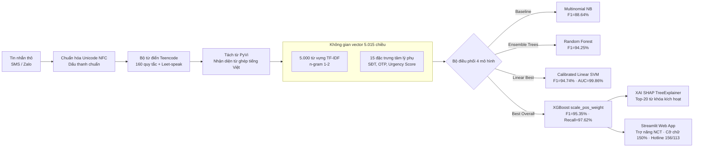

# KỊCH BẢN THUYẾT TRÌNH BÁO CÁO ĐỒ ÁN CS114 (TÀI LIỆU THAM KHẢO & PHÂN VAI TOÀN ĐỘI)

## Đề tài: Nghiên cứu và Xây dựng Hệ thống Phát hiện Tin nhắn & Kịch bản Thao túng Tâm lý Lừa đảo nhắm vào Người cao tuổi tại Việt Nam
### *Vietnamese Elderly Scam Message & Psychological Manipulation Detection*

- **Môn học:** CS114 — Máy học (Machine Learning) | **Mã lớp:** CS114.F31.CN2.TTNT (Đại học từ xa)
- **Hình thức báo cáo:** Thuyết trình trực tuyến qua **Microsoft Teams** (Chia sẻ màn hình Slide PDF & Live Demo)
- **Giảng viên hướng dẫn & Chấm phản biện:** ThS. Cáp Phạm Đình Thăng
- **Nhóm sinh viên thực hiện:** Nhóm 10 (3 thành viên)
  - **Đặng Chí Thanh** — MSSV: `25730067` (Trưởng nhóm / PM, Pipeline & Feature Engineering Lead)
  - **Bùi Thị Mỷ Cẩm** — MSSV: `25730013` (Machine Learning Modeling & XAI Lead)
  - **Hoàng Cao Sơn** — MSSV: `25730061` (Data Collection, Ensemble Trees & Demo UI Lead)
- **Thời gian báo cáo:** 18:30 ngày 23/09/2026
- **Thời lượng quy định:** Đúng **15 phút** (900 giây) luân phiên 3 thành viên + Phiên hỏi đáp phản biện (Q&A cuối buổi)

---

## 🧭 TỔNG QUAN PHÂN VAI & CẤU TRÚC BÁO CÁO (BLUEPRINT)

### 1. Phân vai & Định vị nội dung từng thành viên

- **Đặng Chí Thanh (Slide 1–8: Bối cảnh, Dữ liệu & Tiền xử lý):**
  - *Tốc độ & Nhịp điệu:* Dứt khoát, logic, đi thẳng vào bản chất (**~180 WPM**).
  - *Định vị nội dung:* Đặt vấn đề nghiên cứu, bối cảnh lừa đảo người cao tuổi tại Việt Nam, 3 thách thức kỹ thuật cốt lõi (Class Imbalance, Cost Asymmetry, Zero Synthetic Text), 4 nhóm bẫy tâm lý, quy trình tiền xử lý NLP 5 bước và kỷ luật Zero-Leakage Protocol.
- **Bùi Thị Mỷ Cẩm (Slide 9–12: Mô hình học máy & XAI):**
  - *Tốc độ & Nhịp điệu:* Rõ ràng, điềm tĩnh, chuẩn mực học thuật (**~135 WPM**).
  - *Định vị nội dung:* Đối chuẩn hiệu năng 4 mô hình Machine Learning, phân tích các đánh đổi kỹ thuật (Trade-offs giữa Recall và Precision), giải thích mô hình qua SHAP TreeExplainer và bảo chứng tính khách quan qua thí nghiệm bóc tách Ablation Study.
- **Hoàng Cao Sơn (Slide 13–18: Demo ứng dụng & Tổng kết):**
  - *Tốc độ & Nhịp điệu:* Điềm đạm, vững chãi, nhịp điệu thực nghiệm (**~150 WPM**).
  - *Định vị nội dung:* Trình bày ứng dụng Web Demo Streamlit tối ưu trợ năng cho người cao tuổi (WCAG 2.1), tổng kết đối chiếu 4 mục tiêu nghiên cứu, nhìn nhận khách quan các giới hạn thực nghiệm và định hướng mở rộng.

---

### 2. Bảng thuật ngữ chuyên ngành song ngữ (Terminology Glossary)

| Thuật ngữ Tiếng Anh | Thuật ngữ Tiếng Việt | Định nghĩa & Ngữ cảnh áp dụng trong đồ án |
| :--- | :--- | :--- |
| **Zero Synthetic Text** | Dữ liệu thực tế, không sinh nhân tạo | 100% mẫu tin nhắn có nguồn gốc đời thực, không dùng mô hình ngôn ngữ lớn (LLM) để sinh văn bản giả lập. |
| **Class Imbalance** | Mất cân bằng lớp dữ liệu | Tỷ lệ 4.2 : 1 giữa tin bình thường (1.773 mẫu) và tin lừa đảo (420 mẫu). |
| **Zero-Leakage Protocol** | Giao thức chống rò rỉ dữ liệu | Phân chia Stratified Split 80/20 độc lập; TF-IDF và Scaler chỉ thực hiện `fit` trên tập huấn luyện (Train). |
| **Masking Tags** | Thẻ ẩn danh hóa dữ liệu | Các token `[MONEY]`, `[NUMBER]`, `[URL]` có sẵn từ nguồn thu thập dữ liệu gốc. |
| **Ablation Study** | Nghiên cứu bóc tách thành phần | Thí nghiệm loại bỏ 453 đặc trưng chứa thẻ ẩn danh nhằm kiểm chứng mô hình không học vẹt định dạng. |
| **TreeExplainer (SHAP)** | Trình giải thích cấu trúc cây | Thuật toán tính toán giá trị Shapley trong thời gian đa thức cho mô hình cây quyết định (XGBoost). |
| **Platt Scaling** | Hiệu chỉnh xác suất Platt | Phương pháp sử dụng hàm Sigmoid để chuyển đổi khoảng cách phân cách của Linear SVM thành xác suất [0, 1]. |
| **Touch Target** | Vùng chạm tương tác | Quy chuẩn trợ năng W3C WCAG 2.1 quy định kích thước nút bấm tối thiểu 48px cho người cao tuổi. |
| **False Negative (FN)** | Bỏ sót tin lừa đảo | Sai lầm nghiêm trọng nhất trong bài toán: khiến nạn nhân bị lừa mất tài sản tích lũy. |
| **False Positive (FP)** | Cảnh báo nhầm | Tin bình thường bị cảnh báo: chấp nhận được ở mức độ vừa phải để ưu tiên an toàn. |

---

### 3. Sơ đồ kiến trúc toàn hệ thống (System Architecture Flowchart)

---

### 4. Bảng phân bổ thời gian bài báo cáo (Tổng thời lượng: 15 phút / 900 giây)

| STT | Slide | Người nói | Nội dung trọng tâm | Số từ | WPM | Thời lượng | Phân đoạn | Ghi chú |
| :---: | :--- | :---: | :--- | :---: | :---: | :---: | :---: | :---: |
| **01** | Slide 1: Bìa | **Thanh** | Mở đầu, giới thiệu đề tài và 3 thành viên Nhóm 10 | ~75 | 180 | **25s** | Phần 1 | Gọn gàng, trang trọng |
| **02** | Slide 2: Agenda | **Thanh** | Lộ trình 5 phần chính của buổi báo cáo | ~50 | 180 | **15s** | Phần 1 | Tinh gọn, trực diện |
| **03** | Slide 3: Bối cảnh | **Thanh** | Bối cảnh lừa đảo NCT và 3 thách thức kỹ thuật cốt lõi | ~140 | 180 | **45s** | Phần 1 | Đi thẳng vào bản chất kỹ thuật |
| **04** | Slide 4: Mục tiêu | **Thanh** | 4 mục tiêu cụ thể: 4 mô hình, ngưỡng F1/Recall, XAI, Web Demo | ~130 | 180 | **40s** | Phần 1 | Mục tiêu đo lường được |
| **05** | Slide 5: Divider P2 | — | *Slide chuyển đoạn Phần 2: Dữ liệu & Phương pháp (chuyển nhanh)* | ~15 | 180 | **5s** | Phần 2 | Chuyển tiếp mượt mà |
| **06** | Slide 6: Dataset | **Thanh** | 2.193 mẫu thực tế, kiểm toán 7 tầng, scale_pos_weight = 4.22 | ~150 | 180 | **50s** | Phần 2 | Zero Synthetic Text & Loss weighting |
| **07** | Slide 7: 4 Nhóm bẫy | **Thanh** | Giả mạo công quyền (37.9%), Đe dọa (30.2%), Gia đình, Quà tặng | ~140 | 180 | **45s** | Phần 2 | Insight hành vi đắt giá |
| **08** | Slide 8: Pipeline | **Thanh** | Pipeline 5 bước, vector 5.015 chiều & kỷ luật Zero-Leakage 100% | ~160 | 180 | **55s** | Phần 2 | Tính toàn vẹn kiến trúc |
| 🏁 | **Khối 1 & 2 (Thanh)** | **Thanh** | **Tổng thời gian trình bày của Đặng Chí Thanh** | **~860** | **180** | **4m40s** | — | Dứt khoát, đúng trọng tâm |
| **09** | Slide 9: Divider P3 | — | *Slide chuyển đoạn Phần 3: Mô hình & Kết quả (chuyển nhanh)* | 0 | — | **0s** | Phần 3 | Chuyển slide |
| **10** | Slide 10: Đối chuẩn | **Cẩm** | Bảng so sánh 4 mô hình: XGBoost F1 95.35% (FN=2), SVM, RF, NB | ~190 | 135 | **85s** | Phần 3 | Trọng tâm mô hình & đánh đổi kỹ thuật |
| **11** | Slide 11: ROC/PR | **Cẩm** | ROC-AUC 99.11%–99.86%; Phân tích đường Precision-Recall trên dữ liệu lệch | ~145 | 135 | **65s** | Phần 3 | Đánh giá trực quan |
| **12** | Slide 12: SHAP & XAI | **Cẩm** | SHAP TreeExplainer, Top-20 từ khóa, kiểm chứng Ablation Study | ~250 | 135 | **110s** | Phần 3 | Trọng tâm minh bạch mô hình |
| 🏁 | **Khối 3 (Cẩm)** | **Cẩm** | **Tổng thời gian trình bày của Bùi Thị Mỷ Cẩm** | **~585** | **135** | **4m20s** | — | Đúng khung kế hoạch |
| **13** | Slide 13: Divider P4 | — | *Slide chuyển đoạn Phần 4: Demo ứng dụng (chuyển nhanh)* | 0 | — | **0s** | Phần 4 | Chuyển slide |
| **14** | Slide 14: Demo UI | **Sơn** | Giao diện Streamlit, font 150%, Hotline 156/113, Dán tin 1 chạm, 16 tests | ~300 | 150 | **120s** | Phần 4 | Trực quan hóa sản phẩm thực tế |
| **15** | Slide 15: Divider P5 | — | *Slide chuyển đoạn Phần 5: Kết luận (chuyển nhanh)* | 0 | — | **0s** | Phần 5 | Chuyển slide |
| **16** | Slide 16: Kết luận | **Sơn** | Hoàn thành 100% mục tiêu; nhìn nhận khách quan hạn chế test 84 ca | ~150 | 150 | **60s** | Phần 5 | Đánh giá trung thực, khoa học |
| **17** | Slide 17: Tham khảo | **Sơn** | 15 tài liệu kiểm chứng xếp theo chu trình vòng đời dự án | ~100 | 150 | **40s** | Phần 5 | Cơ sở học thuật vững chắc |
| **18** | Slide 18: Cảm ơn | **Sơn** | Cảm ơn ThS. Cáp Phạm Đình Thăng và lớp, mở phiên hỏi đáp Q&A | ~90 | 150 | **35s** | Phần 5 | Chuyển sang phần thảo luận |
| 🏁 | **Khối 4 & 5 (Sơn)** | **Sơn** | **Tổng thời gian trình bày của Hoàng Cao Sơn** | **~640** | **150** | **4m15s** | — | Đúng khung kế hoạch |
| ⏱️ | **Dự phòng (Buffer)** | **Cả nhóm** | Khoảng đệm điều phối âm thanh, chuyển lượt nói trên MS Teams | — | — | **1m45s** | — | Đảm bảo an toàn thời lượng |
| 🏆 | **TOÀN BỘ BÀI BÁO CÁO** | **3 bạn** | **18 slide trình bày nội dung chính + 4 slide Phụ lục dự bị** | **~2.085** | — | **15m00s** | — | Hoàn thành trong 15 phút |

---

# LỜI THOẠI CHI TIẾT THEO TỪNG SLIDE (REFERENCE TRANSCRIPT)

---

## SLIDE 1 – TRANG TIÊU ĐỀ & GIỚI THIỆU THÀNH VIÊN
> **Người trình bày: Đặng Chí Thanh | Thời lượng dự kiến: ~25s (~75 từ)**

Em kính chào Thầy Cáp Phạm Đình Thăng và các bạn!

Em là **Chí Thanh**, đại diện **Nhóm 10**. Hôm nay, nhóm em xin báo cáo đồ án môn học Máy học với đề tài: **"Nghiên cứu và Xây dựng Hệ thống Phát hiện Tin nhắn & Kịch bản Thao túng Tâm lý Lừa đảo nhắm vào Người cao tuổi tại Việt Nam"**.

Nhóm em gồm 3 thành viên:
- Em — **Đặng Chí Thanh**, phụ trách kiến trúc dữ liệu, tiền xử lý NLP và kỹ thuật đặc trưng.
- Bạn **Bùi Thị Mỷ Cẩm** — phụ trách mô hình học máy và giải thích AI với SHAP.
- Và bạn **Hoàng Cao Sơn** — phụ trách thu thập dữ liệu, mô hình Random Forest và ứng dụng Web Demo.

Sau đây, em xin phép bắt đầu buổi báo cáo.

---

## SLIDE 2 – LỘ TRÌNH BÁO CÁO (AGENDA)
> **Người trình bày: Đặng Chí Thanh | Thời lượng dự kiến: ~15s (~50 từ)**

Bài báo cáo của nhóm sẽ đi qua **5 phần chính**:
- **Phần 1**: Bối cảnh thực tế, 3 thách thức kỹ thuật và mục tiêu nghiên cứu.
- **Phần 2**: Bộ dữ liệu 2.193 mẫu thực tế, 4 nhóm bẫy tâm lý và pipeline tiền xử lý Zero-Leakage.
- **Phần 3**: Bạn Mỷ Cẩm sẽ đối chuẩn 4 mô hình học máy và bóc tách SHAP.
- **Phần 4 & 5**: Bạn Cao Sơn sẽ trực tiếp Demo Web Streamlit và tổng kết đồ án.

---

## SLIDE 3 – BỐI CẢNH & 3 THÁCH THỨC KỸ THUẬT CỐT LÕI
> **Người trình bày: Đặng Chí Thanh | Thời lượng dự kiến: ~45s (~140 từ)**

Thực tế tại Việt Nam hiện nay, người cao tuổi là nhóm đối tượng chịu rủi ro lừa đảo lớn nhất. Kẻ gian nhiều khi chẳng cần dùng đến mã độc công nghệ cao, mà chúng đánh thẳng vào **tâm lý lo sợ pháp luật hoặc tình cảm gia đình** qua tin nhắn SMS và Zalo.

Khi giải quyết bài toán này, nhóm em đối mặt với **3 thách thức kỹ thuật lớn nhất**:
- **Một là Class Imbalance (Mất cân bằng lớp):** Tỉ lệ lệch hơn 4 chọi 1. Nếu một mô hình ngây thơ cứ đoán bừa 100% là tin thường thì Accuracy đã hơn 80%, nhưng sẽ bỏ lọt toàn bộ kẻ gian. Vì vậy, nhóm bắt buộc phải lấy **Recall và F1-Score** làm kim chỉ nam.
- **Hai là Cost Asymmetry (Tổn thất bất đối xứng):** Bỏ sót 1 tin lừa đảo thì nạn nhân mất sạch tiền tích lũy cả đời. Trong khi cảnh báo nhầm thì chỉ cần kiểm tra lại. Do đó, chi phí phạt cho việc bỏ sót (False Negative) phải đặt lên hàng đầu.
- **Ba là tính chân thực (Zero Synthetic Text):** Nhóm kiên quyết dùng 100% tin nhắn đời thực, tuyệt đối không dùng ChatGPT để tự sinh văn bản giả, nhằm nắm bắt chính xác thủ đoạn thực tế của tội phạm.

---

## SLIDE 4 – MỤC TIÊU NGHIÊN CỨU & ĐÓNG GÓP CỐT LÕI
> **Người trình bày: Đặng Chí Thanh | Thời lượng dự kiến: ~40s (~130 từ)**

Từ 3 thách thức trên, nhóm đặt ra và giải quyết trọn vẹn **4 mục tiêu kỹ thuật cụ thể**, thể hiện ở 4 ô trên màn hình:

- **Thứ nhất — Đối chuẩn đa mô hình:** Đưa 4 thuật toán Machine Learning kinh điển lên cùng một bàn cân thực nghiệm trên 439 mẫu test độc lập: Naive Bayes, Random Forest, Linear SVM và XGBoost.
- **Thứ hai — Vượt chỉ tiêu hiệu năng:** Đặt ngưỡng cam kết F1 ≥ 88% và Recall ≥ 92%. Kết quả thực nghiệm cả 4 mô hình đều vượt xa chỉ tiêu, mô hình tối ưu đạt Recall tới 97.62%.
- **Thứ ba — Xóa bỏ "hộp đen" với XAI:** Tích hợp SHAP TreeExplainer và trích xuất Top-20 từ khóa đồng thuận để giải thích minh bạch vì sao một tin nhắn bị cảnh báo.
- **Thứ tư — Đưa vào thực tiễn:** Xây dựng ứng dụng Web Streamlit tối ưu riêng cho người cao tuổi, với chữ phóng to 150% và nút gọi khẩn cấp 156/113 chỉ với 1 chạm.

---

## SLIDE 5 – PHẦN 2: DỮ LIỆU & PHƯƠNG PHÁP
> **Slide phân đoạn nội dung (lướt nhanh 3s)**

Sau khi làm rõ bối cảnh và mục tiêu, chúng ta đến với **Phần 02 — Dữ liệu thực nghiệm và Quy trình tiền xử lý**.

---

## SLIDE 6 – BỘ DỮ LIỆU 2.193 MẪU & KIỂM TOÁN 7 TẦNG
> **Người trình bày: Đặng Chí Thanh | Thời lượng dự kiến: ~50s (~150 từ)**

Để thực nghiệm khách quan, nhóm em xây dựng bộ dữ liệu gồm **2.193 tin nhắn tiếng Việt thực tế 100%**:
- **1.773 tin bình thường:** Tuyển chọn từ bộ dữ liệu SMS chất lượng cao của tác giả Trần Nguyên Thái Tuấn theo giấy phép mở CC BY 4.0.
- **420 tin lừa đảo:** Thu thập từ các kho dữ liệu an toàn thông tin cộng đồng và phóng sự điều tra của VTV24, mỗi mẫu đều lưu trữ URL nguồn gốc để kiểm chứng độc lập.
- Toàn bộ dữ liệu trải qua **quy trình kiểm toán 7 tầng**, dùng Regex che sạch số điện thoại, tài khoản ngân hàng, CCCD và địa chỉ để bảo vệ quyền riêng tư.

Ở biểu đồ bên phải, tỷ lệ lệch lớp là **4.2 : 1** (lừa đảo chiếm ~19.2%).

Đặc biệt, về phương pháp: **Nhóm quyết định dứt khoát không dùng SMOTE để sinh dữ liệu nhân tạo**. Trong NLP tiếng Việt, nội suy toán học giữa các vector từ rất dễ tạo ra các câu văn lai tạp vô nghĩa. Thay vào đó, nhóm bù trừ trực tiếp vào hàm mất mát của XGBoost bằng trọng số phạt `scale_pos_weight = 4.22`.

Dữ liệu được chia phân tầng 80/20: **1.754 mẫu Train** và **439 mẫu Test** hoàn toàn độc lập.

---

## SLIDE 7 – CƠ CẤU 4 NHÓM BẪY THAO TÚNG TÂM LÝ
> **Người trình bày: Đặng Chí Thanh | Thời lượng dự kiến: ~45s (~140 từ)**

Khi phân tích sâu 420 mẫu lừa đảo trên notebook EDA, em đúc kết được **4 kịch bản thao túng tâm lý điển hình**:

- **Phổ biến nhất là Giả mạo dịch vụ công (159 mẫu, chiếm 37.9%):** Giả danh cán bộ Thuế, Bảo hiểm xã hội hoặc Công an phường, yêu cầu cập nhật định danh VNeID mức 2 hoặc dọa khóa tài khoản.
- **Thứ hai là Đe dọa quyền lực (127 mẫu, chiếm 30.2%):** Mạo danh Viện kiểm sát, Tòa án thông báo nạn nhân dính vào đường dây rửa tiền, ép chuyển tiền "tạm giữ" để phục vụ điều tra.
- **Thứ ba là Khẩn cấp gia đình (88 mẫu, chiếm 21.0%):** Báo tin con cháu bị tai nạn đang cấp cứu tại bệnh viện, thúc ép chuyển viện phí ngay.
- **Cuối cùng là Dụ dỗ quà tặng sức khỏe (46 mẫu, chiếm 11.0%):** Mời nhận sữa non, thuốc bổ miễn phí để lừa nạp tiền phí vận chuyển hoặc tiền trúng thưởng.

Insight đắt giá nhất ở đây: **Hai nhóm đầu chiếm tới hơn 68%**, chứng minh kẻ lừa đảo đánh mạnh nhất vào tâm lý sợ vi phạm pháp luật và trách nhiệm công dân của người cao tuổi.

---

## SLIDE 8 – PIPELINE TIỀN XỬ LÝ & KỸ THUẬT ĐẶC TRƯNG
> **Người trình bày: Đặng Chí Thanh | Thời lượng dự kiến: ~55s (~160 từ)**

Để đưa văn bản thô vào mô hình, em xây dựng **Pipeline 5 bước khép kín** ở sơ đồ bên dưới:
1. **Chuẩn hóa Unicode NFC:** Xử lý triệt để xung đột bảng mã Telex và VNI.
2. **Bộ 160 quy tắc Teencode & 22 mẫu Leet-speak:** Tinh chỉnh các từ viết tắt phổ biến về dạng chuẩn mà không làm biến dạng ngữ nghĩa.
3. **Tách từ PyVi:** Ghép các âm tiết đơn thành từ ghép tiếng Việt có nghĩa, ví dụ: `viện_phí`, `số_tiền`.
4. **TF-IDF 5.000 n-grams (1-2 từ):** Nắm bắt các từ vựng đặc trưng có tần suất phân biệt cao.
5. **15 đặc trưng tâm lý chuyên sâu:** Bắt các tín hiệu như cờ khẩn cấp (`has_urgent_words`), sự xuất hiện của số điện thoại, URL, từ khóa tiền tệ và mã OTP.

Kết quả tạo ra không gian vector kết hợp **5.015 chiều**.

Và nguyên tắc kỹ thuật cốt lõi: **Nhóm tuân thủ nghiêm ngặt quy chuẩn Zero-Leakage 100%**. Toàn bộ từ điển TF-IDF và bộ scaler **chỉ được `fit` trên 1.754 mẫu Train**, sau đó chỉ dùng `transform` mù sang tập Test. Tập Test được giữ nguyên vẹn để phản ánh khách quan năng lực tổng quát hóa.

Sau đây, em xin chuyển phần trình bày cho bạn **Bùi Thị Mỷ Cẩm** tiếp tục với kết quả thực nghiệm 4 mô hình học máy ở Phần 3 ạ. Xin mời Cẩm!

---

## SLIDE 9 – PHẦN 3: MÔ HÌNH HỌC MÁY & KẾT QUẢ THỰC NGHIỆM
> **Slide phân đoạn nội dung (chuyển tiếp nhanh)**

---

## SLIDE 10 – BẢNG ĐỐI CHUẨN HIỆU NĂNG 4 MÔ HÌNH
> **Người trình bày: Bùi Thị Mỷ Cẩm | Thời lượng dự kiến: ~85s (~190 từ)**

Dạ em cảm ơn anh Thanh. Em kính chào Thầy và các bạn, em là **Mỷ Cẩm**. Em xin phép đại diện nhóm trình bày kết quả thực nghiệm của 4 mô hình Machine Learning.

Quan sát bảng đối chuẩn ở Slide 10, toàn bộ kết quả đều được đo đạc trực tiếp trên cùng một tập Test độc lập gồm **439 mẫu** (355 tin bình thường và 84 tin lừa đảo):

- **Mô hình tối ưu toàn diện là XGBoost:** Đạt chỉ số **F1-Score 95.35%** và **Recall 97.62%**, độ chính xác tổng thể đạt 98.18%. Trên tập kiểm thử 84 tin nhắn lừa đảo phức tạp, XGBoost **chỉ bỏ sót 2 ca** (`FN = 2`), phát hiện chính xác 82 ca, và chỉ báo nhầm 6 ca tin bình thường.
- **Mô hình tuyến tính tốt nhất là Linear SVM:** Sử dụng kỹ thuật hiệu chỉnh Platt scaling qua 5-fold cross-validation, đạt **F1 94.74%**, Recall 96.43% (bỏ sót 3 ca), và có diện tích **ROC-AUC cao nhất đạt 99.86%**.
- **Mô hình Random Forest:** Đạt Recall **97.62%** (bỏ sót 2 ca), F1 đạt 94.25% và ROC-AUC đạt 99.77%.
- **Và Naive Bayes:** Đóng vai trò là đường cơ sở (Baseline) với `alpha = 0.01`, đạt F1 88.64% và Recall 92.86%.

Cả 4 mô hình đều vượt mục tiêu đề ra. Đáng chú ý, mặc dù **Linear SVM đạt ROC-AUC cao nhất (99.86%)**, nhưng khi lựa chọn mô hình triển khai thực tế, nhóm **quyết định chọn XGBoost** dựa trên tiêu chí tối ưu hóa số ca bỏ sót thực tế và tính tương thích với công cụ giải thích SHAP.

---

## SLIDE 11 – PHÂN TÍCH ĐƯỜNG CONG ROC & PRECISION-RECALL
> **Người trình bày: Bùi Thị Mỷ Cẩm | Thời lượng dự kiến: ~65s (~145 từ)**

Nhìn vào hai biểu đồ thực nghiệm trên slide:
- Ở hình (a) bên trái là **ROC Curves**: Cả 4 đường cong đều tiến sát góc trên cùng bên trái với diện tích dưới đường cong lớn, dao động từ **99.11% đến 99.86%**. Điều này khẳng định không gian 5.015 chiều có năng lực phân tách ranh giới giữa hai nhóm tin nhắn rất hiệu quả.
- Tuy nhiên, như anh Thanh đã phân tích, do dữ liệu thực tế mất cân bằng theo tỷ lệ 4.2 : 1, thước đo đánh giá thực chất hơn chính là biểu đồ (b) bên phải — **Precision-Recall Curves**.

Đường PR của XGBoost và SVM duy trì được Precision trên **90%** ngay cả khi đẩy độ phủ Recall lên mức **97.6%**. Sự đánh đổi giữa việc tăng độ bao phủ và tỷ lệ báo động giả diễn ra rất ổn định, đảm bảo hệ thống có tính khả dụng cao khi triển khai ngoài đời thực.

Tiếp theo, em xin giải thích cơ chế ra quyết định của mô hình thông qua phân tích SHAP.

---

## SLIDE 12 – GIẢI THÍCH MÔ HÌNH — SHAP ANALYSIS & ABLATION STUDY
> **Người trình bày: Bùi Thị Mỷ Cẩm | Thời lượng dự kiến: ~110s (~250 từ)**

Để trả lời câu hỏi cốt lõi: *"Mô hình dựa vào căn cứ nào để đưa ra phán quyết, và liệu các quyết định này có thực sự hợp lý về mặt ngữ nghĩa hay không?"*.

Nhóm áp dụng thuật toán **SHAP TreeExplainer** trên mô hình XGBoost, kết quả thể hiện qua biểu đồ Beeswarm bên phải slide:
- Trục hoành biểu thị độ lệch đóng góp SHAP: dịch sang phải làm tăng xác suất lừa đảo, dịch sang trái làm tăng xác suất bình thường.
- Phân tích Top-20 đặc trưng có trọng số đồng thuận cao nhất:
  - Các từ khóa đẩy mạnh quyết định về phía lừa đảo gồm: `mày`, `gấp`, `viện_phí`, `thuế`, `số_định_danh`. Đây đều là các từ ngữ mang tính thúc ép, đe dọa hoặc tạo bối cảnh tâm lý nguy cấp.
  - Ngược lại, các từ như `money`, `number`, `time`, `liên_hệ 198`, `soạn`, `viettel` lại có giá trị SHAP âm, phản ánh các mẫu tin nhắn chăm sóc khách hàng viễn thông thông thường.

Tại đây, từ `money` và `number` thực chất là các **thẻ ẩn danh (masking tags)** có sẵn trong tập dữ liệu gốc. Nhằm kiểm chứng mô hình **không học vẹt dựa trên sự xuất hiện của các thẻ này**, nhóm đã tiến hành một nghiên cứu bóc tách (**Ablation Study**) độc lập: loại bỏ toàn bộ **453 đặc trưng** chứa các thẻ ẩn danh rồi huấn luyện lại mô hình trong cùng điều kiện.

Kết quả thực nghiệm cho thấy F1 của XGBoost chỉ giảm nhẹ từ **95.35% xuống 94.25%**, và chỉ số quan trọng nhất là Recall **vẫn giữ nguyên 97.62%**. Điều này khẳng định mô hình thực sự phân loại dựa trên ngữ nghĩa của các bẫy tâm lý chứ không phụ thuộc vào định dạng thẻ.

Tiếp theo, em xin trân trọng kính mời bạn **Hoàng Cao Sơn** trình bày phần Demo và Kết luận của đồ án.

---

## SLIDE 13 – PHẦN 4: HỆ THỐNG DEMO & THỬ NGHIỆM THỰC TẾ
> **Slide phân đoạn nội dung (chuyển tiếp nhanh)**

---

## SLIDE 14 – DEMO: GIAO DIỆN STREAMLIT TỐI ƯU CHO NGƯỜI CAO TUỔI
> **Người trình bày: Hoàng Cao Sơn | Thời lượng dự kiến: ~120s (~300 từ)**

Chào Thầy và các bạn, mình là **Cao Sơn**. Sau khi Cẩm đã hoàn tất việc tối ưu và kiểm chứng mô hình, mình phụ trách việc đưa mô hình vào ứng dụng thực tế thông qua giao diện **Web Demo Streamlit**, được thiết kế chuyên biệt theo tiêu chuẩn trợ năng cho người cao tuổi.

Một số điểm nổi bật về mặt thiết kế giao diện:
- **Trợ năng thị giác:** Nhận diện người cao tuổi thường gặp khó khăn về thị lực, giao diện tích hợp thanh điều chỉnh kích thước chữ linh hoạt từ **100%, 125% đến 150%**. Tỷ lệ tương phản chữ đạt **14.6 : 1**, vượt tiêu chuẩn W3C WCAG 2.1 cấp độ AA (yêu cầu tối thiểu 4.5 : 1).
- **Thao tác đơn giản:** Giảm thiểu thao tác nhập liệu bằng nút **"Dán tin nhắn"** thông qua Clipboard API. Người dùng chỉ cần sao chép tin nhắn nghi vấn và bấm nút, hệ thống sẽ tự động trích xuất 5.015 chiều và đưa ra kết quả trong khoảng **15 mili-giây**.
- **Tích hợp linh hoạt 4 mô hình:** Ứng dụng cho phép tùy chọn kiểm tra trên cả 4 thuật toán, mặc định sử dụng XGBoost là mô hình có độ tin cậy cao nhất.
- **Trực quan hóa bẫy tâm lý:** Khi phát hiện rủi ro, hệ thống hiển thị mức độ nguy cơ, phân loại rõ thuộc nhóm bẫy tâm lý nào (ví dụ: *Đe dọa quyền lực - Giả danh Công an*), đồng thời làm nổi bật các từ khóa kích động như `lệnh bắt giam`, `chuyển tiền gấp`.
- **Khung khuyến cáo an toàn "3 KHÔNG & 1 GỌI":** Cung cấp chỉ dẫn phòng ngừa ngắn gọn: Không lo sợ, Không làm theo, Không chuyển tiền. Đồng thời tích hợp hai nút liên hệ khẩn cấp: **Tổng đài 156** (Cục An toàn thông tin) và **Đầu số 113**.
- **Độ tin cậy phần mềm:** Toàn bộ quy trình trải nghiệm người dùng đã được kiểm thử tự động thông qua bộ test Playwright E2E với **16/16 ca kiểm thử đạt kết quả PASS**.

Sau đây mình xin chuyển sang Phần 5: Kết luận và Hướng phát triển của đồ án.

---

## SLIDE 15 – PHẦN 5: KẾT LUẬN & HƯỚNG PHÁT TRIỂN
> **Slide phân đoạn nội dung (chuyển tiếp nhanh)**

---

## SLIDE 16 – KẾT LUẬN & HƯỚNG MỞ RỘNG
> **Người trình bày: Hoàng Cao Sơn | Thời lượng dự kiến: ~60s (~150 từ)**

Tóm lại, đồ án của Nhóm 10 đã hoàn thành 4 cam kết đề ra:
- Xây dựng thành công bộ dữ liệu chuẩn gồm **2.193 tin nhắn thực tế** với 4 nhóm kịch bản thao túng tâm lý.
- Pipeline tiền xử lý ngôn ngữ tiếng Việt tuân thủ **nguyên tắc Zero-Leakage Protocol**.
- Mô hình XGBoost đạt hiệu năng cao với **F1-Score 95.35%** và **Recall 97.62%**, có khả năng giải thích minh bạch với SHAP.
- Sản phẩm Web Demo hoàn chỉnh, đáp ứng tốt tiêu chuẩn trợ năng cho người lớn tuổi.

Về mặt giới hạn thực nghiệm, nhóm thẳng thắn nhìn nhận: **tập kiểm thử Test hiện có 84 mẫu lừa đảo** do tính chất khan hiếm của dữ liệu thực tế, do đó mỗi ca bỏ sót FN sẽ tác động khoảng 1.19% đến chỉ số Recall. Nhóm đã sử dụng kiểm định chéo 5-fold CV trên tập huấn luyện để đối chiếu và bảo đảm tính hội tụ ổn định.

Về định hướng tương lai, nhóm xác định 3 hướng phát triển:
1. Thử nghiệm tinh chỉnh các mô hình ngôn ngữ sâu như **PhoBERT** khi có điều kiện về hạ tầng tính toán.
2. Mở rộng bài toán sang **phát hiện lừa đảo qua giọng nói (Voice Scam / Deepfake Audio)** — một hình thức đang gia tăng nhanh chóng.
3. Chuẩn hóa API để có thể tích hợp vào các ứng dụng ngân hàng số hoặc ứng dụng bảo vệ người dùng trên thiết bị di động.

---

## SLIDE 17 – TÀI LIỆU THAM KHẢO THEO VÒNG ĐỜI DỰ ÁN
> **Người trình bày: Hoàng Cao Sơn | Thời lượng dự kiến: ~40s (~100 từ)**

Tại Slide 17, nhóm tổng hợp **15 tài liệu tham khảo tiêu biểu** trong tổng số các công trình được nhóm nghiên cứu, toàn bộ đều có mã định danh DOI hoặc nguồn xuất bản khoa học rõ ràng.

Các tài liệu được cấu trúc tương ứng theo **vòng đời phát triển của đề tài**:
- Nguồn dữ liệu SMS tiếng Việt của tác giả Trần Nguyên Thái Tuấn và các báo cáo an toàn thông tin.
- Các công trình nền tảng về xử lý ngôn ngữ tự nhiên tiếng Việt: Unicode, PyVi, Underthesea và biểu diễn TF-IDF.
- Các công trình học máy kinh điển: XGBoost của Chen & Guestrin, Random Forest của Breiman, Support Vector Machines của Vapnik và hiệu chỉnh xác suất Platt scaling.
- Lý thuyết giải thích mô hình SHAP của Lundberg, tiêu chuẩn trợ năng W3C WCAG 2.1 và mô hình ngôn ngữ PhoBERT.

---

## SLIDE 18 – LỜI CẢM ƠN & MỞ PHIÊN HỎI ĐÁP (Q&A)
> **Người trình bày: Hoàng Cao Sơn | Thời lượng dự kiến: ~35s (~90 từ)**

Kính thưa Thầy và các bạn, toàn bộ mã nguồn chương trình, bộ dữ liệu thực nghiệm đã kiểm toán, báo cáo chuyên đề và tài liệu thuyết trình đã được nhóm đồng bộ trên GitHub repository chính thức của đồ án.

Thay mặt cho cả 3 thành viên Nhóm 10 — Đặng Chí Thanh, Bùi Thị Mỷ Cẩm và Hoàng Cao Sơn, em xin gửi lời cảm ơn chân thành đến **Thầy ThS. Cáp Phạm Đình Thăng** đã tận tình hướng dẫn và đóng góp những định hướng chuyên môn quý báu cho nhóm em trong suốt học kỳ vừa qua.

Sau đây, nhóm chúng em xin trân trọng kính mời Thầy đưa ra những nhận xét, câu hỏi để nhóm có cơ hội làm rõ và bảo vệ đồ án ạ!

Em xin trân trọng cảm ơn Thầy!

---

## SLIDE 19 – PHỤ LỤC & TÀI LIỆU BỔ TRỢ (BACKUP SLIDES)
> **Slide dự bị phục vụ phiên hỏi đáp:**
- **Slide 20:** Bảng chi tiết Siêu tham số & Quá trình tinh chỉnh (XGBoost `scale_pos_weight=4.22`, SVM `C=10.0`, RF `max_depth=50`, NB `alpha=0.01`).
- **Slide 21:** Lưới ma trận nhầm lẫn 2×2 của cả 4 mô hình thực nghiệm.
- **Slide 22:** Đồ thị đường cong học tập Learning Curves (Train vs Validation qua 5-fold CV).

---

# BỘ CÂU HỎI THẢO LUẬN & PHƯƠNG ÁN GIẢI TRÌNH PHẢN BIỆN (Q&A DEFENSE)

## 1. CÁC CHỦ ĐỀ HỌC THUẬT GỢI MỞ THẢO LUẬN TRỌNG TÂM (KEY DEFENSE TOPICS)

Dưới đây là 4 chủ đề kỹ thuật then chốt được nhóm trình bày có chủ đích trong bài báo cáo, phản ánh các quyết định kiến trúc và đánh đổi phương pháp luận quan trọng nhất:

| Chủ đề trọng tâm | Vị trí trình bày | Câu hỏi dự kiến | Thành viên phụ trách | Luận điểm giải trình cốt lõi |
| :--- | :---: | :--- | :---: | :--- |
| **1. Cân bằng dữ liệu qua hàm mất mát thay vì SMOTE** | Slide 6 (Thanh) | *Tại sao dữ liệu lệch 4.2:1 mà nhóm không dùng SMOTE/ADASYN để cân bằng lớp mà lại dùng scale_pos_weight?* | **Thanh / Sơn** | Bảo vệ nguyên tắc Zero Synthetic Text trong NLP tiếng Việt; phân tích cơ chế toán học của trọng số gradient trong XGBoost. |
| **2. Lựa chọn mô hình triển khai: XGBoost vs Linear SVM** | Slide 10 (Cẩm) | *Tại sao SVM có ROC-AUC cao hơn (99.86%) mà nhóm lại chọn XGBoost đưa vào ứng dụng thực tế?* | **Cẩm** | Phân tích bài toán đánh đổi thiệt hại thực tế (Cost Asymmetry: FN=2 vs FN=3), bản chất hàm xác suất tự nhiên và độ tương thích với SHAP TreeExplainer. |
| **3. Kiểm chứng thẻ ẩn danh qua Ablation Study** | Slide 12 (Cẩm) | *Mô hình có bị học vẹt theo các thẻ ẩn danh như `[MONEY]` không? Thí nghiệm bóc tách chứng minh điều gì?* | **Cẩm** | Trình bày số liệu thực nghiệm từ `ablation_masking_tags.py`: loại bỏ 453 đặc trưng thẻ, Recall vẫn giữ nguyên 97.62%, F1 chỉ biến động 1.1%. |
| **4. Độ tin cậy của tập kiểm thử 84 mẫu lừa đảo** | Slide 16 (Sơn) | *Tập test chỉ có 84 tin lừa đảo thì độ tin cậy thống kê ra sao? Nhóm chứng minh tính ổn định bằng cách nào?* | **Thanh / Sơn** | Thẳng thắn nêu độ nhạy 1 ca = 1.19%; chứng minh tính hội tụ vững chắc giữa 5-fold Train CV (F1 = 0.9603) và Test (F1 = 0.9535). |

---

### Câu hỏi 1: Lựa chọn hàm mất mát có trọng số (`scale_pos_weight`) thay vì kỹ thuật sinh mẫu nhân tạo (SMOTE/ADASYN)

- **Thành viên phụ trách:** **Đặng Chí Thanh / Hoàng Cao Sơn**
- 📌 **Trọng tâm giải trình:** Phân biệt bài toán dữ liệu bảng (Tabular) với NLP tiếng Việt; nêu bật nguyên tắc dữ liệu thực và cơ chế toán học của XGBoost.
- **Nội dung trả lời gợi ý:**  
  > "Dạ thưa Thầy, đây là quyết định mang tính nguyên tắc của nhóm dựa trên 2 căn cứ:  
  > 1. **Bảo vệ tính chân thực của văn bản (Zero Synthetic Text):** Trong NLP tiếng Việt, một câu tin nhắn lừa đảo có cấu trúc ngữ pháp và ngữ cảnh tâm lý rất chặt chẽ. SMOTE nội suy toán học giữa các điểm vector láng giềng k-NN, điều này tạo ra các vector 'lai tạp' không tương ứng với bất kỳ câu văn tiếng Việt có nghĩa nào ngoài đời thực, làm méo mó ranh giới phân lớp.  
  > 2. **Cơ chế hàm mất mát của `scale_pos_weight`:** Thay vì làm giả dữ liệu, XGBoost hỗ trợ tham số `scale_pos_weight = 4.22` (đúng bằng tỷ lệ 1.773 / 420). Tham số này nhân trực tiếp trọng số phạt gradient của lớp lừa đảo lên 4.22 lần khi đoán sai. Cơ chế này ép cây quyết định phải tập trung tối đa bắt trọn lớp lừa đảo mà vẫn bảo toàn 100% tính nguyên bản của văn bản gốc ạ."

---

### Câu hỏi 2: Lựa chọn mô hình triển khai: XGBoost thay vì Linear SVM (mặc dù SVM có ROC-AUC cao hơn)

- **Thành viên phụ trách:** **Bùi Thị Mỷ Cẩm**
- 📌 **Trọng tâm giải trình:** Chuyển từ thước đo xếp hạng tổng quát (ROC-AUC) sang bài toán đánh đổi thiệt hại thực tế (Cost Asymmetry) và yêu cầu kiến trúc phần mềm.
- **Nội dung trả lời gợi ý:**  
  > "Dạ thưa Thầy, ROC-AUC phản ánh khả năng xếp hạng xác suất tổng quát trên toàn dải ngưỡng, nhưng khi triển khai hệ thống thực tế phục vụ người cao tuổi, nhóm lựa chọn **XGBoost** dựa trên 3 lý do:  
  > 1. **Tối thiểu hóa số ca bỏ sót thực tế (False Negatives):** Mục tiêu cốt lõi của đề tài là hạn chế tối đa việc bỏ sót kẻ gian. XGBoost chỉ bỏ sót **2 ca lừa đảo** (Recall 97.62%), trong khi Linear SVM bỏ sót 3 ca (Recall 96.43%). Với người cao tuổi, việc phát hiện thêm một vụ việc có ý nghĩa bảo vệ tài sản thực tế hơn mức chênh lệch nhỏ về chỉ số ROC-AUC.  
  > 2. **Bản chất hàm xác suất:** XGBoost tối ưu trực tiếp hàm log-loss nên xuất ra xác suất rủi ro tự nhiên; trong khi LinearSVC nguyên bản chỉ xuất ra khoảng cách hình học `decision_function`, cần bọc thêm tầng `CalibratedClassifierCV` (Platt scaling) qua 5-fold để thu được xác suất, làm tăng độ phức tạp khi đóng gói vận hành.  
  > 3. **Tương thích giải thích mô hình (XAI):** XGBoost tương thích tự nhiên với thuật toán SHAP TreeExplainer với thời gian tính toán đa thức, cho phép ứng dụng Web Demo bóc tách và giải thích trực quan từng từ khóa cho người dùng trong chưa đầy 15 mili-giây ạ."

---

### Câu hỏi 3: Kiểm chứng hiện tượng học vẹt thẻ ẩn danh qua nghiên cứu bóc tách (Ablation Study)

- **Thành viên phụ trách:** **Bùi Thị Mỷ Cẩm**
- 📌 **Trọng tâm giải trình:** Thẳng thắn nêu đặc điểm dữ liệu và sử dụng bằng chứng định lượng từ thí nghiệm độc lập trong `ablation_masking_tags.py`.
- **Nội dung trả lời gợi ý:**  
  > "Dạ thưa Thầy, đây là điểm mà nhóm đã chủ động phân tích kỹ lưỡng trong quá trình đánh giá mô hình:  
  > - Các token như `money`, `number` thực chất là các thẻ che số tiền và số điện thoại có sẵn trong bộ dữ liệu SMS gốc của tác giả Trần Nguyên Thái Tuấn (1.773 mẫu bình thường), trong khi các nguồn lừa đảo thường dùng các thẻ như `[ĐƯỜNG_DẪN]`, `[SỐ_TIỀN]`.  
  > - Để kiểm chứng liệu mô hình có bị phụ thuộc vào sự khác biệt định dạng này hay không, nhóm đã xây dựng mã nguồn kiểm chứng độc lập trong file `ablation_masking_tags.py`: tiến hành **loại bỏ toàn bộ 453 đặc trưng** có chứa các thẻ ẩn danh này rồi huấn luyện lại toàn bộ mô hình trên cùng quy chuẩn.  
  > - Kết quả thực nghiệm cho thấy: Điểm F1 của XGBoost chỉ biến động nhẹ từ **95.35% xuống 94.25%**, và quan trọng nhất là **Recall vẫn giữ nguyên vẹn ở mức 97.62%** (phát hiện chính xác 82/84 ca lừa đảo). Điều này cung cấp bằng chứng thực nghiệm rõ ràng rằng mô hình phân loại dựa trên ngữ nghĩa của các bẫy tâm lý (`viện_phí`, `gấp`, `thuế`, `số_định_danh`), chứ không học vẹt theo các thẻ ẩn danh ạ."

---

### Câu hỏi 4: Độ tin cậy thống kê của tập kiểm thử 84 mẫu lừa đảo và độ hội tụ Cross-Validation

- **Thành viên phụ trách:** **Đặng Chí Thanh / Hoàng Cao Sơn**
- 📌 **Trọng tâm giải trình:** Phân tích độ nhạy của 1 ca FN (`1/84 ≈ 1.19%`) và đối chiếu độ hội tụ giữa Train Cross-Validation và Test.
- **Nội dung trả lời gợi ý:**  
  > "Dạ thưa Thầy, nhóm hoàn toàn đồng ý và đã chủ động nhìn nhận hạn chế này tại Slide 16:  
  > - Với tập test gồm 84 mẫu lừa đảo, mỗi ca bỏ sót (False Negative) sẽ làm Recall dao động đúng `1 / 84 ≈ 1.19%`.  
  > - Đây là đặc thù thực tế khi thu thập dữ liệu lừa đảo tiếng Việt đời thực có kiểm chứng. Để chứng minh kết quả không phải do may rủi trên tập test, nhóm đã đối chiếu với kết quả kiểm định chéo 5-Fold Cross Validation trên toàn bộ 1.754 mẫu Train.  
  > - Điểm F1 trung bình trên 5 fold đạt **0.9603**, cực kỳ sát với F1 trên tập test độc lập là **0.9535**. Sự hội tụ chặt chẽ này chứng minh mô hình có tính ổn định và khả năng khái quát hóa rất vững chắc ạ."

---

## 2. BỘ CÂU HỎI PHẢN BIỆN KỸ THUẬT MỞ RỘNG (EXTENDED TECHNICAL QUESTIONS)

---

### Câu hỏi 5: Lý do lựa chọn mô hình Machine Learning truyền thống (XGBoost, SVM) kết hợp TF-IDF thay vì Deep Learning / LLM

- **Thành viên phụ trách:** **Bùi Thị Mỷ Cẩm / Đặng Chí Thanh**
- 📌 **Trọng tâm giải trình:** Đánh đổi giữa chi phí tài nguyên, độ trễ suy luận, hiệu năng thực tế và tính minh bạch.
- **Nội dung trả lời gợi ý:**  
  > "Dạ thưa Thầy, nhóm đã cân nhắc kỹ bài toán đánh đổi giữa tài nguyên tính toán và hiệu năng ứng dụng dựa trên 3 căn cứ:  
  > 1. **Độ trễ suy luận (Inference Latency):** Định hướng của đề tài là ứng dụng gọn nhẹ, có thể phục vụ người cao tuổi trên thiết bị cá nhân. XGBoost chỉ mất **khoảng 5 đến 15 mili-giây** cho một lượt dự đoán trên CPU thông thường; trong khi các mô hình như PhoBERT hoặc LLM đòi hỏi hạ tầng GPU và có độ trễ lớn hơn nhiều lần.  
  > 2. **Hiệu năng thực nghiệm đã tiệm cận mức cao:** Không gian 5.015 chiều kết hợp TF-IDF và đặc trưng tâm lý đã giúp XGBoost đạt F1 95.35% và Recall 97.62% (chỉ bỏ sót 2/84 ca), do đó dư địa cải thiện thêm không nhiều so với mức tăng chi phí tính toán.  
  > 3. **Khả năng giải thích minh bạch:** Mô hình dạng cây kết hợp SHAP TreeExplainer cho phép định lượng chính xác mức độ đóng góp của từng từ khóa, giúp hiển thị lý do cảnh báo rõ ràng cho người dùng lớn tuổi, điều mà các mạng nơ-ron sâu rất khó thực hiện tường minh ở mức độ tương đương ạ."

---

### Câu hỏi 6: Cơ chế bảo chứng chống rò rỉ dữ liệu (Zero-Leakage Protocol)

- **Thành viên phụ trách:** **Đặng Chí Thanh**
- 📌 **Trọng tâm giải trình:** Trình bày 4 chốt chặn kỹ thuật ngăn chặn rò rỉ thông tin giữa tập Train và tập Test.
- **Nội dung trả lời gợi ý:**  
  > "Dạ thưa Thầy, nhóm em kiểm soát rò rỉ dữ liệu qua **4 chốt chặn kỹ thuật nghiêm ngặt**:  
  > 1. Phép chia Stratified Split 80/20 được thực hiện ngay từ bước đầu tiên trên dữ liệu văn bản thô, bảo toàn nguyên vẹn tỷ lệ phân bố nhãn ở cả hai tập.  
  > 2. Bộ từ điển TF-IDF (5.000 n-grams) và bộ chuẩn hóa `StandardScaler` (15 đặc trưng tâm lý) **chỉ được gọi phương thức `fit()` duy nhất trên 1.754 mẫu Train**. Tập Test gồm 439 mẫu hoàn toàn ở trạng thái 'mù' và chỉ được áp dụng phương thức `transform()`.  
  > 3. Toàn bộ quá trình RandomizedSearchCV và GridSearchCV đều dùng 5-Fold CV nội bộ trên tập Train, tuyệt đối không tiếp cận tập Test.  
  > 4. Hiệu năng cao của mô hình thực chất đến từ năng lực phân biệt mạnh của 15 đặc trưng tâm lý kết hợp với từ vựng đặc thù, hoàn toàn không xuất phát từ việc rò rỉ dữ liệu ạ."

---

### Câu hỏi 7: Quy trình kiểm toán dữ liệu 7 tầng và bảo vệ quyền riêng tư (PII)

- **Thành viên phụ trách:** **Đặng Chí Thanh / Hoàng Cao Sơn**
- 📌 **Trọng tâm giải trình:** Các bước ẩn danh hóa thông tin định danh cá nhân tuân thủ đạo đức nghiên cứu AI.
- **Nội dung trả lời gợi ý:**  
  > "Dạ thưa Thầy, để bảo đảm tính chuẩn mực về đạo đức nghiên cứu và quyền riêng tư, nhóm thiết lập quy trình kiểm toán 7 tầng tự động và bán tự động:  
  > 1. Tầng 1: Dùng biểu thức chính quy (Regex) quét và chuẩn hóa toàn bộ số điện thoại thành token `[SĐT]`.  
  > 2. Tầng 2: Che toàn bộ số tài khoản ngân hàng thành `[STK]`.  
  > 3. Tầng 3: Ẩn danh hóa số thẻ Căn cước công dân và mã định danh thành `[CCCD]`.  
  > 4. Tầng 4: Xóa bỏ tên riêng cụ thể của nạn nhân, thay bằng danh xưng trung tính.  
  > 5. Tầng 5: Thay thế địa chỉ nhà riêng cụ thể thành token `[ĐỊA_CHỈ]`.  
  > 6. Tầng 6: Rút gọn các liên kết URL độc hại thành token `[ĐƯỜNG_DẪN]`, chỉ lưu lại tên miền phục vụ kiểm tra.  
  > 7. Tầng 7: Cả 3 thành viên tiến hành rà soát chéo thủ công 100% các mẫu trước khi merge vào tập dữ liệu chính thức ạ."

---

### Câu hỏi 8: Xây dựng bộ từ điển 160 quy tắc teencode và leet-speak

- **Thành viên phụ trách:** **Đặng Chí Thanh**
- 📌 **Trọng tâm giải trình:** Lý do tự biên soạn danh mục chọn lọc thay vì dùng từ điển cộng đồng thiếu kiểm soát.
- **Nội dung trả lời gợi ý:**  
  > "Dạ thưa Thầy, các bộ từ điển teencode cộng đồng có nhược điểm là tự động thay thế các từ đơn rất mơ hồ, dễ làm sai lệch ngữ cảnh của tin nhắn (ví dụ từ viết tắt `dc` có thể mang nghĩa là `được`, nhưng cũng có thể là `địa chỉ`). Nhóm em chủ động tinh lọc danh mục cô đọng gồm **160 quy tắc viết tắt có tần suất cao và mang nghĩa đơn trị xác định**, kết hợp 22 mẫu ký tự leet-speak phổ biến. Đối với các từ ngữ đa nghĩa, nhóm giữ nguyên hiện trạng và bổ sung đặc trưng nhị phân `has_leet_speak` để mô hình tự học ranh giới tối ưu ạ."

---

### Câu hỏi 9: Thiết kế trợ năng cho người cao tuổi (WCAG 2.1) và kiểm thử E2E trên Web Demo

- **Thành viên phụ trách:** **Hoàng Cao Sơn**
- 📌 **Trọng tâm giải trình:** Tiêu chuẩn thiết kế thân thiện cho người lớn tuổi và quy trình bảo đảm chất lượng phần mềm.
- **Nội dung trả lời gợi ý:**  
  > "Dạ thưa Thầy, giao diện được nhóm phát triển bám sát tiêu chuẩn trợ năng quốc tế W3C WCAG 2.1:  
  > 1. **Khả năng hiển thị và tương phản:** Tích hợp tùy chọn phóng to kích thước chữ lên 150%, độ tương phản màu sắc đạt **14.6 : 1**, vượt mức yêu cầu của tiêu chuẩn WCAG 2.1 AA.  
  > 2. **Vùng chạm tương tác (Touch Target):** Các nút bấm chức năng chính như 'Dán tin nhắn', 'Gọi 156', 'Gọi 113' đều có kích thước tối thiểu 48px với khoảng đệm an toàn, giúp thao tác dễ dàng trên màn hình cảm ứng.  
  > 3. **Kiểm thử tự động:** Nhóm xây dựng bộ kiểm thử Playwright E2E với 16 kịch bản tự động, kiểm tra toàn diện việc co giãn giao diện, phản hồi cảnh báo và kích hoạt đường dây nóng, bảo đảm hệ thống vận hành ổn định và không gặp lỗi vỡ giao diện ạ."

---

### Câu hỏi 10: Rủi ro quá khớp (Overfitting) trên Random Forest với tham số `max_depth = 50`

- **Thành viên phụ trách:** **Hoàng Cao Sơn / Bùi Thị Mỷ Cẩm**
- 📌 **Trọng tâm giải trình:** Giải thích đặc thù không gian đặc trưng thưa (Sparse Vector) và các kỹ thuật điều hòa (Regularization) kiểm soát quá khớp.
- **Nội dung trả lời gợi ý:**  
  > "Dạ thưa Thầy, quan sát đường cong học tập tại Slide 22:  
  > - Trong không gian 5.015 chiều (vốn có tính chất thưa lớn), các cây quyết định có xu hướng phát triển độ sâu để phân tách các từ khóa hiếm. Điểm Train F1 đạt xấp xỉ 99%, trong khi Validation F1 đạt khoảng 94% — xuất hiện khoảng cách nhất định giữa tập huấn luyện và tập kiểm định.  
  > - Tuy nhiên, nhóm đã kiểm soát hiện tượng quá khớp thông qua cơ chế đóng bao (Bagging) với **200 cây quyết định độc lập**, kết hợp các ràng buộc điều hòa `min_samples_split = 2`, `min_samples_leaf = 2` và lấy mẫu ngẫu nhiên 20% đặc trưng tại mỗi nhánh phân chia (`max_features = 0.2`).  
  > - Thực tế trên tập Test độc lập, Random Forest vẫn đạt F1 **94.25%** và Recall **97.62%** (rất sát với điểm CV F1 là 0.9412), chứng minh mô hình vẫn duy trì khả năng khái quát hóa tốt trên dữ liệu mới ạ."

---

*(Tài liệu tham khảo nội bộ dành cho các thành viên Nhóm 10 rà soát, thảo luận và hoàn thiện bản kịch bản cá nhân trước buổi báo cáo chính thức.)*
